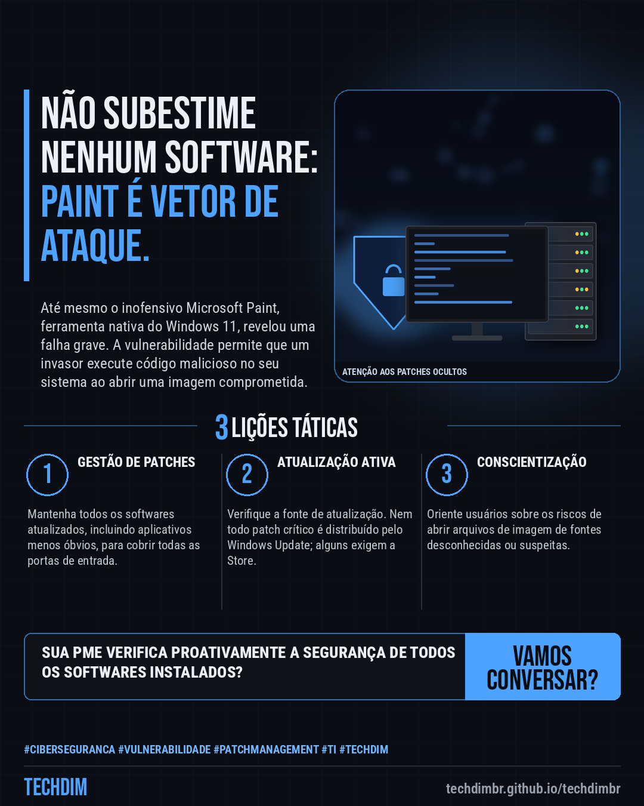
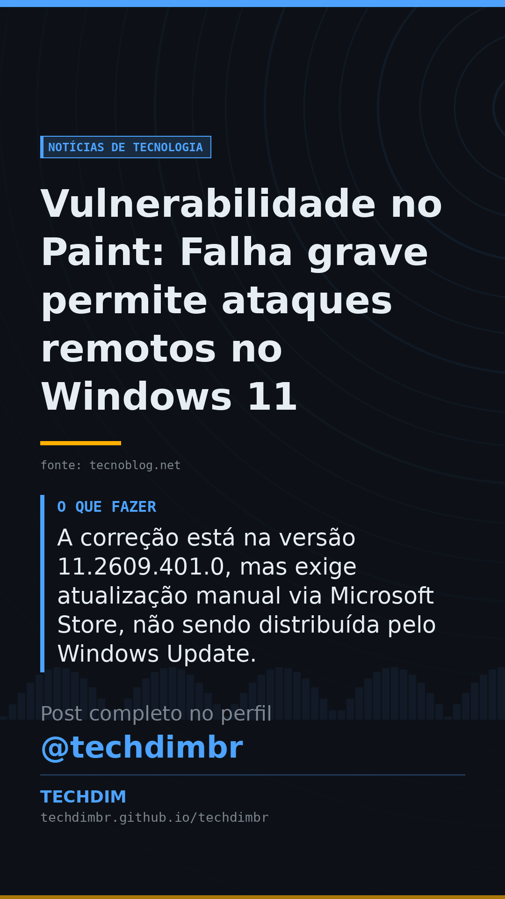

# Notícias de Tecnologia — Vulnerabilidade no Paint: Falha grave permite ataques remotos no Windows 11

- **Data:** 2026-11-06, 14:56 (horário de Brasília)
- **Curadoria:** Claude (Routine) — pauta do dia
- **Execução no Actions:** https://github.com/Techdimbr/Publi-midia-Techdim/actions/runs/42266006101
- **Por que esta pauta:** Mesmo ferramentas simples podem ser vetores de ataque se não forem devidamente atualizadas e monitoradas.

## Resultado

| Rede | Status | Link | 1º comentário |
|---|---|---|---|
| linkedin | ✅ publicado | https://www.linkedin.com/feed/update/urn:li:share:7524529963396431872/ | — |
| facebook | ✅ publicado | https://www.facebook.com/122132402349390486/posts/122141105793390486 | ✅ |
| instagram | ✅ publicado | https://www.instagram.com/p/DfaMVEQD3OF/ | ✅ |
| Stories | ✅ publicado | https://www.instagram.com/stories/techdimbr/4024583537826758177 | — |

## Fontes

- [tecnoblog.net](https://tecnoblog.net/noticias/microsoft-paint-tem-falha-grave-que-permite-ataques-remotos/)

## Linkedin

```text
Vulnerabilidade no Paint: Falha grave permite ataques remotos no Windows 11

01. A vulnerabilidade CVE-2026-83844 no Microsoft Paint do Windows 11 permite a execução remota de código malicioso, com pontuação de gravidade 8,1 (CVSS 3.1).
02. Classificada como "Out-of-bounds Read", a falha ocorre ao abrir imagens maliciosas, induzindo o software a acessar memória fora dos limites predefinidos.
03. A correção está na versão 11.2609.401.0, mas exige atualização manual via Microsoft Store, não sendo distribuída pelo Windows Update.

A gestão de patches e a vigilância sobre todos os softwares são cruciais para a cibersegurança da sua PME.

Fontes: https://tecnoblog.net/noticias/microsoft-paint-tem-falha-grave-que-permite-ataques-remotos/

TECHDIM — Infraestrutura · Segurança · IA
https://techdimbr.github.io/techdimbr/

#Ciberseguranca #Vulnerabilidade #PatchManagement #TI #TECHDIM
```



## Facebook

```text
Vulnerabilidade no Paint: Falha grave permite ataques remotos no Windows 11

• A vulnerabilidade CVE-2026-83844 no Microsoft Paint do Windows 11 permite a execução remota de código malicioso, com pontuação de gravidade 8,1 (CVSS 3.1).
• Classificada como "Out-of-bounds Read", a falha ocorre ao abrir imagens maliciosas, induzindo o software a acessar memória fora dos limites predefinidos.
• A correção está na versão 11.2609.401.0, mas exige atualização manual via Microsoft Store, não sendo distribuída pelo Windows Update.

A gestão de patches e a vigilância sobre todos os softwares são cruciais para a cibersegurança da sua PME.

Fale com a TECHDIM — fontes e site no primeiro comentário 👇

#Ciberseguranca #Vulnerabilidade #PatchManagement #TECHDIM
```

Primeiro comentário:

```text
📎 Fontes:
• tecnoblog.net: https://tecnoblog.net/noticias/microsoft-paint-tem-falha-grave-que-permite-ataques-remotos/

🌐 TECHDIM — Infraestrutura · Segurança · IA: https://techdimbr.github.io/techdimbr/
```


## Instagram

```text
Vulnerabilidade no Paint: Falha grave permite ataques remotos no Windows 11

1️⃣ A vulnerabilidade CVE-2026-83844 no Microsoft Paint do Windows 11 permite a execução remota de código malicioso, com pontuação de gravidade 8,1 (CVSS 3.1).
2️⃣ Classificada como "Out-of-bounds Read", a falha ocorre ao abrir imagens maliciosas, induzindo o software a acessar memória fora dos limites predefinidos.
3️⃣ A correção está na versão 11.2609.401.0, mas exige atualização manual via Microsoft Store, não sendo distribuída pelo Windows Update.

A gestão de patches e a vigilância sobre todos os softwares são cruciais para a cibersegurança da sua PME.

🔗 Link na bio: techdimbr.github.io/techdimbr
Fontes no primeiro comentário 👇

#ciberseguranca #vulnerabilidade #patchmanagement #ti #techdim #tecnologia #inteligenciaartificial #ia
```

Primeiro comentário:

```text
📎 Fontes: tecnoblog.net
```


## Stories


