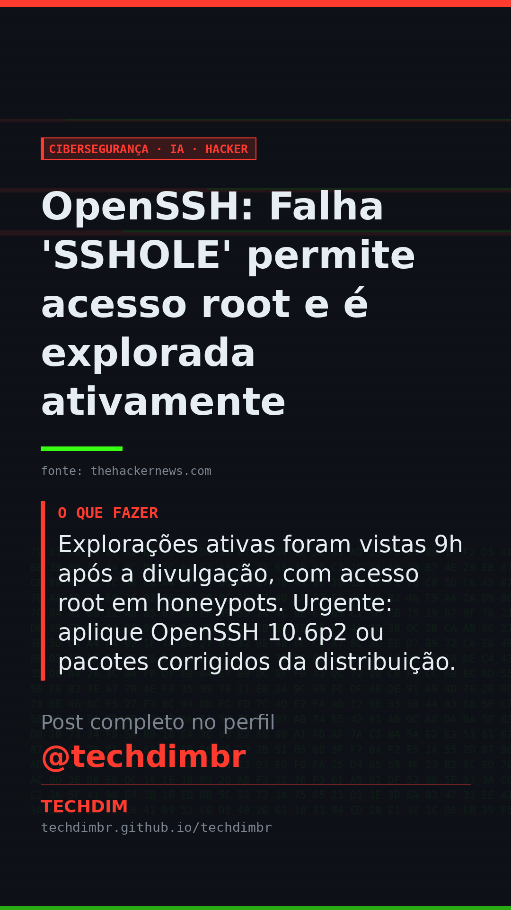

# Cibersegurança · IA · Hacker — OpenSSH: Falha 'SSHOLE' permite acesso root e é explorada ativamente

- **Data:** 2026-11-06, 17:24 (horário de Brasília)
- **Curadoria:** Claude (Routine) — pauta do dia
- **Execução no Actions:** https://github.com/Techdimbr/Publi-midia-Techdim/actions/runs/42287876057
- **Por que esta pauta:** A exploração rápida desta vulnerabilidade exige atenção imediata para evitar comprometimento de sistemas.

## Resultado

| Rede | Status | Link | 1º comentário |
|---|---|---|---|
| linkedin | ✅ publicado | https://www.linkedin.com/feed/update/urn:li:share:7524567135621316608/ | — |
| facebook | ✅ publicado | https://www.facebook.com/122132402349390486/posts/122141222169390486 | ✅ |
| instagram | ✅ publicado | https://www.instagram.com/p/DfadO5ADNBy/ | ✅ |
| Stories | ✅ publicado | https://www.instagram.com/stories/techdimbr/4024657927532757469 | — |

## Fontes

- [thehackernews.com](https://thehackernews.com/2026/11/hackers-exploited-openssh-sshole-flaw.html)

## Linkedin

```text
OpenSSH: Falha 'SSHOLE' permite acesso root e é explorada ativamente

01. A falha CVE-2026-123158 (SSHOLE) no OpenSSH permite login sem senha em contas com asterisco (*) no hash. Afeta Linux com musl C library e PAM desabilitado, como Alpine Linux.
02. Atacantes utilizam senhas de 257 a 1024 bytes para forçar falha no hash, gerando um asterisco que corresponde a contas sem senha, concedendo acesso root.
03. Explorações ativas foram vistas 9h após a divulgação, com acesso root em honeypots. Urgente: aplique OpenSSH 10.6p2 ou pacotes corrigidos da distribuição.

A TECHDIM oferece cibersegurança defensiva e hardening de servidores para proteger sua infraestrutura contra vulnerabilidades críticas como o SSHole.

Fontes: https://thehackernews.com/2026/11/hackers-exploited-openssh-sshole-flaw.html

TECHDIM — Infraestrutura · Segurança · IA
https://techdimbr.github.io/techdimbr/

#Ciberseguranca #Vulnerabilidade #OpenSSH #TI #TECHDIM
```


## Facebook

```text
OpenSSH: Falha 'SSHOLE' permite acesso root e é explorada ativamente

• A falha CVE-2026-123158 (SSHOLE) no OpenSSH permite login sem senha em contas com asterisco (*) no hash. Afeta Linux com musl C library e PAM desabilitado, como Alpine Linux.
• Atacantes utilizam senhas de 257 a 1024 bytes para forçar falha no hash, gerando um asterisco que corresponde a contas sem senha, concedendo acesso root.
• Explorações ativas foram vistas 9h após a divulgação, com acesso root em honeypots. Urgente: aplique OpenSSH 10.6p2 ou pacotes corrigidos da distribuição.

A TECHDIM oferece cibersegurança defensiva e hardening de servidores para proteger sua infraestrutura contra vulnerabilidades críticas como o SSHole.

Fale com a TECHDIM — fontes e site no primeiro comentário 👇

#Ciberseguranca #Vulnerabilidade #OpenSSH #TECHDIM
```

Primeiro comentário:

```text
📎 Fontes:
• thehackernews.com: https://thehackernews.com/2026/11/hackers-exploited-openssh-sshole-flaw.html

🌐 TECHDIM — Infraestrutura · Segurança · IA: https://techdimbr.github.io/techdimbr/
```


## Instagram

```text
OpenSSH: Falha 'SSHOLE' permite acesso root e é explorada ativamente

1️⃣ A falha CVE-2026-123158 (SSHOLE) no OpenSSH permite login sem senha em contas com asterisco (*) no hash. Afeta Linux com musl C library e PAM desabilitado, como Alpine Linux.
2️⃣ Atacantes utilizam senhas de 257 a 1024 bytes para forçar falha no hash, gerando um asterisco que corresponde a contas sem senha, concedendo acesso root.
3️⃣ Explorações ativas foram vistas 9h após a divulgação, com acesso root em honeypots. Urgente: aplique OpenSSH 10.6p2 ou pacotes corrigidos da distribuição.

A TECHDIM oferece cibersegurança defensiva e hardening de servidores para proteger sua infraestrutura contra vulnerabilidades críticas como o SSHole.

🔗 Link na bio: techdimbr.github.io/techdimbr
Fontes no primeiro comentário 👇

#ciberseguranca #vulnerabilidade #openssh #ti #techdim #seguranca #hacker #infraestrutura
```

Primeiro comentário:

```text
📎 Fontes: thehackernews.com
```


## Stories


