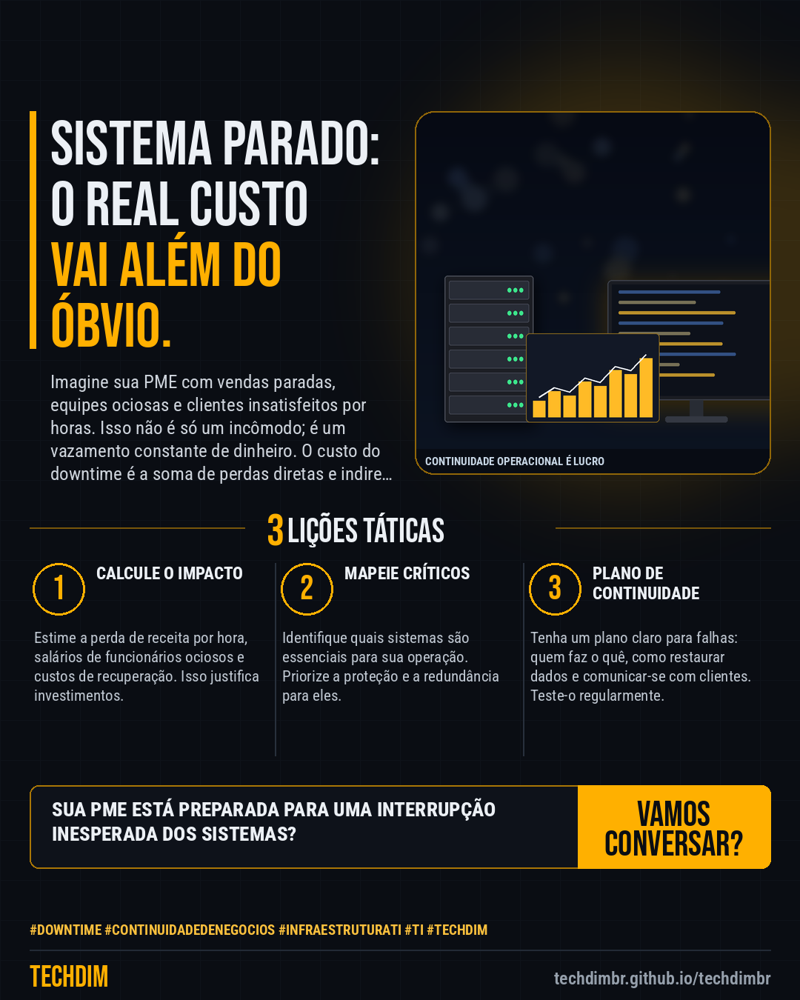

# Conhecimento — Downtime: O Custo Oculto da Parada de Sistema na Sua PME

- **Data:** 2026-11-06, 19:10 (horário de Brasília)
- **Curadoria:** Claude (Routine) — pauta do dia
- **Execução no Actions:** https://github.com/Techdimbr/Publi-midia-Techdim/actions/runs/42302524026
- **Por que esta pauta:** Entender o impacto financeiro de um sistema parado é crucial para priorizar investimentos em TI e segurança hoje.

## Resultado

| Rede | Status | Link | 1º comentário |
|---|---|---|---|
| linkedin | ✅ publicado | https://www.linkedin.com/feed/update/urn:li:share:7524594022208684032/ | — |
| facebook | ✅ publicado | https://www.facebook.com/122132402349390486/posts/122141307711390486 | ✅ |
| instagram | ✅ publicado | https://www.instagram.com/p/DfapdcYGvwn/ | — |

## Linkedin

```text
Downtime: O Custo Oculto da Parada de Sistema na Sua PME

01. Cada hora de sistema parado na PME pode custar milhares de reais em perdas de receita, produtividade e danos à reputação, impactando diretamente o caixa e a confiança do cliente.
02. A interrupção de serviços críticos vai além da perda financeira imediata, gerando estresse operacional, sobrecarga de equipes e desmotivação dos colaboradores.
03. Investir proativamente em infraestrutura robusta e planos de contingência é mais econômico do que reagir a falhas, garantindo a continuidade dos negócios e a satisfação do cliente.

A TECHDIM ajuda sua PME a blindar sistemas e garantir a continuidade operacional.

TECHDIM — Infraestrutura · Segurança · IA
https://techdimbr.github.io/techdimbr/

#Downtime #ContinuidadeDeNegocios #InfraestruturaTI #TI #TECHDIM
```



## Facebook

```text
Downtime: O Custo Oculto da Parada de Sistema na Sua PME

• Cada hora de sistema parado na PME pode custar milhares de reais em perdas de receita, produtividade e danos à reputação, impactando diretamente o caixa e a confiança do cliente.
• A interrupção de serviços críticos vai além da perda financeira imediata, gerando estresse operacional, sobrecarga de equipes e desmotivação dos colaboradores.
• Investir proativamente em infraestrutura robusta e planos de contingência é mais econômico do que reagir a falhas, garantindo a continuidade dos negócios e a satisfação do cliente.

A TECHDIM ajuda sua PME a blindar sistemas e garantir a continuidade operacional.

Fale com a TECHDIM — link no primeiro comentário 👇

#Downtime #ContinuidadeDeNegocios #InfraestruturaTI #TECHDIM
```

Primeiro comentário:

```text
🌐 TECHDIM — Infraestrutura · Segurança · IA: https://techdimbr.github.io/techdimbr/
```


## Instagram

```text
Downtime: O Custo Oculto da Parada de Sistema na Sua PME

1️⃣ Cada hora de sistema parado na PME pode custar milhares de reais em perdas de receita, produtividade e danos à reputação, impactando diretamente o caixa e a confiança do cliente.
2️⃣ A interrupção de serviços críticos vai além da perda financeira imediata, gerando estresse operacional, sobrecarga de equipes e desmotivação dos colaboradores.
3️⃣ Investir proativamente em infraestrutura robusta e planos de contingência é mais econômico do que reagir a falhas, garantindo a continuidade dos negócios e a satisfação do cliente.

A TECHDIM ajuda sua PME a blindar sistemas e garantir a continuidade operacional.

🔗 Link na bio: techdimbr.github.io/techdimbr

#downtime #continuidadedenegocios #infraestruturati #ti #techdim #conhecimento #aprendati #tecnologia
```


