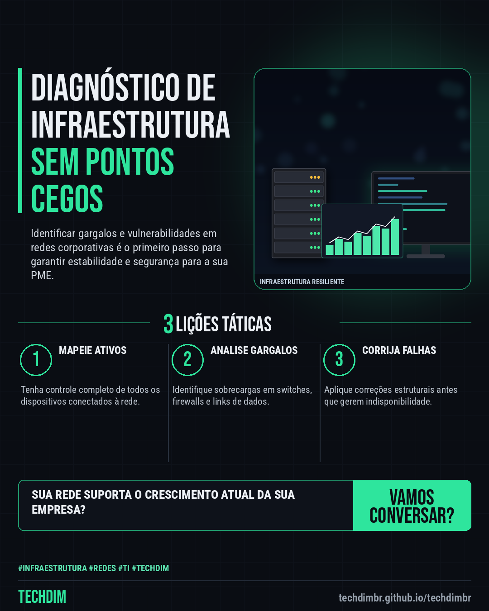

# TECHDIM · Serviços — Diagnóstico de Infraestrutura: identifique gargalos antes da falha

- **Data:** 2026-11-06, 21:10 (horário de Brasília)
- **Curadoria:** Claude (Routine) — pauta do dia
- **Execução no Actions:** https://github.com/Techdimbr/Publi-midia-Techdim/actions/runs/42316495955
- **Por que esta pauta:** Empresas precisam de visibilidade total de sua infraestrutura para evitar interrupções inesperadas nos negócios.

## Resultado

| Rede | Status | Link | 1º comentário |
|---|---|---|---|
| linkedin | ✅ publicado | https://www.linkedin.com/feed/update/urn:li:share:7524624140092248064/ | — |
| facebook | ✅ publicado | https://www.facebook.com/122132402349390486/posts/122141416521390486 | ✅ |
| instagram | ✅ publicado | https://www.instagram.com/p/Dfa3JuLkbmz/ | — |

## Linkedin

```text
Diagnóstico de Infraestrutura: identifique gargalos antes da falha

01. Redes corporativas com gargalos ocultos provocam lentidão crônica e quedas de produtividade na PME.
02. A engenharia da TECHDIM realiza um diagnóstico completo para mapear falhas de hardware, gargalos de rede e pontos cegos de segurança.
03. A identificação precoce de falhas evita paradas não planejadas e garante uma operação de TI estável e segura.

Conheça o diagnóstico especializado no portal oficial techdimbr.github.io/techdimbr.

TECHDIM — Infraestrutura · Segurança · IA
https://techdimbr.github.io/techdimbr/

#Infraestrutura #Redes #TI #TECHDIM #InfraestruturaDeTI
```



## Facebook

```text
Diagnóstico de Infraestrutura: identifique gargalos antes da falha

• Redes corporativas com gargalos ocultos provocam lentidão crônica e quedas de produtividade na PME.
• A engenharia da TECHDIM realiza um diagnóstico completo para mapear falhas de hardware, gargalos de rede e pontos cegos de segurança.
• A identificação precoce de falhas evita paradas não planejadas e garante uma operação de TI estável e segura.

Conheça o diagnóstico especializado no portal oficial techdimbr.github.io/techdimbr.

Fale com a TECHDIM — link no primeiro comentário 👇

#Infraestrutura #Redes #TI #TECHDIM
```

Primeiro comentário:

```text
🌐 TECHDIM — Infraestrutura · Segurança · IA: https://techdimbr.github.io/techdimbr/
```


## Instagram

```text
Diagnóstico de Infraestrutura: identifique gargalos antes da falha

1️⃣ Redes corporativas com gargalos ocultos provocam lentidão crônica e quedas de produtividade na PME.
2️⃣ A engenharia da TECHDIM realiza um diagnóstico completo para mapear falhas de hardware, gargalos de rede e pontos cegos de segurança.
3️⃣ A identificação precoce de falhas evita paradas não planejadas e garante uma operação de TI estável e segura.

Conheça o diagnóstico especializado no portal oficial techdimbr.github.io/techdimbr.

🔗 Link na bio: techdimbr.github.io/techdimbr

#infraestrutura #redes #ti #techdim #suportetecnico #ciberseguranca #automacao #campinas
```


