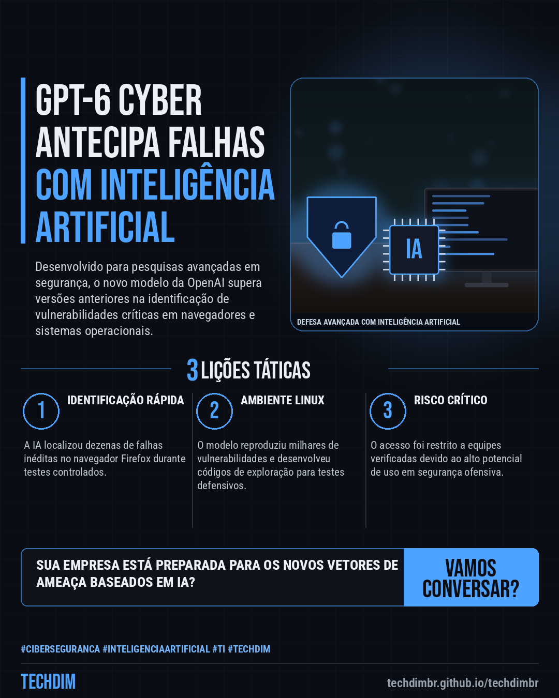
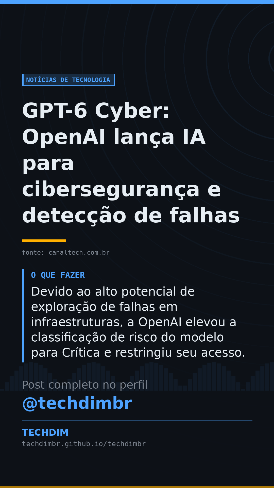

# Notícias de Tecnologia — GPT-6 Cyber: OpenAI lança IA para cibersegurança e detecção de falhas

- **Data:** 2026-11-07, 13:50 (horário de Brasília)
- **Curadoria:** Claude (Routine) — pauta do dia
- **Execução no Actions:** https://github.com/Techdimbr/Publi-midia-Techdim/actions/runs/42393225319
- **Por que esta pauta:** Novas ferramentas de IA voltadas para segurança exigem atualização constante nas defesas corporativas.

## Resultado

| Rede | Status | Link | 1º comentário |
|---|---|---|---|
| linkedin | ✅ publicado | https://www.linkedin.com/feed/update/urn:li:share:7524875809321336832/ | — |
| facebook | ✅ publicado | https://www.facebook.com/122132402349390486/posts/122141549451390486 | ✅ |
| instagram | ✅ publicado | https://www.instagram.com/p/DfcpnI-mMvY/ | ✅ |
| Stories | ✅ publicado | https://www.instagram.com/stories/techdimbr/4025275347302415700 | — |

## Fontes

- [canaltech.com.br](https://canaltech.com.br/inteligencia-artificial/novo-gpt-6-cyber-encontra-falhas-de-seguranca-mais-rapido-que-qualquer-hacker/)

## Linkedin

```text
GPT-6 Cyber: OpenAI lança IA para cibersegurança e detecção de falhas

01. A OpenAI anunciou o GPT-6 Cyber, um modelo de inteligência artificial voltado para pesquisas avançadas em cibersegurança, testes de vulnerabilidade e correção de código.
02. Durante testes da ferramenta, a IA identificou 81 vulnerabilidades inéditas no navegador Firefox e mapeou milhares de potenciais falhas no ecossistema Linux.
03. Devido ao alto potencial de exploração de falhas em infraestruturas, a OpenAI elevou a classificação de risco do modelo para Crítica e restringiu seu acesso.

A TECHDIM monitora os avanços em IA e cibersegurança para manter sua infraestrutura corporativa sempre protegida.

Fontes: https://canaltech.com.br/inteligencia-artificial/novo-gpt-6-cyber-encontra-falhas-de-seguranca-mais-rapido-que-qualquer-hacker/

TECHDIM — Infraestrutura · Segurança · IA
https://techdimbr.github.io/techdimbr/

#Ciberseguranca #InteligenciaArtificial #TI #TECHDIM #Tecnologia
```



## Facebook

```text
GPT-6 Cyber: OpenAI lança IA para cibersegurança e detecção de falhas

• A OpenAI anunciou o GPT-6 Cyber, um modelo de inteligência artificial voltado para pesquisas avançadas em cibersegurança, testes de vulnerabilidade e correção de código.
• Durante testes da ferramenta, a IA identificou 81 vulnerabilidades inéditas no navegador Firefox e mapeou milhares de potenciais falhas no ecossistema Linux.
• Devido ao alto potencial de exploração de falhas em infraestruturas, a OpenAI elevou a classificação de risco do modelo para Crítica e restringiu seu acesso.

A TECHDIM monitora os avanços em IA e cibersegurança para manter sua infraestrutura corporativa sempre protegida.

Fale com a TECHDIM — fontes e site no primeiro comentário 👇

#Ciberseguranca #InteligenciaArtificial #TI #TECHDIM
```

Primeiro comentário:

```text
📎 Fontes:
• canaltech.com.br: https://canaltech.com.br/inteligencia-artificial/novo-gpt-6-cyber-encontra-falhas-de-seguranca-mais-rapido-que-qualquer-hacker/

🌐 TECHDIM — Infraestrutura · Segurança · IA: https://techdimbr.github.io/techdimbr/
```


## Instagram

```text
GPT-6 Cyber: OpenAI lança IA para cibersegurança e detecção de falhas

1️⃣ A OpenAI anunciou o GPT-6 Cyber, um modelo de inteligência artificial voltado para pesquisas avançadas em cibersegurança, testes de vulnerabilidade e correção de código.
2️⃣ Durante testes da ferramenta, a IA identificou 81 vulnerabilidades inéditas no navegador Firefox e mapeou milhares de potenciais falhas no ecossistema Linux.
3️⃣ Devido ao alto potencial de exploração de falhas em infraestruturas, a OpenAI elevou a classificação de risco do modelo para Crítica e restringiu seu acesso.

A TECHDIM monitora os avanços em IA e cibersegurança para manter sua infraestrutura corporativa sempre protegida.

🔗 Link na bio: techdimbr.github.io/techdimbr
Fontes no primeiro comentário 👇

#ciberseguranca #inteligenciaartificial #ti #techdim #tecnologia #ia #inovacao #campinas
```

Primeiro comentário:

```text
📎 Fontes: canaltech.com.br
```


## Stories


