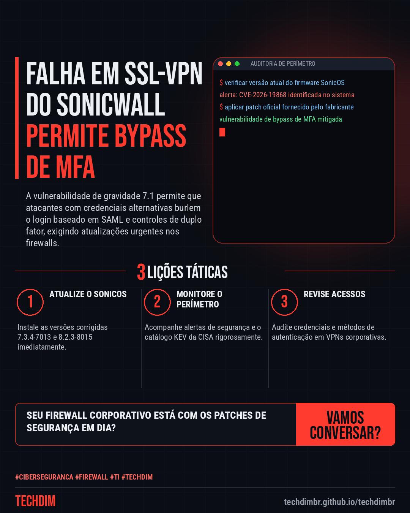

# Cibersegurança · IA · Hacker — SonicWall: Falha em SSL-VPN com bypass de MFA é explorada em ataques

- **Data:** 2026-11-07, 15:40 (horário de Brasília)
- **Curadoria:** Claude (Routine) — pauta do dia
- **Execução no Actions:** https://github.com/Techdimbr/Publi-midia-Techdim/actions/runs/42402382104
- **Por que esta pauta:** A exploração ativa de falhas de autenticação em firewalls exige aplicação imediata de correções de segurança.

## Resultado

| Rede | Status | Link | 1º comentário |
|---|---|---|---|
| linkedin | ✅ publicado | https://www.linkedin.com/feed/update/urn:li:share:7524903534572748800/ | — |
| facebook | ✅ publicado | https://www.facebook.com/122132402349390486/posts/122141588169390486 | ✅ |
| instagram | ✅ publicado | https://www.instagram.com/p/Dfc2Nm1E0nQ/ | ✅ |
| Stories | ✅ publicado | https://www.instagram.com/stories/techdimbr/4025330722768383692 | — |

## Fontes

- [bleepingcomputer.com](https://www.bleepingcomputer.com/news/security/sonicwall-warns-of-new-ssl-vpn-mfa-bypass-flaw-exploited-in-attacks/)

## Linkedin

```text
SonicWall: Falha em SSL-VPN com bypass de MFA é explorada em ataques

01. A SonicWall corrigiu a falha CVE-2026-19868 no SonicOS, que permite a invasores burlar o SAML e controles de MFA.
02. A CISA adicionou a vulnerabilidade ao catálogo de explorações conhecidas após investigações confirmarem ataques ativos.
03. A atualização abrange versões Gen7 e Gen8 do SonicOS, sem soluções de contorno disponíveis além do patch.

Proteja seu perímetro corporativo com a gestão especializada de firewalls e atualizações da TECHDIM.

Fontes: https://www.bleepingcomputer.com/news/security/sonicwall-warns-of-new-ssl-vpn-mfa-bypass-flaw-exploited-in-attacks/

TECHDIM — Infraestrutura · Segurança · IA
https://techdimbr.github.io/techdimbr/

#Ciberseguranca #Firewall #TI #TECHDIM #SegurancaDaInformacao
```



## Facebook

```text
SonicWall: Falha em SSL-VPN com bypass de MFA é explorada em ataques

• A SonicWall corrigiu a falha CVE-2026-19868 no SonicOS, que permite a invasores burlar o SAML e controles de MFA.
• A CISA adicionou a vulnerabilidade ao catálogo de explorações conhecidas após investigações confirmarem ataques ativos.
• A atualização abrange versões Gen7 e Gen8 do SonicOS, sem soluções de contorno disponíveis além do patch.

Proteja seu perímetro corporativo com a gestão especializada de firewalls e atualizações da TECHDIM.

Fale com a TECHDIM — fontes e site no primeiro comentário 👇

#Ciberseguranca #Firewall #TI #TECHDIM
```

Primeiro comentário:

```text
📎 Fontes:
• bleepingcomputer.com: https://www.bleepingcomputer.com/news/security/sonicwall-warns-of-new-ssl-vpn-mfa-bypass-flaw-exploited-in-attacks/

🌐 TECHDIM — Infraestrutura · Segurança · IA: https://techdimbr.github.io/techdimbr/
```


## Instagram

```text
SonicWall: Falha em SSL-VPN com bypass de MFA é explorada em ataques

1️⃣ A SonicWall corrigiu a falha CVE-2026-19868 no SonicOS, que permite a invasores burlar o SAML e controles de MFA.
2️⃣ A CISA adicionou a vulnerabilidade ao catálogo de explorações conhecidas após investigações confirmarem ataques ativos.
3️⃣ A atualização abrange versões Gen7 e Gen8 do SonicOS, sem soluções de contorno disponíveis além do patch.

Proteja seu perímetro corporativo com a gestão especializada de firewalls e atualizações da TECHDIM.

🔗 Link na bio: techdimbr.github.io/techdimbr
Fontes no primeiro comentário 👇

#ciberseguranca #firewall #ti #techdim #seguranca #hacker #infraestrutura #campinas
```

Primeiro comentário:

```text
📎 Fontes: bleepingcomputer.com
```


## Stories


