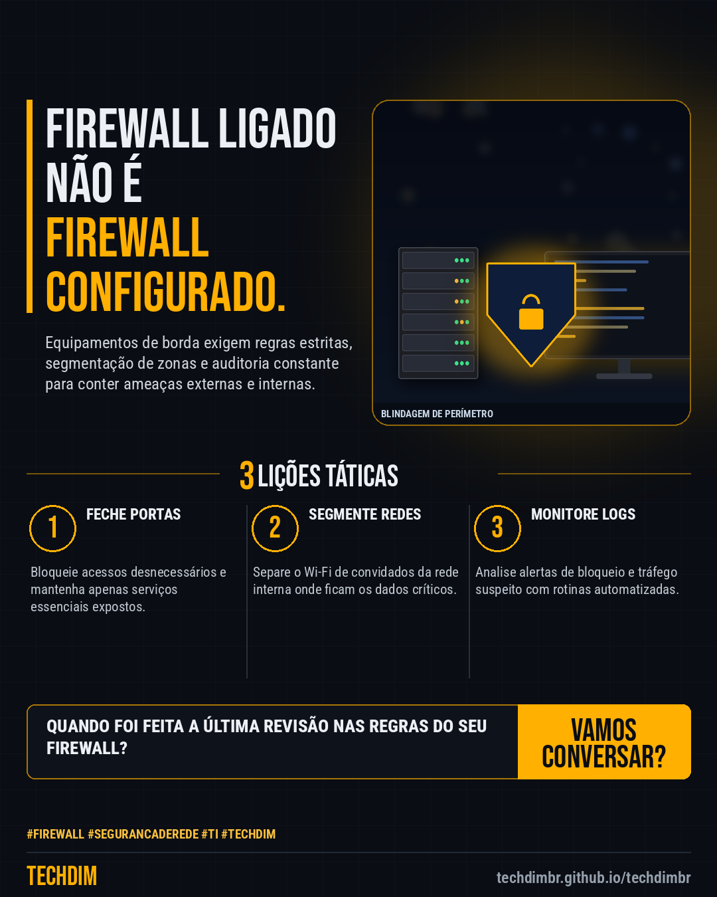

# Conhecimento — Firewall corporativo: sua empresa está protegida ou apenas com o equipamento ligado?

- **Data:** 2026-11-07, 17:58 (horário de Brasília)
- **Curadoria:** Claude (Routine) — pauta do dia
- **Execução no Actions:** https://github.com/Techdimbr/Publi-midia-Techdim/actions/runs/42413502990
- **Por que esta pauta:** Muitas PMEs investem em hardware de segurança, mas negligenciam a configuração adequada e a revisão de regras no dia a dia.

## Resultado

| Rede | Status | Link | 1º comentário |
|---|---|---|---|
| linkedin | ✅ publicado | https://www.linkedin.com/feed/update/urn:li:share:7524938156526452736/ | — |
| facebook | ✅ publicado | https://www.facebook.com/122132402349390486/posts/122141611089390486 | ✅ |
| instagram | ✅ publicado | https://www.instagram.com/p/DfdF9KjkyXA/ | — |

## Linkedin

```text
Firewall corporativo: sua empresa está protegida ou apenas com o equipamento ligado?

01. Ter um firewall fisicamente instalado e ligado na PME não garante segurança se regras de acesso e monitoramento não estiverem ativas.
02. Firewalls mal configurados deixam portas abertas para invasões, tráfego malicioso e vazamentos de dados confidenciais.
03. A TECHDIM ajuda sua empresa a implementar políticas rígidas de filtragem e inspeção de tráfego para blindar a rede corporativa.

Conte com a governança de rede da TECHDIM para blindar sua infraestrutura corporativa. Acesse techdimbr.github.io/techdimbr.

TECHDIM — Infraestrutura · Segurança · IA
https://techdimbr.github.io/techdimbr/

#Firewall #SegurancaDeRede #TI #TECHDIM #Conhecimento
```



## Facebook

```text
Firewall corporativo: sua empresa está protegida ou apenas com o equipamento ligado?

• Ter um firewall fisicamente instalado e ligado na PME não garante segurança se regras de acesso e monitoramento não estiverem ativas.
• Firewalls mal configurados deixam portas abertas para invasões, tráfego malicioso e vazamentos de dados confidenciais.
• A TECHDIM ajuda sua empresa a implementar políticas rígidas de filtragem e inspeção de tráfego para blindar a rede corporativa.

Conte com a governança de rede da TECHDIM para blindar sua infraestrutura corporativa. Acesse techdimbr.github.io/techdimbr.

Fale com a TECHDIM — link no primeiro comentário 👇

#Firewall #SegurancaDeRede #TI #TECHDIM
```

Primeiro comentário:

```text
🌐 TECHDIM — Infraestrutura · Segurança · IA: https://techdimbr.github.io/techdimbr/
```


## Instagram

```text
Firewall corporativo: sua empresa está protegida ou apenas com o equipamento ligado?

1️⃣ Ter um firewall fisicamente instalado e ligado na PME não garante segurança se regras de acesso e monitoramento não estiverem ativas.
2️⃣ Firewalls mal configurados deixam portas abertas para invasões, tráfego malicioso e vazamentos de dados confidenciais.
3️⃣ A TECHDIM ajuda sua empresa a implementar políticas rígidas de filtragem e inspeção de tráfego para blindar a rede corporativa.

Conte com a governança de rede da TECHDIM para blindar sua infraestrutura corporativa. Acesse techdimbr.github.io/techdimbr.

🔗 Link na bio: techdimbr.github.io/techdimbr

#firewall #segurancaderede #ti #techdim #conhecimento #aprendati #tecnologia #ciberseguranca
```


