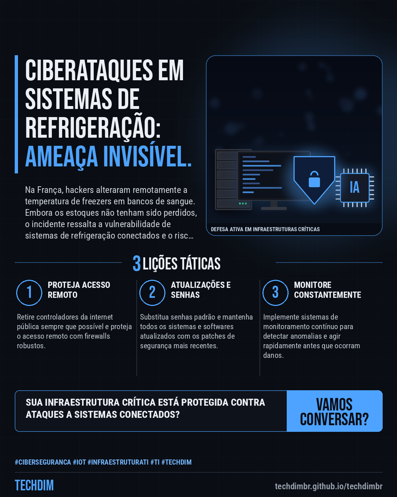
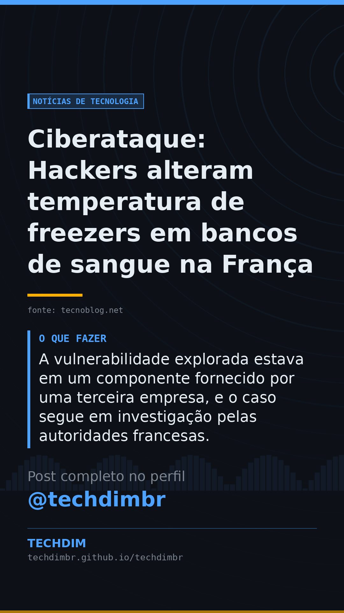

# Notícias de Tecnologia — Ciberataque: Hackers alteram temperatura de freezers em bancos de sangue na França

- **Data:** 2026-11-08, 14:02 (horário de Brasília)
- **Curadoria:** Claude (Routine) — pauta do dia
- **Execução no Actions:** https://github.com/Techdimbr/Publi-midia-Techdim/actions/runs/42502787476
- **Por que esta pauta:** Este incidente recente destaca a crescente ameaça a sistemas conectados e a importância da proteção de infraestruturas essenciais.

## Resultado

| Rede | Status | Link | 1º comentário |
|---|---|---|---|
| linkedin | ✅ publicado | https://www.linkedin.com/feed/update/urn:li:share:7525241084793450496/ | — |
| facebook | ✅ publicado | https://www.facebook.com/122132402349390486/posts/122141946687390486 | ✅ |
| instagram | ✅ publicado | https://www.instagram.com/p/DffPtjAD7F1/ | ✅ |
| Stories | ✅ publicado | https://www.instagram.com/stories/techdimbr/4026005880545727657 | — |

## Fontes

- [tecnoblog.net](https://tecnoblog.net/noticias/apos-supermercados-hackers-atacam-freezers-de-bancos-de-sangue-na-franca/)

## Linkedin

```text
Ciberataque: Hackers alteram temperatura de freezers em bancos de sangue na França

01. Hackers alteraram remotamente a temperatura de freezers em três instalações do Estabelecimento Francês de Sangue (EFS), programando-os para até 110 ºC.
02. O ataque não comprometeu estoques ou a saúde de pacientes devido a sistemas de monitoramento e ação rápida de funcionários.
03. A vulnerabilidade explorada estava em um componente fornecido por uma terceira empresa, e o caso segue em investigação pelas autoridades francesas.

Ataques a sistemas OT/IoT sublinham a necessidade de cibersegurança robusta e governança de acesso para infraestruturas críticas.

Fontes: https://tecnoblog.net/noticias/apos-supermercados-hackers-atacam-freezers-de-bancos-de-sangue-na-franca/

TECHDIM — Infraestrutura · Segurança · IA
https://techdimbr.github.io/techdimbr/

#Ciberseguranca #IoT #InfraestruturaTI #TI #TECHDIM
```



## Facebook

```text
Ciberataque: Hackers alteram temperatura de freezers em bancos de sangue na França

• Hackers alteraram remotamente a temperatura de freezers em três instalações do Estabelecimento Francês de Sangue (EFS), programando-os para até 110 ºC.
• O ataque não comprometeu estoques ou a saúde de pacientes devido a sistemas de monitoramento e ação rápida de funcionários.
• A vulnerabilidade explorada estava em um componente fornecido por uma terceira empresa, e o caso segue em investigação pelas autoridades francesas.

Ataques a sistemas OT/IoT sublinham a necessidade de cibersegurança robusta e governança de acesso para infraestruturas críticas.

Fale com a TECHDIM — fontes e site no primeiro comentário 👇

#Ciberseguranca #IoT #InfraestruturaTI #TECHDIM
```

Primeiro comentário:

```text
📎 Fontes:
• tecnoblog.net: https://tecnoblog.net/noticias/apos-supermercados-hackers-atacam-freezers-de-bancos-de-sangue-na-franca/

🌐 TECHDIM — Infraestrutura · Segurança · IA: https://techdimbr.github.io/techdimbr/
```


## Instagram

```text
Ciberataque: Hackers alteram temperatura de freezers em bancos de sangue na França

1️⃣ Hackers alteraram remotamente a temperatura de freezers em três instalações do Estabelecimento Francês de Sangue (EFS), programando-os para até 110 ºC.
2️⃣ O ataque não comprometeu estoques ou a saúde de pacientes devido a sistemas de monitoramento e ação rápida de funcionários.
3️⃣ A vulnerabilidade explorada estava em um componente fornecido por uma terceira empresa, e o caso segue em investigação pelas autoridades francesas.

Ataques a sistemas OT/IoT sublinham a necessidade de cibersegurança robusta e governança de acesso para infraestruturas críticas.

🔗 Link na bio: techdimbr.github.io/techdimbr
Fontes no primeiro comentário 👇

#ciberseguranca #iot #infraestruturati #ti #techdim #tecnologia #inteligenciaartificial #ia
```

Primeiro comentário:

```text
📎 Fontes: tecnoblog.net
```


## Stories


