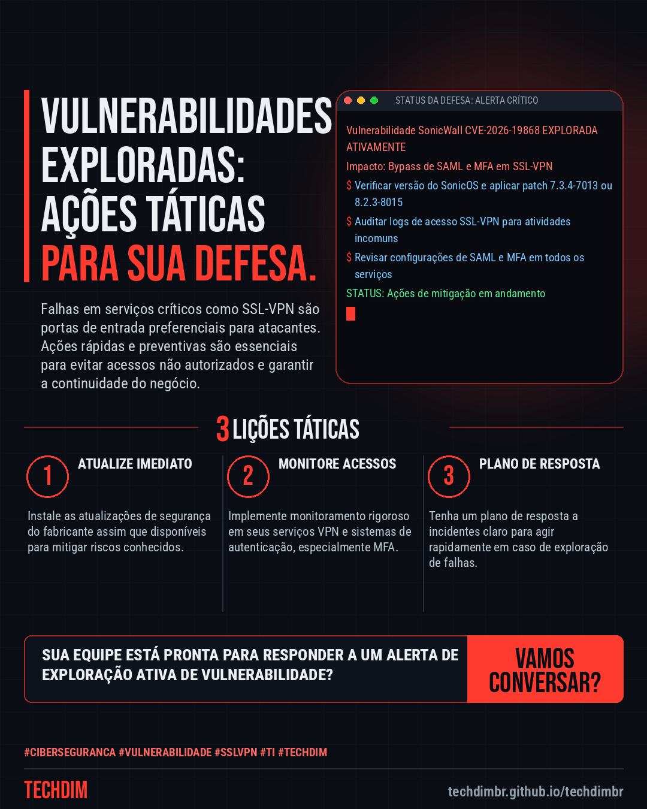
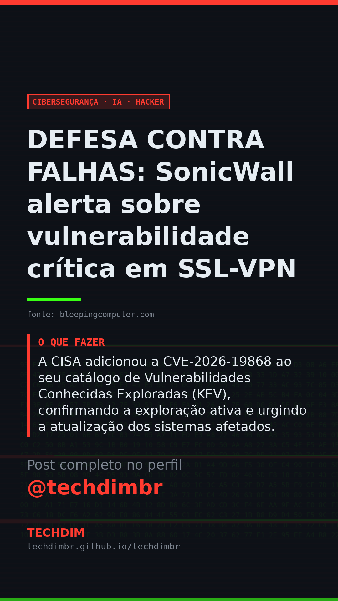

# Cibersegurança · IA · Hacker — DEFESA CONTRA FALHAS: SonicWall alerta sobre vulnerabilidade crítica em SSL-VPN

- **Data:** 2026-11-08, 15:47 (horário de Brasília)
- **Curadoria:** Claude (Routine) — pauta do dia
- **Execução no Actions:** https://github.com/Techdimbr/Publi-midia-Techdim/actions/runs/42511653592
- **Por que esta pauta:** A exploração ativa de vulnerabilidades de VPN é um risco constante para a segurança corporativa.

## Resultado

| Rede | Status | Link | 1º comentário |
|---|---|---|---|
| linkedin | ✅ publicado | https://www.linkedin.com/feed/update/urn:li:share:7525267588898082817/ | — |
| facebook | ✅ publicado | https://www.facebook.com/122132402349390486/posts/122142006711390486 | ✅ |
| instagram | ✅ publicado | https://www.instagram.com/p/DffbwoclOr9/ | ✅ |
| Stories | ✅ publicado | https://www.instagram.com/stories/techdimbr/4026058799257545056 | — |

## Fontes

- [bleepingcomputer.com](https://www.bleepingcomputer.com/news/security/sonicwall-warns-of-new-ssl-vpn-mfa-bypass-flaw-exploited-in-attacks/)

## Linkedin

```text
DEFESA CONTRA FALHAS: SonicWall alerta sobre vulnerabilidade crítica em SSL-VPN

01. A SonicWall lançou atualizações de segurança para corrigir sete falhas em seus firewalls SonicOS, incluindo uma vulnerabilidade de bypass de autenticação SSL-VPN já explorada em ataques.
02. A falha (CVE-2026-19868) permite que atacantes com credenciais válidas para um método de autenticação alternativo ignorem controles SAML, incluindo MFA, com score CVSS de 7.1.
03. A CISA adicionou a CVE-2026-19868 ao seu catálogo de Vulnerabilidades Conhecidas Exploradas (KEV), confirmando a exploração ativa e urgindo a atualização dos sistemas afetados.

A TECHDIM oferece expertise em cibersegurança defensiva para proteger sua infraestrutura contra ameaças como esta.

Fontes: https://www.bleepingcomputer.com/news/security/sonicwall-warns-of-new-ssl-vpn-mfa-bypass-flaw-exploited-in-attacks/

TECHDIM — Infraestrutura · Segurança · IA
https://techdimbr.github.io/techdimbr/

#Ciberseguranca #Vulnerabilidade #Sslvpn #TI #TECHDIM
```



## Facebook

```text
DEFESA CONTRA FALHAS: SonicWall alerta sobre vulnerabilidade crítica em SSL-VPN

• A SonicWall lançou atualizações de segurança para corrigir sete falhas em seus firewalls SonicOS, incluindo uma vulnerabilidade de bypass de autenticação SSL-VPN já explorada em ataques.
• A falha (CVE-2026-19868) permite que atacantes com credenciais válidas para um método de autenticação alternativo ignorem controles SAML, incluindo MFA, com score CVSS de 7.1.
• A CISA adicionou a CVE-2026-19868 ao seu catálogo de Vulnerabilidades Conhecidas Exploradas (KEV), confirmando a exploração ativa e urgindo a atualização dos sistemas afetados.

A TECHDIM oferece expertise em cibersegurança defensiva para proteger sua infraestrutura contra ameaças como esta.

Fale com a TECHDIM — fontes e site no primeiro comentário 👇

#Ciberseguranca #Vulnerabilidade #Sslvpn #TECHDIM
```

Primeiro comentário:

```text
📎 Fontes:
• bleepingcomputer.com: https://www.bleepingcomputer.com/news/security/sonicwall-warns-of-new-ssl-vpn-mfa-bypass-flaw-exploited-in-attacks/

🌐 TECHDIM — Infraestrutura · Segurança · IA: https://techdimbr.github.io/techdimbr/
```


## Instagram

```text
DEFESA CONTRA FALHAS: SonicWall alerta sobre vulnerabilidade crítica em SSL-VPN

1️⃣ A SonicWall lançou atualizações de segurança para corrigir sete falhas em seus firewalls SonicOS, incluindo uma vulnerabilidade de bypass de autenticação SSL-VPN já explorada em ataques.
2️⃣ A falha (CVE-2026-19868) permite que atacantes com credenciais válidas para um método de autenticação alternativo ignorem controles SAML, incluindo MFA, com score CVSS de 7.1.
3️⃣ A CISA adicionou a CVE-2026-19868 ao seu catálogo de Vulnerabilidades Conhecidas Exploradas (KEV), confirmando a exploração ativa e urgindo a atualização dos sistemas afetados.

A TECHDIM oferece expertise em cibersegurança defensiva para proteger sua infraestrutura contra ameaças como esta.

🔗 Link na bio: techdimbr.github.io/techdimbr
Fontes no primeiro comentário 👇

#ciberseguranca #vulnerabilidade #sslvpn #ti #techdim #seguranca #hacker #infraestrutura
```

Primeiro comentário:

```text
📎 Fontes: bleepingcomputer.com
```


## Stories


