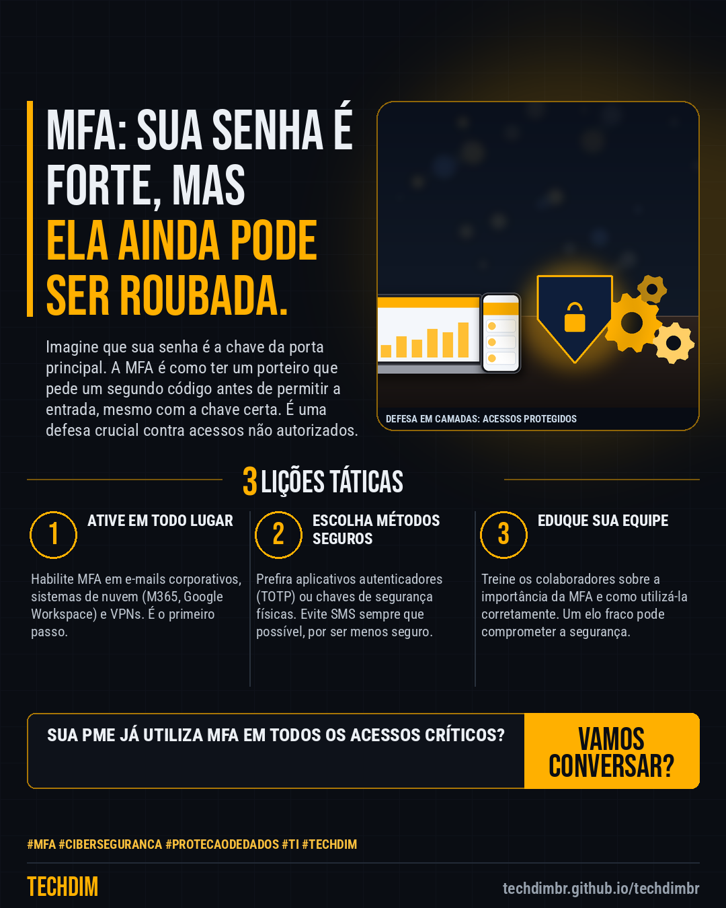

# Conhecimento — MFA: Por que apenas uma senha forte não protege sua PME de ciberataques

- **Data:** 2026-11-08, 18:14 (horário de Brasília)
- **Curadoria:** Claude (Routine) — pauta do dia
- **Execução no Actions:** https://github.com/Techdimbr/Publi-midia-Techdim/actions/runs/42524134840
- **Por que esta pauta:** A proteção de acessos é um pilar da cibersegurança e precisa ser revista constantemente para PMEs.

## Resultado

| Rede | Status | Link | 1º comentário |
|---|---|---|---|
| linkedin | ✅ publicado | https://www.linkedin.com/feed/update/urn:li:share:7525304706168963072/ | — |
| facebook | ✅ publicado | https://www.facebook.com/122132402349390486/posts/122142026565390486 | ✅ |
| instagram | ✅ publicado | https://www.instagram.com/p/DffspTfEz1t/ | — |

## Linkedin

```text
MFA: Por que apenas uma senha forte não protege sua PME de ciberataques

01. Ataques de phishing e engenharia social evoluíram para roubar credenciais, tornando senhas fortes insuficientes para a segurança corporativa.
02. A Autenticação Multifator (MFA) adiciona uma camada extra de segurança, exigindo um segundo método de verificação além da senha.
03. Implementar MFA é uma medida tática essencial para proteger acessos a e-mails, sistemas em nuvem e redes internas da sua PME.

A TECHDIM atua na implementação de cibersegurança defensiva, garantindo que sua PME adote as melhores práticas de proteção de acesso.

TECHDIM — Infraestrutura · Segurança · IA
https://techdimbr.github.io/techdimbr/

#MFA #Ciberseguranca #ProtecaoDeDados #TI #TECHDIM
```



## Facebook

```text
MFA: Por que apenas uma senha forte não protege sua PME de ciberataques

• Ataques de phishing e engenharia social evoluíram para roubar credenciais, tornando senhas fortes insuficientes para a segurança corporativa.
• A Autenticação Multifator (MFA) adiciona uma camada extra de segurança, exigindo um segundo método de verificação além da senha.
• Implementar MFA é uma medida tática essencial para proteger acessos a e-mails, sistemas em nuvem e redes internas da sua PME.

A TECHDIM atua na implementação de cibersegurança defensiva, garantindo que sua PME adote as melhores práticas de proteção de acesso.

Fale com a TECHDIM — link no primeiro comentário 👇

#MFA #Ciberseguranca #ProtecaoDeDados #TECHDIM
```

Primeiro comentário:

```text
🌐 TECHDIM — Infraestrutura · Segurança · IA: https://techdimbr.github.io/techdimbr/
```


## Instagram

```text
MFA: Por que apenas uma senha forte não protege sua PME de ciberataques

1️⃣ Ataques de phishing e engenharia social evoluíram para roubar credenciais, tornando senhas fortes insuficientes para a segurança corporativa.
2️⃣ A Autenticação Multifator (MFA) adiciona uma camada extra de segurança, exigindo um segundo método de verificação além da senha.
3️⃣ Implementar MFA é uma medida tática essencial para proteger acessos a e-mails, sistemas em nuvem e redes internas da sua PME.

A TECHDIM atua na implementação de cibersegurança defensiva, garantindo que sua PME adote as melhores práticas de proteção de acesso.

🔗 Link na bio: techdimbr.github.io/techdimbr

#mfa #ciberseguranca #protecaodedados #ti #techdim #conhecimento #aprendati #tecnologia
```


