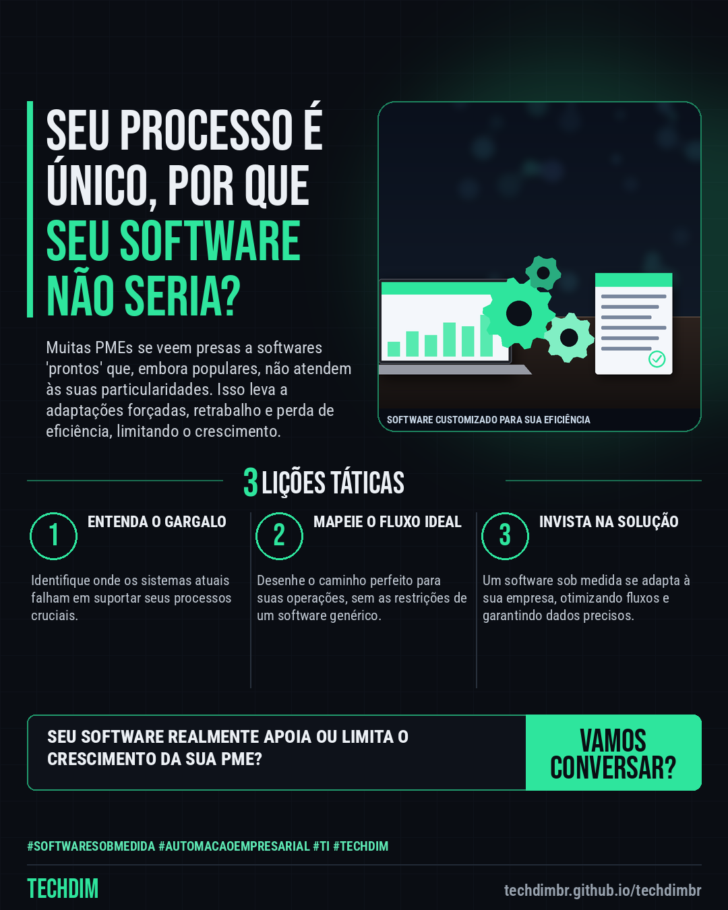

# TECHDIM · Serviços — Software Sob Medida: Solução para processos únicos da sua PME.

- **Data:** 2026-11-08, 20:50 (horário de Brasília)
- **Curadoria:** Claude (Routine) — pauta do dia
- **Execução no Actions:** https://github.com/Techdimbr/Publi-midia-Techdim/actions/runs/42537048605
- **Por que esta pauta:** Este assunto é vital hoje para PMEs que buscam eficiência e vantagem competitiva através da tecnologia.

## Resultado

| Rede | Status | Link | 1º comentário |
|---|---|---|---|
| linkedin | ✅ publicado | https://www.linkedin.com/feed/update/urn:li:share:7525343978490085377/ | — |
| facebook | ✅ publicado | https://www.facebook.com/122132402349390486/posts/122142044547390486 | ✅ |
| instagram | ✅ publicado | https://www.instagram.com/p/Dff-gLtDzRR/ | — |

## Linkedin

```text
Software Sob Medida: Solução para processos únicos da sua PME.

01. Sistemas genéricos forçam sua PME a adaptar processos, gerando ineficiência e gargalos operacionais.
02. Com software sob medida, a lógica do sistema se alinha perfeitamente à sua operação, não o contrário.
03. Reduza retrabalho, otimize fluxos e obtenha dados precisos para decisões estratégicas, tudo customizado.

A TECHDIM projeta e desenvolve soluções de software que impulsionam a produtividade e a competitividade da sua PME.

TECHDIM — Infraestrutura · Segurança · IA
https://techdimbr.github.io/techdimbr/

#SoftwareSobMedida #AutomacaoEmpresarial #TI #TECHDIM #InfraestruturaDeTI
```



## Facebook

```text
Software Sob Medida: Solução para processos únicos da sua PME.

• Sistemas genéricos forçam sua PME a adaptar processos, gerando ineficiência e gargalos operacionais.
• Com software sob medida, a lógica do sistema se alinha perfeitamente à sua operação, não o contrário.
• Reduza retrabalho, otimize fluxos e obtenha dados precisos para decisões estratégicas, tudo customizado.

A TECHDIM projeta e desenvolve soluções de software que impulsionam a produtividade e a competitividade da sua PME.

Fale com a TECHDIM — link no primeiro comentário 👇

#SoftwareSobMedida #AutomacaoEmpresarial #TI #TECHDIM
```

Primeiro comentário:

```text
🌐 TECHDIM — Infraestrutura · Segurança · IA: https://techdimbr.github.io/techdimbr/
```


## Instagram

```text
Software Sob Medida: Solução para processos únicos da sua PME.

1️⃣ Sistemas genéricos forçam sua PME a adaptar processos, gerando ineficiência e gargalos operacionais.
2️⃣ Com software sob medida, a lógica do sistema se alinha perfeitamente à sua operação, não o contrário.
3️⃣ Reduza retrabalho, otimize fluxos e obtenha dados precisos para decisões estratégicas, tudo customizado.

A TECHDIM projeta e desenvolve soluções de software que impulsionam a produtividade e a competitividade da sua PME.

🔗 Link na bio: techdimbr.github.io/techdimbr

#softwaresobmedida #automacaoempresarial #ti #techdim #suportetecnico #ciberseguranca #automacao #campinas
```


