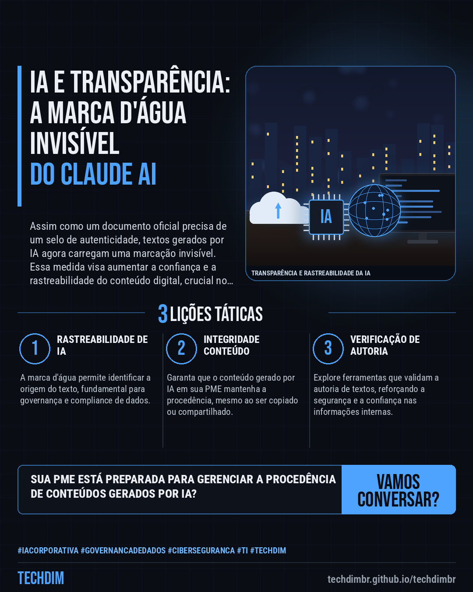
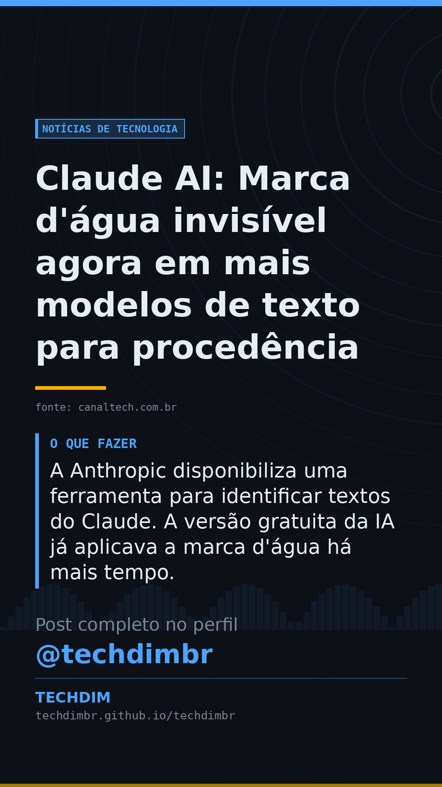

# Notícias de Tecnologia — Claude AI: Marca d'água invisível agora em mais modelos de texto para procedência

- **Data:** 2026-11-09, 18:26 (horário de Brasília)
- **Curadoria:** Claude (Routine) — pauta do dia
- **Execução no Actions:** https://github.com/Techdimbr/Publi-midia-Techdim/actions/runs/42702234579
- **Por que esta pauta:** A transparência na geração de conteúdo por IA é um tema crescente e relevante para a governança de dados corporativos.

## Resultado

| Rede | Status | Link | 1º comentário |
|---|---|---|---|
| linkedin | ✅ publicado | https://www.linkedin.com/feed/update/urn:li:share:7525669850883579905/ | — |
| facebook | ✅ publicado | https://www.facebook.com/122132402349390486/posts/122142354285390486 | ✅ |
| instagram | ✅ publicado | https://www.instagram.com/p/DfiSsh3jW3M/ | ✅ |
| Stories | ✅ publicado | https://www.instagram.com/stories/techdimbr/4026863405495039827 | — |

## Fontes

- [canaltech.com.br](https://canaltech.com.br/inteligencia-artificial/fim-do-anonimato-claude-passa-a-marcar-todos-os-textos-com-marca-dagua-invisivel/)

## Linkedin

```text
Claude AI: Marca d'água invisível agora em mais modelos de texto para procedência

01. A Anthropic expandiu a marca d'água invisível para modelos antigos do Claude AI, como Opus 4.6 e a família Claude 4.5, a partir de 16 de novembro.
02. O recurso insere uma marcação invisível automática para indicar a origem do texto, sem impactar a qualidade ou o uso de tokens, e persiste ao copiar/colar.
03. A Anthropic disponibiliza uma ferramenta para identificar textos do Claude. A versão gratuita da IA já aplicava a marca d'água há mais tempo.

A governança de dados e a procedência de conteúdo gerado por IA são cruciais. A TECHDIM apoia sua PME na implementação segura da IA corporativa.

Fontes: https://canaltech.com.br/inteligencia-artificial/fim-do-anonimato-claude-passa-a-marcar-todos-os-textos-com-marca-dagua-invisivel/

TECHDIM — Infraestrutura · Segurança · IA
https://techdimbr.github.io/techdimbr/

#IACorporativa #GovernancaDeDados #Ciberseguranca #TI #TECHDIM
```



## Facebook

```text
Claude AI: Marca d'água invisível agora em mais modelos de texto para procedência

• A Anthropic expandiu a marca d'água invisível para modelos antigos do Claude AI, como Opus 4.6 e a família Claude 4.5, a partir de 16 de novembro.
• O recurso insere uma marcação invisível automática para indicar a origem do texto, sem impactar a qualidade ou o uso de tokens, e persiste ao copiar/colar.
• A Anthropic disponibiliza uma ferramenta para identificar textos do Claude. A versão gratuita da IA já aplicava a marca d'água há mais tempo.

A governança de dados e a procedência de conteúdo gerado por IA são cruciais. A TECHDIM apoia sua PME na implementação segura da IA corporativa.

Fale com a TECHDIM — fontes e site no primeiro comentário 👇

#IACorporativa #GovernancaDeDados #Ciberseguranca #TECHDIM
```

Primeiro comentário:

```text
📎 Fontes:
• canaltech.com.br: https://canaltech.com.br/inteligencia-artificial/fim-do-anonimato-claude-passa-a-marcar-todos-os-textos-com-marca-dagua-invisivel/

🌐 TECHDIM — Infraestrutura · Segurança · IA: https://techdimbr.github.io/techdimbr/
```


## Instagram

```text
Claude AI: Marca d'água invisível agora em mais modelos de texto para procedência

1️⃣ A Anthropic expandiu a marca d'água invisível para modelos antigos do Claude AI, como Opus 4.6 e a família Claude 4.5, a partir de 16 de novembro.
2️⃣ O recurso insere uma marcação invisível automática para indicar a origem do texto, sem impactar a qualidade ou o uso de tokens, e persiste ao copiar/colar.
3️⃣ A Anthropic disponibiliza uma ferramenta para identificar textos do Claude. A versão gratuita da IA já aplicava a marca d'água há mais tempo.

A governança de dados e a procedência de conteúdo gerado por IA são cruciais. A TECHDIM apoia sua PME na implementação segura da IA corporativa.

🔗 Link na bio: techdimbr.github.io/techdimbr
Fontes no primeiro comentário 👇

#iacorporativa #governancadedados #ciberseguranca #ti #techdim #tecnologia #inteligenciaartificial #ia
```

Primeiro comentário:

```text
📎 Fontes: canaltech.com.br
```


## Stories


