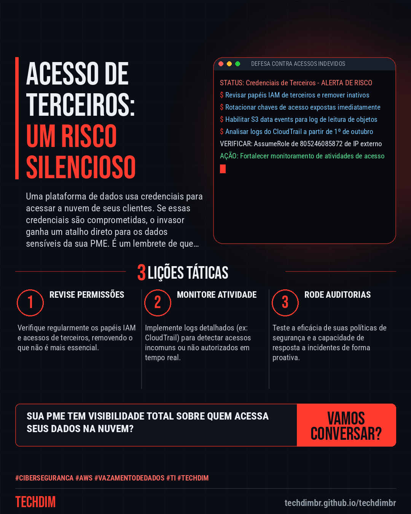
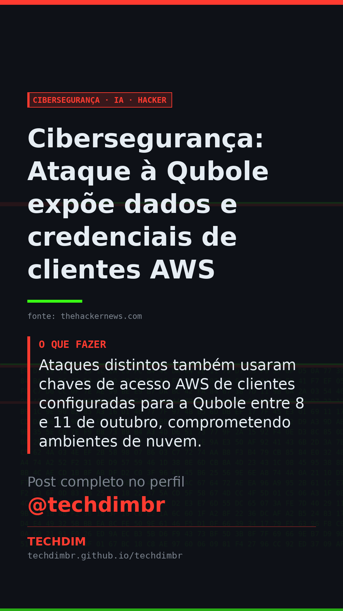

# Cibersegurança · IA · Hacker — Cibersegurança: Ataque à Qubole expõe dados e credenciais de clientes AWS

- **Data:** 2026-11-09, 20:24 (horário de Brasília)
- **Curadoria:** Claude (Routine) — pauta do dia
- **Execução no Actions:** https://github.com/Techdimbr/Publi-midia-Techdim/actions/runs/42719971427
- **Por que esta pauta:** Este incidente destaca a importância de gerenciar e monitorar rigorosamente o acesso de terceiros em ambientes de nuvem.

## Resultado

| Rede | Status | Link | 1º comentário |
|---|---|---|---|
| linkedin | ✅ publicado | https://www.linkedin.com/feed/update/urn:li:share:7525699567275917312/ | — |
| facebook | ✅ publicado | https://www.facebook.com/122132402349390486/posts/122142520311390486 | ✅ |
| instagram | ✅ publicado | https://www.instagram.com/p/DfigM-bF6Hm/ | ✅ |
| Stories | ✅ publicado | https://www.instagram.com/stories/techdimbr/4026922804222074347 | — |

## Fontes

- [thehackernews.com](https://thehackernews.com/2026/11/hackers-exploit-quboles-trusted-aws.html)

## Linkedin

```text
Cibersegurança: Ataque à Qubole expõe dados e credenciais de clientes AWS

01. Um ataque explorou credenciais da plataforma Qubole para acessar contas AWS de múltiplos clientes entre 14 e 26 de outubro, resultando em roubo de dados e segredos.
02. Os invasores assumiram papéis IAM confiáveis, mesmo em contas não utilizadas, e extraíram credenciais de acesso AWS, segredos de clientes Entra ID e Okta.
03. Ataques distintos também usaram chaves de acesso AWS de clientes configuradas para a Qubole entre 8 e 11 de outubro, comprometendo ambientes de nuvem.

A proteção de acessos de terceiros e a vigilância constante são cruciais para a segurança da informação na sua PME. A TECHDIM pode ajudar.

Fontes: https://thehackernews.com/2026/11/hackers-exploit-quboles-trusted-aws.html

TECHDIM — Infraestrutura · Segurança · IA
https://techdimbr.github.io/techdimbr/

#Ciberseguranca #AWS #VazamentoDeDados #TI #TECHDIM
```



## Facebook

```text
Cibersegurança: Ataque à Qubole expõe dados e credenciais de clientes AWS

• Um ataque explorou credenciais da plataforma Qubole para acessar contas AWS de múltiplos clientes entre 14 e 26 de outubro, resultando em roubo de dados e segredos.
• Os invasores assumiram papéis IAM confiáveis, mesmo em contas não utilizadas, e extraíram credenciais de acesso AWS, segredos de clientes Entra ID e Okta.
• Ataques distintos também usaram chaves de acesso AWS de clientes configuradas para a Qubole entre 8 e 11 de outubro, comprometendo ambientes de nuvem.

A proteção de acessos de terceiros e a vigilância constante são cruciais para a segurança da informação na sua PME. A TECHDIM pode ajudar.

Fale com a TECHDIM — fontes e site no primeiro comentário 👇

#Ciberseguranca #AWS #VazamentoDeDados #TECHDIM
```

Primeiro comentário:

```text
📎 Fontes:
• thehackernews.com: https://thehackernews.com/2026/11/hackers-exploit-quboles-trusted-aws.html

🌐 TECHDIM — Infraestrutura · Segurança · IA: https://techdimbr.github.io/techdimbr/
```


## Instagram

```text
Cibersegurança: Ataque à Qubole expõe dados e credenciais de clientes AWS

1️⃣ Um ataque explorou credenciais da plataforma Qubole para acessar contas AWS de múltiplos clientes entre 14 e 26 de outubro, resultando em roubo de dados e segredos.
2️⃣ Os invasores assumiram papéis IAM confiáveis, mesmo em contas não utilizadas, e extraíram credenciais de acesso AWS, segredos de clientes Entra ID e Okta.
3️⃣ Ataques distintos também usaram chaves de acesso AWS de clientes configuradas para a Qubole entre 8 e 11 de outubro, comprometendo ambientes de nuvem.

A proteção de acessos de terceiros e a vigilância constante são cruciais para a segurança da informação na sua PME. A TECHDIM pode ajudar.

🔗 Link na bio: techdimbr.github.io/techdimbr
Fontes no primeiro comentário 👇

#ciberseguranca #aws #vazamentodedados #ti #techdim #seguranca #hacker #infraestrutura
```

Primeiro comentário:

```text
📎 Fontes: thehackernews.com
```


## Stories


