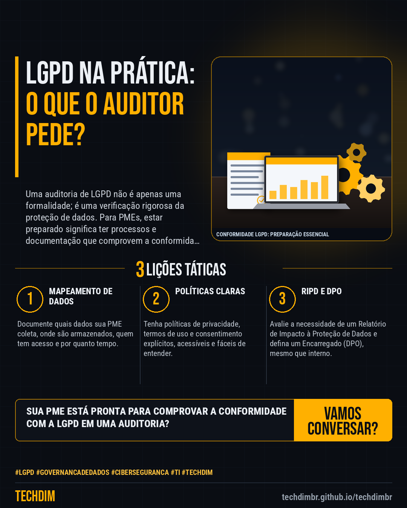

# Conhecimento — LGPD na prática: Prepare sua PME para a auditoria com estes 4 itens essenciais

- **Data:** 2026-11-09, 21:44 (horário de Brasília)
- **Curadoria:** Claude (Routine) — pauta do dia
- **Execução no Actions:** https://github.com/Techdimbr/Publi-midia-Techdim/actions/runs/42730465217
- **Por que esta pauta:** A conformidade com a LGPD é uma necessidade contínua para proteger dados e evitar sanções.

## Resultado

| Rede | Status | Link | 1º comentário |
|---|---|---|---|
| linkedin | ✅ publicado | https://www.linkedin.com/feed/update/urn:li:share:7525719864833949696/ | — |
| facebook | ✅ publicado | https://www.facebook.com/122132402349390486/posts/122142530955390486 | ✅ |
| instagram | ✅ publicado | https://www.instagram.com/p/DfipcIxDzhX/ | — |

## Linkedin

```text
LGPD na prática: Prepare sua PME para a auditoria com estes 4 itens essenciais

01. Auditorias de LGPD focam em evidências de conformidade; ter os documentos e processos organizados é crucial para PMEs.
02. A falta de um Relatório de Impacto à Proteção de Dados (RIPD) pode ser um ponto de atenção, especialmente para operações com alto risco.
03. Políticas de privacidade claras, registros de consentimento e mapeamento de dados são pilares que auditores examinam primeiro.

A TECHDIM estrutura sua conformidade com LGPD, desde o mapeamento de dados até a implementação de controles e políticas.

TECHDIM — Infraestrutura · Segurança · IA
https://techdimbr.github.io/techdimbr/

#Lgpd #GovernancaDeDados #Ciberseguranca #TI #TECHDIM
```



## Facebook

```text
LGPD na prática: Prepare sua PME para a auditoria com estes 4 itens essenciais

• Auditorias de LGPD focam em evidências de conformidade; ter os documentos e processos organizados é crucial para PMEs.
• A falta de um Relatório de Impacto à Proteção de Dados (RIPD) pode ser um ponto de atenção, especialmente para operações com alto risco.
• Políticas de privacidade claras, registros de consentimento e mapeamento de dados são pilares que auditores examinam primeiro.

A TECHDIM estrutura sua conformidade com LGPD, desde o mapeamento de dados até a implementação de controles e políticas.

Fale com a TECHDIM — link no primeiro comentário 👇

#Lgpd #GovernancaDeDados #Ciberseguranca #TECHDIM
```

Primeiro comentário:

```text
🌐 TECHDIM — Infraestrutura · Segurança · IA: https://techdimbr.github.io/techdimbr/
```


## Instagram

```text
LGPD na prática: Prepare sua PME para a auditoria com estes 4 itens essenciais

1️⃣ Auditorias de LGPD focam em evidências de conformidade; ter os documentos e processos organizados é crucial para PMEs.
2️⃣ A falta de um Relatório de Impacto à Proteção de Dados (RIPD) pode ser um ponto de atenção, especialmente para operações com alto risco.
3️⃣ Políticas de privacidade claras, registros de consentimento e mapeamento de dados são pilares que auditores examinam primeiro.

A TECHDIM estrutura sua conformidade com LGPD, desde o mapeamento de dados até a implementação de controles e políticas.

🔗 Link na bio: techdimbr.github.io/techdimbr

#lgpd #governancadedados #ciberseguranca #ti #techdim #conhecimento #aprendati #tecnologia
```


