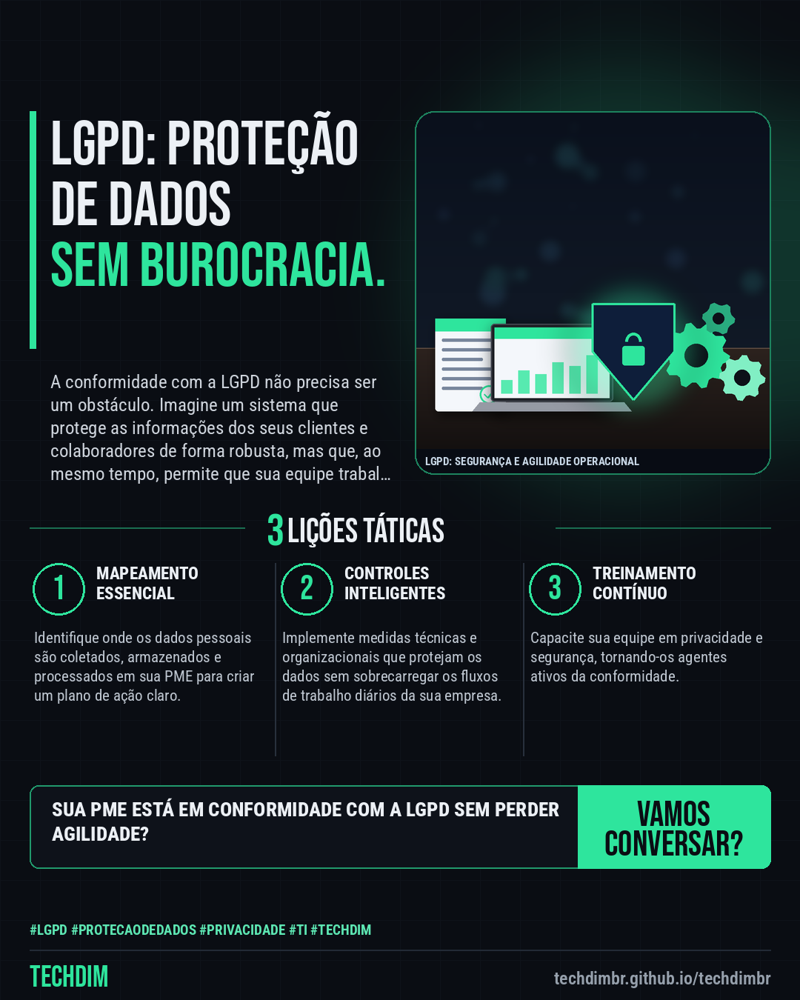

# TECHDIM · Serviços — LGPD: Adequação à LGPD sem travar a operação da sua PME é possível

- **Data:** 2026-11-09, 23:49 (horário de Brasília)
- **Curadoria:** Claude (Routine) — pauta do dia
- **Execução no Actions:** https://github.com/Techdimbr/Publi-midia-Techdim/actions/runs/42745306798
- **Por que esta pauta:** Este assunto é crucial hoje para que PMEs entendam como a LGPD pode ser implementada de forma prática e eficaz.

## Resultado

| Rede | Status | Link | 1º comentário |
|---|---|---|---|
| linkedin | ✅ publicado | https://www.linkedin.com/feed/update/urn:li:share:7525751424962473984/ | — |
| facebook | ✅ publicado | https://www.facebook.com/122132402349390486/posts/122142544863390486 | ✅ |
| instagram | ✅ publicado | https://www.instagram.com/p/Dfi3ySHjGYR/ | — |

## Linkedin

```text
LGPD: Adequação à LGPD sem travar a operação da sua PME é possível

01. A LGPD exige conformidade com a proteção de dados, mas a implementação inadequada pode gerar burocracia excessiva e atrasar processos.
02. Muitas PMEs enfrentam o desafio de proteger dados pessoais sem comprometer a agilidade operacional, buscando soluções que equilibrem segurança e eficiência.
03. A conformidade com a LGPD vai além de documentos: envolve mapeamento de dados, avaliação de riscos, implementação de controles técnicos e treinamento da equipe.

A TECHDIM oferece consultoria especializada para adequar sua PME à LGPD, garantindo segurança e fluidez operacional, sem interrupções.

TECHDIM — Infraestrutura · Segurança · IA
https://techdimbr.github.io/techdimbr/

#Lgpd #ProtecaoDeDados #Privacidade #TI #TECHDIM
```



## Facebook

```text
LGPD: Adequação à LGPD sem travar a operação da sua PME é possível

• A LGPD exige conformidade com a proteção de dados, mas a implementação inadequada pode gerar burocracia excessiva e atrasar processos.
• Muitas PMEs enfrentam o desafio de proteger dados pessoais sem comprometer a agilidade operacional, buscando soluções que equilibrem segurança e eficiência.
• A conformidade com a LGPD vai além de documentos: envolve mapeamento de dados, avaliação de riscos, implementação de controles técnicos e treinamento da equipe.

A TECHDIM oferece consultoria especializada para adequar sua PME à LGPD, garantindo segurança e fluidez operacional, sem interrupções.

Fale com a TECHDIM — link no primeiro comentário 👇

#Lgpd #ProtecaoDeDados #Privacidade #TECHDIM
```

Primeiro comentário:

```text
🌐 TECHDIM — Infraestrutura · Segurança · IA: https://techdimbr.github.io/techdimbr/
```


## Instagram

```text
LGPD: Adequação à LGPD sem travar a operação da sua PME é possível

1️⃣ A LGPD exige conformidade com a proteção de dados, mas a implementação inadequada pode gerar burocracia excessiva e atrasar processos.
2️⃣ Muitas PMEs enfrentam o desafio de proteger dados pessoais sem comprometer a agilidade operacional, buscando soluções que equilibrem segurança e eficiência.
3️⃣ A conformidade com a LGPD vai além de documentos: envolve mapeamento de dados, avaliação de riscos, implementação de controles técnicos e treinamento da equipe.

A TECHDIM oferece consultoria especializada para adequar sua PME à LGPD, garantindo segurança e fluidez operacional, sem interrupções.

🔗 Link na bio: techdimbr.github.io/techdimbr

#lgpd #protecaodedados #privacidade #ti #techdim #suportetecnico #ciberseguranca #automacao
```


