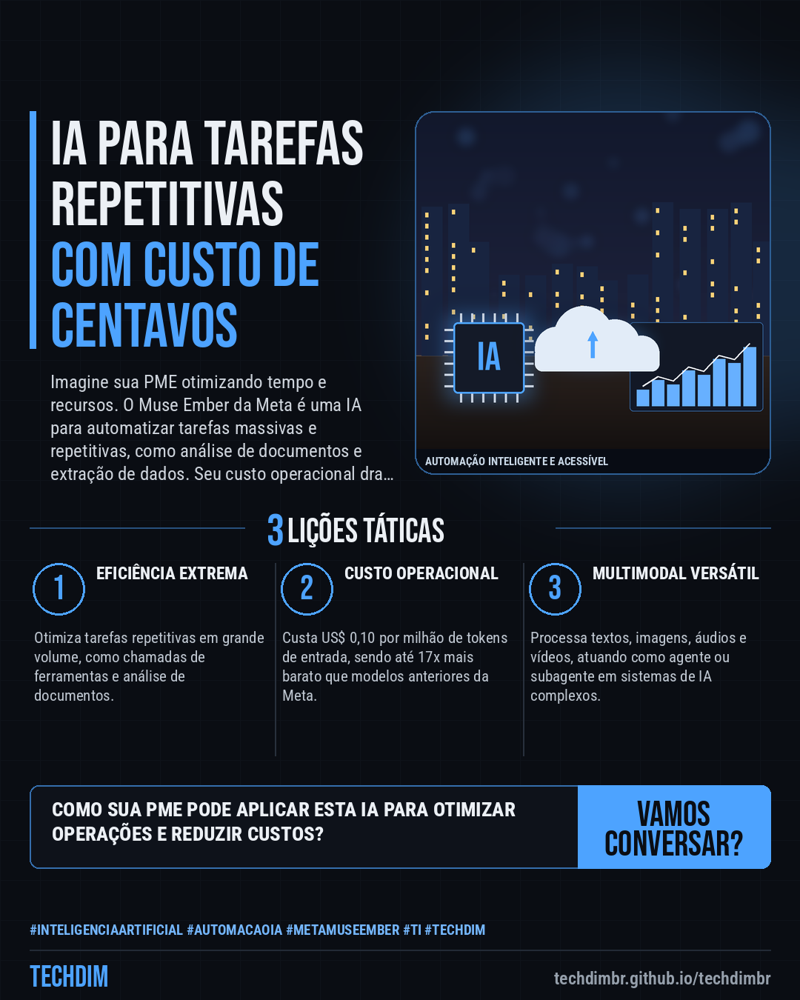
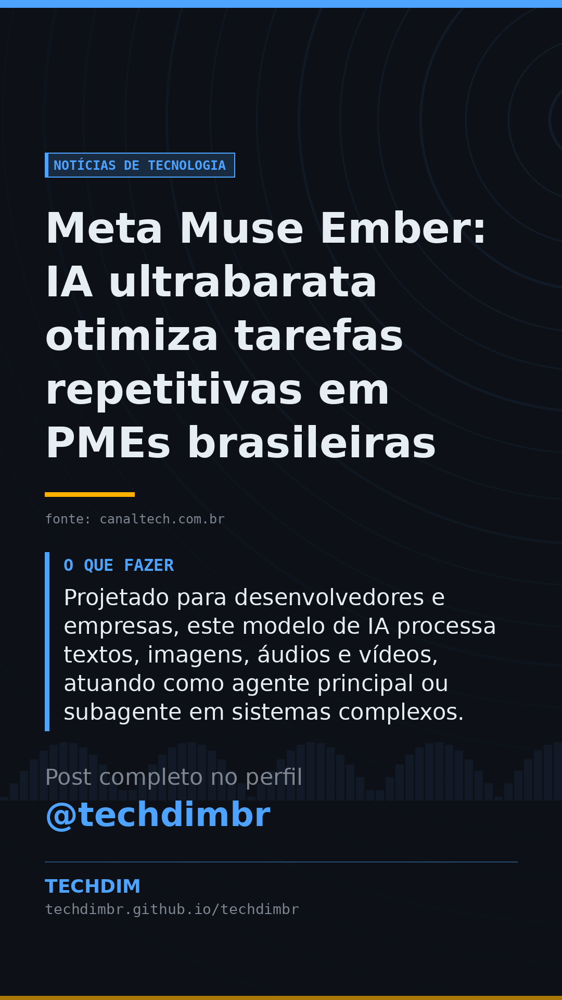

# Notícias de Tecnologia — Meta Muse Ember: IA ultrabarata otimiza tarefas repetitivas em PMEs brasileiras

- **Data:** 2026-11-10, 15:39 (horário de Brasília)
- **Curadoria:** Claude (Routine) — pauta do dia
- **Execução no Actions:** https://github.com/Techdimbr/Publi-midia-Techdim/actions/runs/42877277774
- **Por que esta pauta:** Modelos de IA mais acessíveis e eficientes transformam a automação corporativa, tornando-a viável para mais empresas brasileiras.

## Resultado

| Rede | Status | Link | 1º comentário |
|---|---|---|---|
| linkedin | ✅ publicado | https://www.linkedin.com/feed/update/urn:li:share:7525990430224613377/ | — |
| facebook | ✅ publicado | https://www.facebook.com/122132402349390486/posts/122142915513390486 | ✅ |
| instagram | ✅ publicado | https://www.instagram.com/p/Dfkkd8rFxoK/ | ✅ |
| Stories | ✅ publicado | https://www.instagram.com/stories/techdimbr/4027504523954592477 | — |

## Fontes

- [canaltech.com.br](https://canaltech.com.br/inteligencia-artificial/meta-lanca-muse-ember-ia-ultrabarata-para-tarefas-repetitivas-que-custa-centavos/)

## Linkedin

```text
Meta Muse Ember: IA ultrabarata otimiza tarefas repetitivas em PMEs brasileiras

01. A Meta lançou o Muse Ember, seu menor e mais eficiente modelo de IA até o momento, focado em tarefas repetitivas de alto volume como análise de documentos e extração de dados.
02. Com um custo de US$ 0,10 por milhão de tokens de entrada, o Muse Ember é 17 vezes mais barato que o Muse Spark e superou concorrentes em automação empresarial e programação.
03. Projetado para desenvolvedores e empresas, este modelo de IA processa textos, imagens, áudios e vídeos, atuando como agente principal ou subagente em sistemas complexos.

Aproveite a eficiência e a redução de custos que IAs como o Muse Ember podem trazer para a sua infraestrutura e processos de software corporativo.

Fontes: https://canaltech.com.br/inteligencia-artificial/meta-lanca-muse-ember-ia-ultrabarata-para-tarefas-repetitivas-que-custa-centavos/

TECHDIM — Infraestrutura · Segurança · IA
https://techdimbr.github.io/techdimbr/

#InteligenciaArtificial #AutomacaoIA #MetaMuseEmber #TI #TECHDIM
```



## Facebook

```text
Meta Muse Ember: IA ultrabarata otimiza tarefas repetitivas em PMEs brasileiras

• A Meta lançou o Muse Ember, seu menor e mais eficiente modelo de IA até o momento, focado em tarefas repetitivas de alto volume como análise de documentos e extração de dados.
• Com um custo de US$ 0,10 por milhão de tokens de entrada, o Muse Ember é 17 vezes mais barato que o Muse Spark e superou concorrentes em automação empresarial e programação.
• Projetado para desenvolvedores e empresas, este modelo de IA processa textos, imagens, áudios e vídeos, atuando como agente principal ou subagente em sistemas complexos.

Aproveite a eficiência e a redução de custos que IAs como o Muse Ember podem trazer para a sua infraestrutura e processos de software corporativo.

Fale com a TECHDIM — fontes e site no primeiro comentário 👇

#InteligenciaArtificial #AutomacaoIA #MetaMuseEmber #TECHDIM
```

Primeiro comentário:

```text
📎 Fontes:
• canaltech.com.br: https://canaltech.com.br/inteligencia-artificial/meta-lanca-muse-ember-ia-ultrabarata-para-tarefas-repetitivas-que-custa-centavos/

🌐 TECHDIM — Infraestrutura · Segurança · IA: https://techdimbr.github.io/techdimbr/
```


## Instagram

```text
Meta Muse Ember: IA ultrabarata otimiza tarefas repetitivas em PMEs brasileiras

1️⃣ A Meta lançou o Muse Ember, seu menor e mais eficiente modelo de IA até o momento, focado em tarefas repetitivas de alto volume como análise de documentos e extração de dados.
2️⃣ Com um custo de US$ 0,10 por milhão de tokens de entrada, o Muse Ember é 17 vezes mais barato que o Muse Spark e superou concorrentes em automação empresarial e programação.
3️⃣ Projetado para desenvolvedores e empresas, este modelo de IA processa textos, imagens, áudios e vídeos, atuando como agente principal ou subagente em sistemas complexos.

Aproveite a eficiência e a redução de custos que IAs como o Muse Ember podem trazer para a sua infraestrutura e processos de software corporativo.

🔗 Link na bio: techdimbr.github.io/techdimbr
Fontes no primeiro comentário 👇

#inteligenciaartificial #automacaoia #metamuseember #ti #techdim #tecnologia #ia #inovacao
```

Primeiro comentário:

```text
📎 Fontes: canaltech.com.br
```


## Stories


