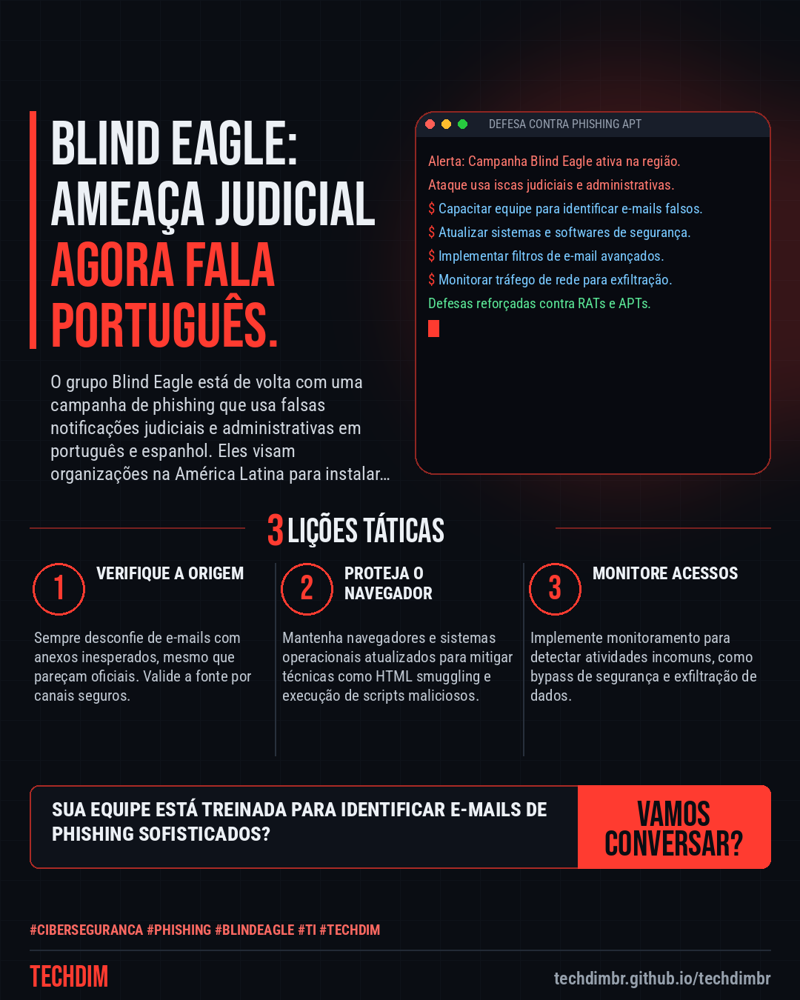
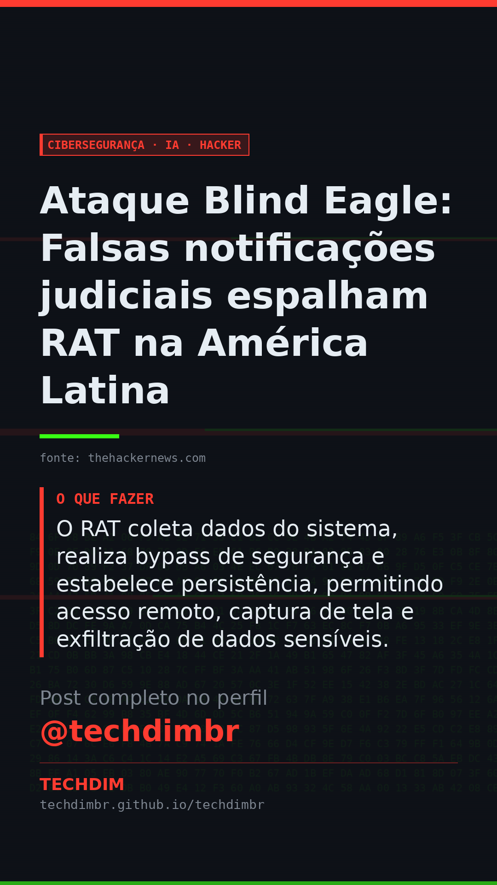

# Cibersegurança · IA · Hacker — Ataque Blind Eagle: Falsas notificações judiciais espalham RAT na América Latina

- **Data:** 2026-11-10, 17:46 (horário de Brasília)
- **Curadoria:** Claude (Routine) — pauta do dia
- **Execução no Actions:** https://github.com/Techdimbr/Publi-midia-Techdim/actions/runs/42898443146
- **Por que esta pauta:** Esta campanha de phishing é um alerta crítico para empresas brasileiras, destacando a necessidade de vigilância contra ameaças regionais.

## Resultado

| Rede | Status | Link | 1º comentário |
|---|---|---|---|
| linkedin | ✅ publicado | https://www.linkedin.com/feed/update/urn:li:share:7526022434198536192/ | — |
| facebook | ✅ publicado | https://www.facebook.com/122132402349390486/posts/122142932907390486 | ✅ |
| instagram | ✅ publicado | https://www.instagram.com/p/DfkzBfXl2oN/ | ✅ |
| Stories | ✅ publicado | https://www.instagram.com/stories/techdimbr/4027568497777657608 | — |

## Fontes

- [thehackernews.com](https://thehackernews.com/2026/11/blind-eagle-uses-fake-court-notices-to.html)

## Linkedin

```text
Ataque Blind Eagle: Falsas notificações judiciais espalham RAT na América Latina

01. O grupo Blind Eagle (APT-C-36) reativou campanhas de phishing com iscas judiciais e administrativas em português e espanhol, visando empresas na América Latina.
02. Ataques usam e-mails com arquivos XHTML que simulam páginas oficiais, empregando HTML smuggling para burlar defesas e entregar um RAT (Remote Access Trojan).
03. O RAT coleta dados do sistema, realiza bypass de segurança e estabelece persistência, permitindo acesso remoto, captura de tela e exfiltração de dados sensíveis.

A TECHDIM protege sua PME com cibersegurança defensiva, garantindo que sua infraestrutura e dados estejam seguros contra ataques sofisticados.

Fontes: https://thehackernews.com/2026/11/blind-eagle-uses-fake-court-notices-to.html

TECHDIM — Infraestrutura · Segurança · IA
https://techdimbr.github.io/techdimbr/

#Ciberseguranca #Phishing #BlindEagle #TI #TECHDIM
```



## Facebook

```text
Ataque Blind Eagle: Falsas notificações judiciais espalham RAT na América Latina

• O grupo Blind Eagle (APT-C-36) reativou campanhas de phishing com iscas judiciais e administrativas em português e espanhol, visando empresas na América Latina.
• Ataques usam e-mails com arquivos XHTML que simulam páginas oficiais, empregando HTML smuggling para burlar defesas e entregar um RAT (Remote Access Trojan).
• O RAT coleta dados do sistema, realiza bypass de segurança e estabelece persistência, permitindo acesso remoto, captura de tela e exfiltração de dados sensíveis.

A TECHDIM protege sua PME com cibersegurança defensiva, garantindo que sua infraestrutura e dados estejam seguros contra ataques sofisticados.

Fale com a TECHDIM — fontes e site no primeiro comentário 👇

#Ciberseguranca #Phishing #BlindEagle #TECHDIM
```

Primeiro comentário:

```text
📎 Fontes:
• thehackernews.com: https://thehackernews.com/2026/11/blind-eagle-uses-fake-court-notices-to.html

🌐 TECHDIM — Infraestrutura · Segurança · IA: https://techdimbr.github.io/techdimbr/
```


## Instagram

```text
Ataque Blind Eagle: Falsas notificações judiciais espalham RAT na América Latina

1️⃣ O grupo Blind Eagle (APT-C-36) reativou campanhas de phishing com iscas judiciais e administrativas em português e espanhol, visando empresas na América Latina.
2️⃣ Ataques usam e-mails com arquivos XHTML que simulam páginas oficiais, empregando HTML smuggling para burlar defesas e entregar um RAT (Remote Access Trojan).
3️⃣ O RAT coleta dados do sistema, realiza bypass de segurança e estabelece persistência, permitindo acesso remoto, captura de tela e exfiltração de dados sensíveis.

A TECHDIM protege sua PME com cibersegurança defensiva, garantindo que sua infraestrutura e dados estejam seguros contra ataques sofisticados.

🔗 Link na bio: techdimbr.github.io/techdimbr
Fontes no primeiro comentário 👇

#ciberseguranca #phishing #blindeagle #ti #techdim #seguranca #hacker #infraestrutura
```

Primeiro comentário:

```text
📎 Fontes: thehackernews.com
```


## Stories


