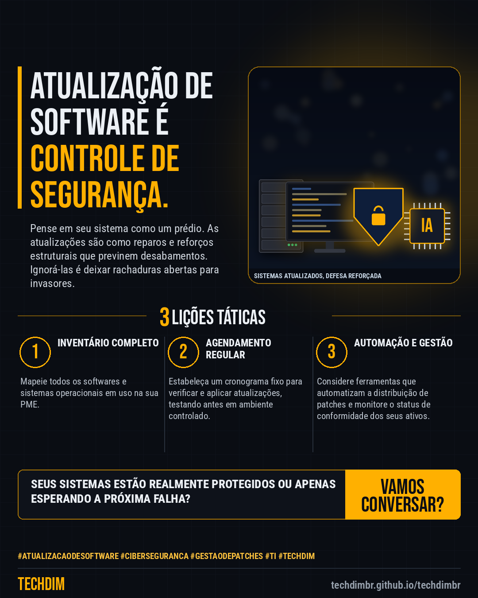

# Conhecimento — Atualização de Software: Mantenha seus sistemas seguros e evite vulnerabilidades críticas

- **Data:** 2026-11-10, 19:25 (horário de Brasília)
- **Curadoria:** Claude (Routine) — pauta do dia
- **Execução no Actions:** https://github.com/Techdimbr/Publi-midia-Techdim/actions/runs/42914281527
- **Por que esta pauta:** Este assunto é crucial hoje para proteger empresas contra as crescentes ameaças cibernéticas que exploram sistemas desatualizados.

## Resultado

| Rede | Status | Link | 1º comentário |
|---|---|---|---|
| linkedin | ✅ publicado | https://www.linkedin.com/feed/update/urn:li:share:7526047288683769857/ | — |
| facebook | ✅ publicado | https://www.facebook.com/122132402349390486/posts/122142944613390486 | ✅ |
| instagram | ✅ publicado | https://www.instagram.com/p/Dfk-UzilxUu/ | — |

## Linkedin

```text
Atualização de Software: Mantenha seus sistemas seguros e evite vulnerabilidades críticas

01. Atualizações de software não são apenas para novas funcionalidades; elas corrigem falhas de segurança que hackers exploram ativamente.
02. Ignorar patches e updates expõe sua PME a ransomware, vazamento de dados e interrupções operacionais, gerando custos e perda de reputação.
03. Um plano de atualização sistemático é essencial para a resiliência cibernética, garantindo que todos os sistemas estejam protegidos contra ameaças conhecidas.

A TECHDIM ajuda sua PME a implementar uma política robusta de gestão de patches, garantindo que sua infraestrutura esteja sempre atualizada e segura.

TECHDIM — Infraestrutura · Segurança · IA
https://techdimbr.github.io/techdimbr/

#AtualizacaoDeSoftware #Ciberseguranca #GestaoDePatches #TI #TECHDIM
```



## Facebook

```text
Atualização de Software: Mantenha seus sistemas seguros e evite vulnerabilidades críticas

• Atualizações de software não são apenas para novas funcionalidades; elas corrigem falhas de segurança que hackers exploram ativamente.
• Ignorar patches e updates expõe sua PME a ransomware, vazamento de dados e interrupções operacionais, gerando custos e perda de reputação.
• Um plano de atualização sistemático é essencial para a resiliência cibernética, garantindo que todos os sistemas estejam protegidos contra ameaças conhecidas.

A TECHDIM ajuda sua PME a implementar uma política robusta de gestão de patches, garantindo que sua infraestrutura esteja sempre atualizada e segura.

Fale com a TECHDIM — link no primeiro comentário 👇

#AtualizacaoDeSoftware #Ciberseguranca #GestaoDePatches #TECHDIM
```

Primeiro comentário:

```text
🌐 TECHDIM — Infraestrutura · Segurança · IA: https://techdimbr.github.io/techdimbr/
```


## Instagram

```text
Atualização de Software: Mantenha seus sistemas seguros e evite vulnerabilidades críticas

1️⃣ Atualizações de software não são apenas para novas funcionalidades; elas corrigem falhas de segurança que hackers exploram ativamente.
2️⃣ Ignorar patches e updates expõe sua PME a ransomware, vazamento de dados e interrupções operacionais, gerando custos e perda de reputação.
3️⃣ Um plano de atualização sistemático é essencial para a resiliência cibernética, garantindo que todos os sistemas estejam protegidos contra ameaças conhecidas.

A TECHDIM ajuda sua PME a implementar uma política robusta de gestão de patches, garantindo que sua infraestrutura esteja sempre atualizada e segura.

🔗 Link na bio: techdimbr.github.io/techdimbr

#atualizacaodesoftware #ciberseguranca #gestaodepatches #ti #techdim #conhecimento #aprendati #tecnologia
```


