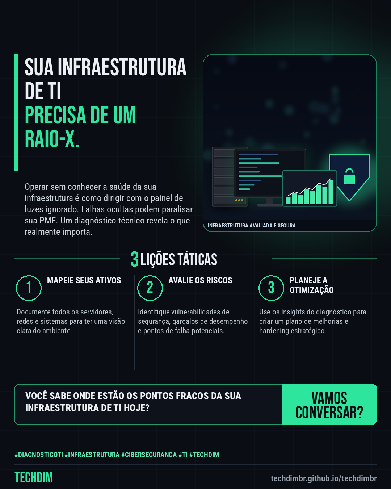

# TECHDIM · Serviços — DIAGNÓSTICO: Identifique gargalos e vulnerabilidades antes que afetem sua PME

- **Data:** 2026-11-10, 21:43 (horário de Brasília)
- **Curadoria:** Claude (Routine) — pauta do dia
- **Execução no Actions:** https://github.com/Techdimbr/Publi-midia-Techdim/actions/runs/42933562126
- **Por que esta pauta:** Porque identificar problemas antes que se tornem crises é essencial para a resiliência da PME.

## Resultado

| Rede | Status | Link | 1º comentário |
|---|---|---|---|
| linkedin | ✅ publicado | https://www.linkedin.com/feed/update/urn:li:share:7526082182537461760/ | — |
| facebook | ✅ publicado | https://www.facebook.com/122132402349390486/posts/122142960021390486 | ✅ |
| instagram | ✅ publicado | https://www.instagram.com/p/DflOMfPlBSR/ | — |

## Linkedin

```text
DIAGNÓSTICO: Identifique gargalos e vulnerabilidades antes que afetem sua PME

01. Muitas PMEs operam com infraestrutura de TI sem visibilidade clara dos riscos, levando a falhas inesperadas e perda de produtividade.
02. Um diagnóstico técnico completo mapeia sua rede, servidores e sistemas, revelando pontos fracos e oportunidades de otimização.
03. A TECHDIM oferece uma análise detalhada para transformar dados brutos em um plano de ação estratégico para sua infraestrutura.

Com a engenharia da TECHDIM, sua PME garante uma base de TI robusta, segura e preparada para o crescimento.

TECHDIM — Infraestrutura · Segurança · IA
https://techdimbr.github.io/techdimbr/

#DiagnosticoTI #Infraestrutura #Ciberseguranca #TI #TECHDIM
```



## Facebook

```text
DIAGNÓSTICO: Identifique gargalos e vulnerabilidades antes que afetem sua PME

• Muitas PMEs operam com infraestrutura de TI sem visibilidade clara dos riscos, levando a falhas inesperadas e perda de produtividade.
• Um diagnóstico técnico completo mapeia sua rede, servidores e sistemas, revelando pontos fracos e oportunidades de otimização.
• A TECHDIM oferece uma análise detalhada para transformar dados brutos em um plano de ação estratégico para sua infraestrutura.

Com a engenharia da TECHDIM, sua PME garante uma base de TI robusta, segura e preparada para o crescimento.

Fale com a TECHDIM — link no primeiro comentário 👇

#DiagnosticoTI #Infraestrutura #Ciberseguranca #TECHDIM
```

Primeiro comentário:

```text
🌐 TECHDIM — Infraestrutura · Segurança · IA: https://techdimbr.github.io/techdimbr/
```


## Instagram

```text
DIAGNÓSTICO: Identifique gargalos e vulnerabilidades antes que afetem sua PME

1️⃣ Muitas PMEs operam com infraestrutura de TI sem visibilidade clara dos riscos, levando a falhas inesperadas e perda de produtividade.
2️⃣ Um diagnóstico técnico completo mapeia sua rede, servidores e sistemas, revelando pontos fracos e oportunidades de otimização.
3️⃣ A TECHDIM oferece uma análise detalhada para transformar dados brutos em um plano de ação estratégico para sua infraestrutura.

Com a engenharia da TECHDIM, sua PME garante uma base de TI robusta, segura e preparada para o crescimento.

🔗 Link na bio: techdimbr.github.io/techdimbr

#diagnosticoti #infraestrutura #ciberseguranca #ti #techdim #suportetecnico #automacao #campinas
```


