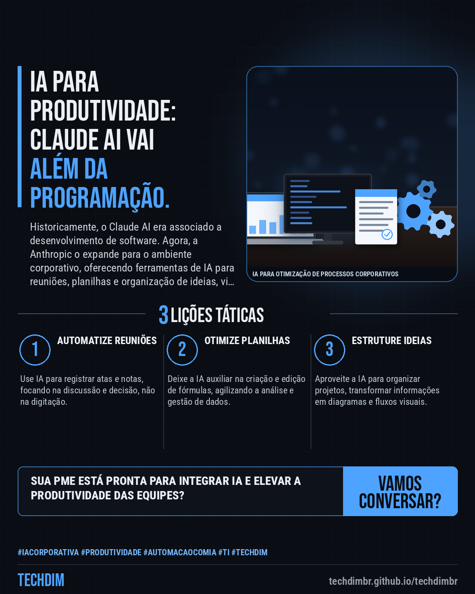

# Notícias de Tecnologia — Claude AI: Novas ferramentas de produtividade para empresas em fase beta

- **Data:** 2026-11-11, 15:39 (horário de Brasília)
- **Curadoria:** Claude (Routine) — pauta do dia
- **Execução no Actions:** https://github.com/Techdimbr/Publi-midia-Techdim/actions/runs/43079677055
- **Por que esta pauta:** Este assunto é relevante hoje pela constante evolução das ferramentas de IA e seu impacto direto na eficiência operacional das empresas.

## Resultado

| Rede | Status | Link | 1º comentário |
|---|---|---|---|
| linkedin | ✅ publicado | https://www.linkedin.com/feed/update/urn:li:share:7526352746971742208/ | — |
| facebook | ✅ publicado | https://www.facebook.com/122132402349390486/posts/122143148109390486 | ✅ |
| instagram | ✅ publicado | https://www.instagram.com/p/DfnJO_gl_r6/ | ✅ |
| Stories | ✅ publicado | https://www.instagram.com/stories/techdimbr/4028229126184193306 | — |

## Fontes

- [tecnoblog.net](https://tecnoblog.net/noticias/alem-de-programacao-claude-ganha-ferramentas-para-reunioes-planilhas-e-e-ideias/)

## Linkedin

```text
Claude AI: Novas ferramentas de produtividade para empresas em fase beta

01. A Anthropic lançou Claude Meetings, Claude Sheets e Claude Whiteboards, expandindo o assistente Claude para tarefas de escritório, atualmente em fase beta.
02. O Claude Meetings atua no Google Meet para registrar atas e notas, enquanto o Claude Sheets auxilia na criação e edição de planilhas complexas.
03. O Claude Whiteboards organiza ideias e projetos, transformando informações em diagramas e fluxos, lembrando plataformas como Miro e Lucid.

A TECHDIM projeta e implementa soluções de automação com IA, infraestrutura e software sob medida para otimizar a produtividade da sua PME.

Fontes: https://tecnoblog.net/noticias/alem-de-programacao-claude-ganha-ferramentas-para-reunioes-planilhas-e-e-ideias/

TECHDIM — Infraestrutura · Segurança · IA
https://techdimbr.github.io/techdimbr/

#IACorporativa #Produtividade #AutomacaoComIA #TI #TECHDIM
```



## Facebook

```text
Claude AI: Novas ferramentas de produtividade para empresas em fase beta

• A Anthropic lançou Claude Meetings, Claude Sheets e Claude Whiteboards, expandindo o assistente Claude para tarefas de escritório, atualmente em fase beta.
• O Claude Meetings atua no Google Meet para registrar atas e notas, enquanto o Claude Sheets auxilia na criação e edição de planilhas complexas.
• O Claude Whiteboards organiza ideias e projetos, transformando informações em diagramas e fluxos, lembrando plataformas como Miro e Lucid.

A TECHDIM projeta e implementa soluções de automação com IA, infraestrutura e software sob medida para otimizar a produtividade da sua PME.

Fale com a TECHDIM — fontes e site no primeiro comentário 👇

#IACorporativa #Produtividade #AutomacaoComIA #TECHDIM
```

Primeiro comentário:

```text
📎 Fontes:
• tecnoblog.net: https://tecnoblog.net/noticias/alem-de-programacao-claude-ganha-ferramentas-para-reunioes-planilhas-e-e-ideias/

🌐 TECHDIM — Infraestrutura · Segurança · IA: https://techdimbr.github.io/techdimbr/
```


## Instagram

```text
Claude AI: Novas ferramentas de produtividade para empresas em fase beta

1️⃣ A Anthropic lançou Claude Meetings, Claude Sheets e Claude Whiteboards, expandindo o assistente Claude para tarefas de escritório, atualmente em fase beta.
2️⃣ O Claude Meetings atua no Google Meet para registrar atas e notas, enquanto o Claude Sheets auxilia na criação e edição de planilhas complexas.
3️⃣ O Claude Whiteboards organiza ideias e projetos, transformando informações em diagramas e fluxos, lembrando plataformas como Miro e Lucid.

A TECHDIM projeta e implementa soluções de automação com IA, infraestrutura e software sob medida para otimizar a produtividade da sua PME.

🔗 Link na bio: techdimbr.github.io/techdimbr
Fontes no primeiro comentário 👇

#iacorporativa #produtividade #automacaocomia #ti #techdim #tecnologia #inteligenciaartificial #ia
```

Primeiro comentário:

```text
📎 Fontes: tecnoblog.net
```


## Stories


