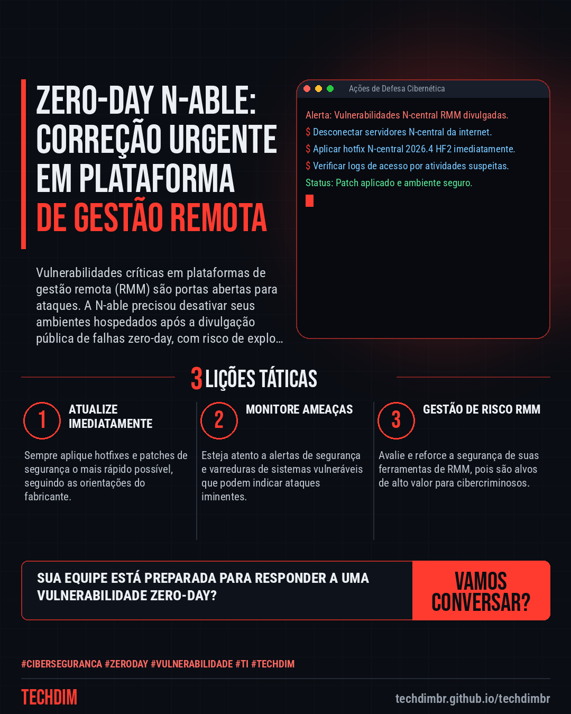
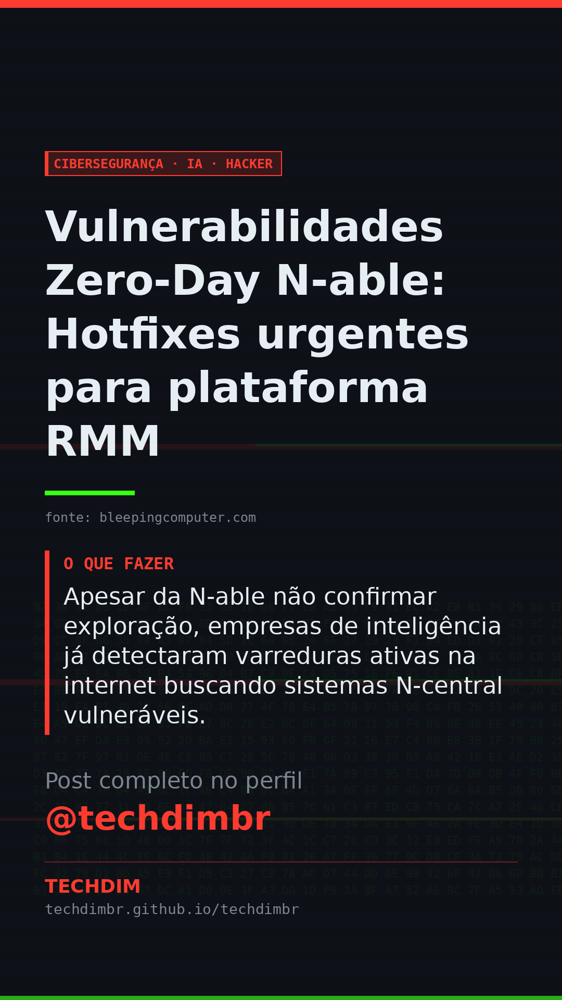

# Cibersegurança · IA · Hacker — Vulnerabilidades Zero-Day N-able: Hotfixes urgentes para plataforma RMM

- **Data:** 2026-11-11, 18:16 (horário de Brasília)
- **Curadoria:** Claude (Routine) — pauta do dia
- **Execução no Actions:** https://github.com/Techdimbr/Publi-midia-Techdim/actions/runs/43101484691
- **Por que esta pauta:** Este incidente realça a urgência de gerenciar e aplicar patches de segurança em plataformas de monitoramento e gestão remota.

## Resultado

| Rede | Status | Link | 1º comentário |
|---|---|---|---|
| linkedin | ✅ publicado | https://www.linkedin.com/feed/update/urn:li:share:7526392301045153793/ | — |
| facebook | ✅ publicado | https://www.facebook.com/122132402349390486/posts/122143175169390486 | ✅ |
| instagram | ✅ publicado | https://www.instagram.com/p/DfnbOI6D9Tn/ | ✅ |
| Stories | ✅ publicado | https://www.instagram.com/stories/techdimbr/4028308217905770310 | — |

## Fontes

- [bleepingcomputer.com](https://www.bleepingcomputer.com/news/security/n-able-releases-security-hotfixes-for-zero-day-vulnerabilities/)

## Linkedin

```text
Vulnerabilidades Zero-Day N-able: Hotfixes urgentes para plataforma RMM

01. A N-able lançou hotfixes de segurança para vulnerabilidades zero-day críticas em sua plataforma N-central RMM, forçando a desativação de ambientes hospedados.
02. As falhas, que incluem RCE e bypass de autenticação, foram divulgadas publicamente por um pesquisador, com PoC disponível no GitHub antes da correção.
03. Apesar da N-able não confirmar exploração, empresas de inteligência já detectaram varreduras ativas na internet buscando sistemas N-central vulneráveis.

A TECHDIM atua na defesa proativa de sua infraestrutura, garantindo que vulnerabilidades sejam mitigadas antes de se tornarem incidentes.

Fontes: https://www.bleepingcomputer.com/news/security/n-able-releases-security-hotfixes-for-zero-day-vulnerabilities/

TECHDIM — Infraestrutura · Segurança · IA
https://techdimbr.github.io/techdimbr/

#Ciberseguranca #ZeroDay #Vulnerabilidade #TI #TECHDIM
```



## Facebook

```text
Vulnerabilidades Zero-Day N-able: Hotfixes urgentes para plataforma RMM

• A N-able lançou hotfixes de segurança para vulnerabilidades zero-day críticas em sua plataforma N-central RMM, forçando a desativação de ambientes hospedados.
• As falhas, que incluem RCE e bypass de autenticação, foram divulgadas publicamente por um pesquisador, com PoC disponível no GitHub antes da correção.
• Apesar da N-able não confirmar exploração, empresas de inteligência já detectaram varreduras ativas na internet buscando sistemas N-central vulneráveis.

A TECHDIM atua na defesa proativa de sua infraestrutura, garantindo que vulnerabilidades sejam mitigadas antes de se tornarem incidentes.

Fale com a TECHDIM — fontes e site no primeiro comentário 👇

#Ciberseguranca #ZeroDay #Vulnerabilidade #TECHDIM
```

Primeiro comentário:

```text
📎 Fontes:
• bleepingcomputer.com: https://www.bleepingcomputer.com/news/security/n-able-releases-security-hotfixes-for-zero-day-vulnerabilities/

🌐 TECHDIM — Infraestrutura · Segurança · IA: https://techdimbr.github.io/techdimbr/
```


## Instagram

```text
Vulnerabilidades Zero-Day N-able: Hotfixes urgentes para plataforma RMM

1️⃣ A N-able lançou hotfixes de segurança para vulnerabilidades zero-day críticas em sua plataforma N-central RMM, forçando a desativação de ambientes hospedados.
2️⃣ As falhas, que incluem RCE e bypass de autenticação, foram divulgadas publicamente por um pesquisador, com PoC disponível no GitHub antes da correção.
3️⃣ Apesar da N-able não confirmar exploração, empresas de inteligência já detectaram varreduras ativas na internet buscando sistemas N-central vulneráveis.

A TECHDIM atua na defesa proativa de sua infraestrutura, garantindo que vulnerabilidades sejam mitigadas antes de se tornarem incidentes.

🔗 Link na bio: techdimbr.github.io/techdimbr
Fontes no primeiro comentário 👇

#ciberseguranca #zeroday #vulnerabilidade #ti #techdim #seguranca #hacker #infraestrutura
```

Primeiro comentário:

```text
📎 Fontes: bleepingcomputer.com
```


## Stories


