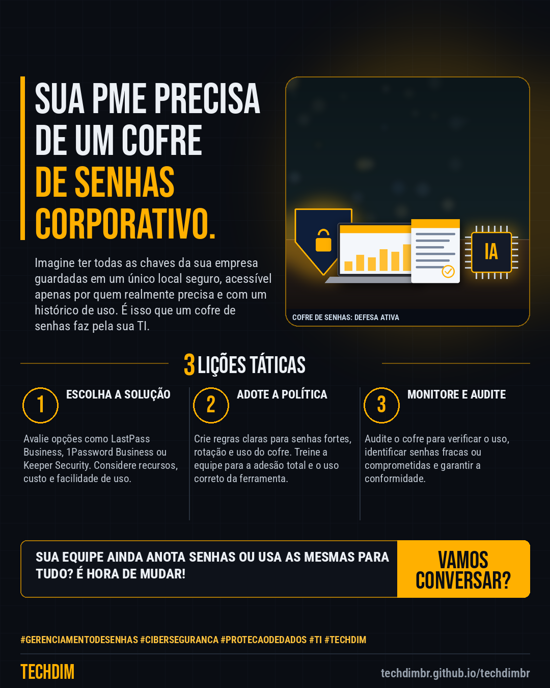

# Conhecimento — GERENCIAMENTO DE SENHAS: Cofre corporativo é essencial para a segurança da sua PME

- **Data:** 2026-11-11, 20:30 (horário de Brasília)
- **Curadoria:** Claude (Routine) — pauta do dia
- **Execução no Actions:** https://github.com/Techdimbr/Publi-midia-Techdim/actions/runs/43120248296
- **Por que esta pauta:** Este assunto é crucial hoje para garantir a integridade e a continuidade das operações da sua empresa.

## Resultado

| Rede | Status | Link | 1º comentário |
|---|---|---|---|
| linkedin | ✅ publicado | https://www.linkedin.com/feed/update/urn:li:share:7526426107844182017/ | — |
| facebook | ✅ publicado | https://www.facebook.com/122132402349390486/posts/122143229211390486 | ✅ |
| instagram | ✅ publicado | https://www.instagram.com/p/DfnqmqiG6Sp/ | — |

## Linkedin

```text
GERENCIAMENTO DE SENHAS: Cofre corporativo é essencial para a segurança da sua PME

01. Senhas fracas ou reutilizadas são portas de entrada comuns para ciberataques, expondo dados e sistemas críticos da sua PME.
02. Um cofre de senhas corporativo centraliza credenciais, forçando senhas fortes e únicas para cada serviço, reduzindo drasticamente o risco.
03. Além da segurança, otimiza o acesso da equipe a sistemas essenciais, eliminando a perda de tempo com redefinições e compartilhamento inseguro.

A TECHDIM oferece soluções de governança de dados e cibersegurança defensiva para proteger as credenciais da sua PME.

TECHDIM — Infraestrutura · Segurança · IA
https://techdimbr.github.io/techdimbr/

#GerenciamentoDeSenhas #Ciberseguranca #ProtecaoDeDados #TI #TECHDIM
```



## Facebook

```text
GERENCIAMENTO DE SENHAS: Cofre corporativo é essencial para a segurança da sua PME

• Senhas fracas ou reutilizadas são portas de entrada comuns para ciberataques, expondo dados e sistemas críticos da sua PME.
• Um cofre de senhas corporativo centraliza credenciais, forçando senhas fortes e únicas para cada serviço, reduzindo drasticamente o risco.
• Além da segurança, otimiza o acesso da equipe a sistemas essenciais, eliminando a perda de tempo com redefinições e compartilhamento inseguro.

A TECHDIM oferece soluções de governança de dados e cibersegurança defensiva para proteger as credenciais da sua PME.

Fale com a TECHDIM — link no primeiro comentário 👇

#GerenciamentoDeSenhas #Ciberseguranca #ProtecaoDeDados #TECHDIM
```

Primeiro comentário:

```text
🌐 TECHDIM — Infraestrutura · Segurança · IA: https://techdimbr.github.io/techdimbr/
```


## Instagram

```text
GERENCIAMENTO DE SENHAS: Cofre corporativo é essencial para a segurança da sua PME

1️⃣ Senhas fracas ou reutilizadas são portas de entrada comuns para ciberataques, expondo dados e sistemas críticos da sua PME.
2️⃣ Um cofre de senhas corporativo centraliza credenciais, forçando senhas fortes e únicas para cada serviço, reduzindo drasticamente o risco.
3️⃣ Além da segurança, otimiza o acesso da equipe a sistemas essenciais, eliminando a perda de tempo com redefinições e compartilhamento inseguro.

A TECHDIM oferece soluções de governança de dados e cibersegurança defensiva para proteger as credenciais da sua PME.

🔗 Link na bio: techdimbr.github.io/techdimbr

#gerenciamentodesenhas #ciberseguranca #protecaodedados #ti #techdim #conhecimento #aprendati #tecnologia
```


