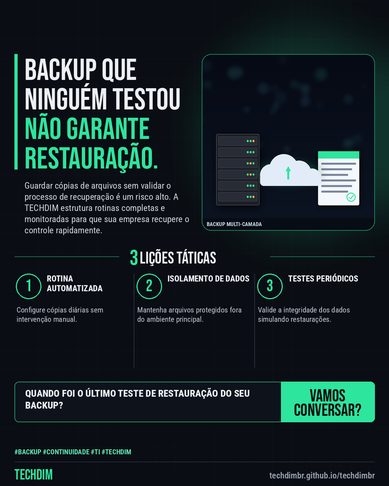

# TECHDIM · Serviços — Backup gerenciado: garanta que sua PME consiga recuperar dados e operar após falhas

- **Data:** 2026-11-11, 22:57 (horário de Brasília)
- **Curadoria:** Claude (Routine) — pauta do dia
- **Execução no Actions:** https://github.com/Techdimbr/Publi-midia-Techdim/actions/runs/43137908043
- **Por que esta pauta:** A garantia de recuperação de dados é vital para a sobrevivência de PMEs diante de imprevistos técnicos.

## Resultado

| Rede | Status | Link | 1º comentário |
|---|---|---|---|
| linkedin | ✅ publicado | https://www.linkedin.com/feed/update/urn:li:share:7526462991098208256/ | — |
| facebook | ✅ publicado | https://www.facebook.com/122132402349390486/posts/122143249173390486 | ✅ |
| instagram | ✅ publicado | https://www.instagram.com/p/Dfn7X9BlbsT/ | — |

## Linkedin

```text
Backup gerenciado: garanta que sua PME consiga recuperar dados e operar após falhas

01. Empresas frequentemente acumulam cópias de segurança sem nunca validar se os arquivos corrompidos podem ser restaurados com integridade.
02. A engenharia da TECHDIM implementa rotinas de backup gerenciado com testes periódicos de recuperação para blindar a continuidade do seu negócio.
03. Monitore o status dos seus dados críticos e evite surpresas desagradáveis quando o imprevisto técnico acontecer na sua operação.

Conheça o backup gerenciado da TECHDIM em techdimbr.github.io/techdimbr.

TECHDIM — Infraestrutura · Segurança · IA
https://techdimbr.github.io/techdimbr/

#Backup #Continuidade #TI #TECHDIM #InfraestruturaDeTI
```



## Facebook

```text
Backup gerenciado: garanta que sua PME consiga recuperar dados e operar após falhas

• Empresas frequentemente acumulam cópias de segurança sem nunca validar se os arquivos corrompidos podem ser restaurados com integridade.
• A engenharia da TECHDIM implementa rotinas de backup gerenciado com testes periódicos de recuperação para blindar a continuidade do seu negócio.
• Monitore o status dos seus dados críticos e evite surpresas desagradáveis quando o imprevisto técnico acontecer na sua operação.

Conheça o backup gerenciado da TECHDIM em techdimbr.github.io/techdimbr.

Fale com a TECHDIM — link no primeiro comentário 👇

#Backup #Continuidade #TI #TECHDIM
```

Primeiro comentário:

```text
🌐 TECHDIM — Infraestrutura · Segurança · IA: https://techdimbr.github.io/techdimbr/
```


## Instagram

```text
Backup gerenciado: garanta que sua PME consiga recuperar dados e operar após falhas

1️⃣ Empresas frequentemente acumulam cópias de segurança sem nunca validar se os arquivos corrompidos podem ser restaurados com integridade.
2️⃣ A engenharia da TECHDIM implementa rotinas de backup gerenciado com testes periódicos de recuperação para blindar a continuidade do seu negócio.
3️⃣ Monitore o status dos seus dados críticos e evite surpresas desagradáveis quando o imprevisto técnico acontecer na sua operação.

Conheça o backup gerenciado da TECHDIM em techdimbr.github.io/techdimbr.

🔗 Link na bio: techdimbr.github.io/techdimbr

#backup #continuidade #ti #techdim #suportetecnico #ciberseguranca #automacao #campinas
```


