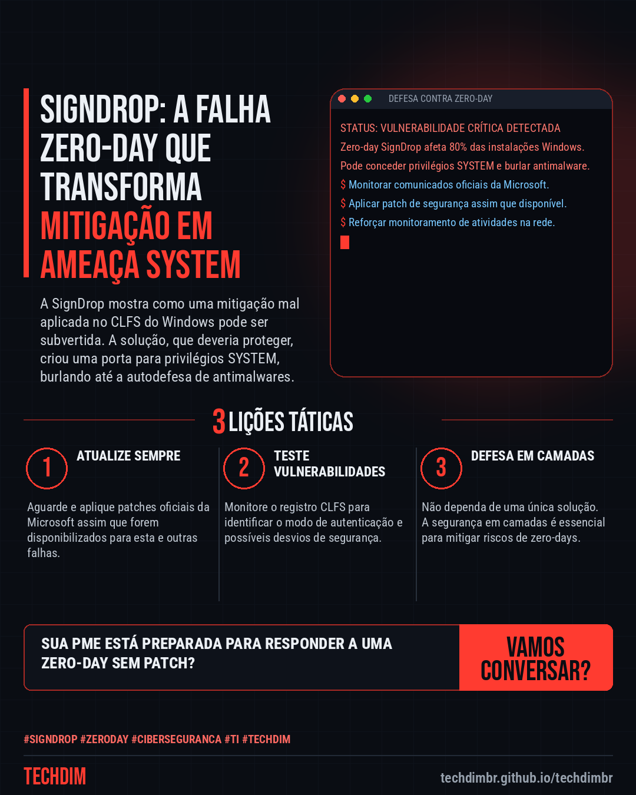
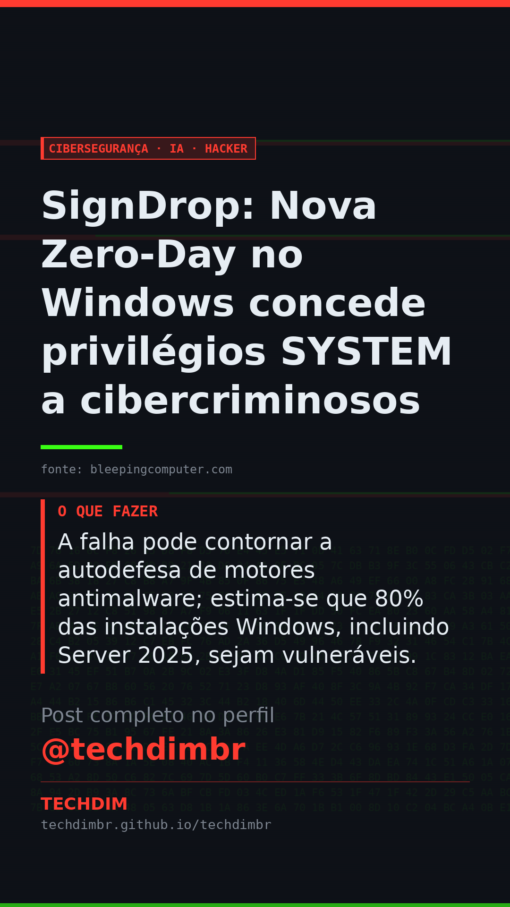

# Cibersegurança · IA · Hacker — SignDrop: Nova Zero-Day no Windows concede privilégios SYSTEM a cibercriminosos

- **Data:** 2026-11-12, 18:25 (horário de Brasília)
- **Curadoria:** Claude (Routine) — pauta do dia
- **Execução no Actions:** https://github.com/Techdimbr/Publi-midia-Techdim/actions/runs/43309969621
- **Por que esta pauta:** Zero-days como a SignDrop representam ameaças críticas que exigem atenção imediata e estratégias de defesa robustas.

## Resultado

| Rede | Status | Link | 1º comentário |
|---|---|---|---|
| linkedin | ✅ publicado | https://www.linkedin.com/feed/update/urn:li:share:7526756984717606912/ | — |
| facebook | ✅ publicado | https://www.facebook.com/122132402349390486/posts/122143495143390486 | ✅ |
| instagram | ✅ publicado | https://www.instagram.com/p/DfqBD59ibrh/ | ✅ |
| Stories | ✅ publicado | https://www.instagram.com/stories/techdimbr/4029037622797647869 | — |

## Fontes

- [bleepingcomputer.com](https://www.bleepingcomputer.com/news/security/new-windows-signdrop-zero-day-gives-hackers-system-privileges/)

## Linkedin

```text
SignDrop: Nova Zero-Day no Windows concede privilégios SYSTEM a cibercriminosos

01. A zero-day SignDrop permite a atacantes obter privilégios SYSTEM no Windows ao explorar uma falha na mitigação do componente CLFS.
02. A vulnerabilidade engana processos privilegiados, como o Windows Defender, forçando a criação de arquivos com acesso total ao sistema.
03. A falha pode contornar a autodefesa de motores antimalware; estima-se que 80% das instalações Windows, incluindo Server 2025, sejam vulneráveis.

A TECHDIM provê cibersegurança defensiva para identificar e mitigar vulnerabilidades críticas antes de explorações.

Fontes: https://www.bleepingcomputer.com/news/security/new-windows-signdrop-zero-day-gives-hackers-system-privileges/

TECHDIM — Infraestrutura · Segurança · IA
https://techdimbr.github.io/techdimbr/

#SignDrop #ZeroDay #Ciberseguranca #TI #TECHDIM
```



## Facebook

```text
SignDrop: Nova Zero-Day no Windows concede privilégios SYSTEM a cibercriminosos

• A zero-day SignDrop permite a atacantes obter privilégios SYSTEM no Windows ao explorar uma falha na mitigação do componente CLFS.
• A vulnerabilidade engana processos privilegiados, como o Windows Defender, forçando a criação de arquivos com acesso total ao sistema.
• A falha pode contornar a autodefesa de motores antimalware; estima-se que 80% das instalações Windows, incluindo Server 2025, sejam vulneráveis.

A TECHDIM provê cibersegurança defensiva para identificar e mitigar vulnerabilidades críticas antes de explorações.

Fale com a TECHDIM — fontes e site no primeiro comentário 👇

#SignDrop #ZeroDay #Ciberseguranca #TECHDIM
```

Primeiro comentário:

```text
📎 Fontes:
• bleepingcomputer.com: https://www.bleepingcomputer.com/news/security/new-windows-signdrop-zero-day-gives-hackers-system-privileges/

🌐 TECHDIM — Infraestrutura · Segurança · IA: https://techdimbr.github.io/techdimbr/
```


## Instagram

```text
SignDrop: Nova Zero-Day no Windows concede privilégios SYSTEM a cibercriminosos

1️⃣ A zero-day SignDrop permite a atacantes obter privilégios SYSTEM no Windows ao explorar uma falha na mitigação do componente CLFS.
2️⃣ A vulnerabilidade engana processos privilegiados, como o Windows Defender, forçando a criação de arquivos com acesso total ao sistema.
3️⃣ A falha pode contornar a autodefesa de motores antimalware; estima-se que 80% das instalações Windows, incluindo Server 2025, sejam vulneráveis.

A TECHDIM provê cibersegurança defensiva para identificar e mitigar vulnerabilidades críticas antes de explorações.

🔗 Link na bio: techdimbr.github.io/techdimbr
Fontes no primeiro comentário 👇

#signdrop #zeroday #ciberseguranca #ti #techdim #seguranca #hacker #infraestrutura
```

Primeiro comentário:

```text
📎 Fontes: bleepingcomputer.com
```


## Stories


