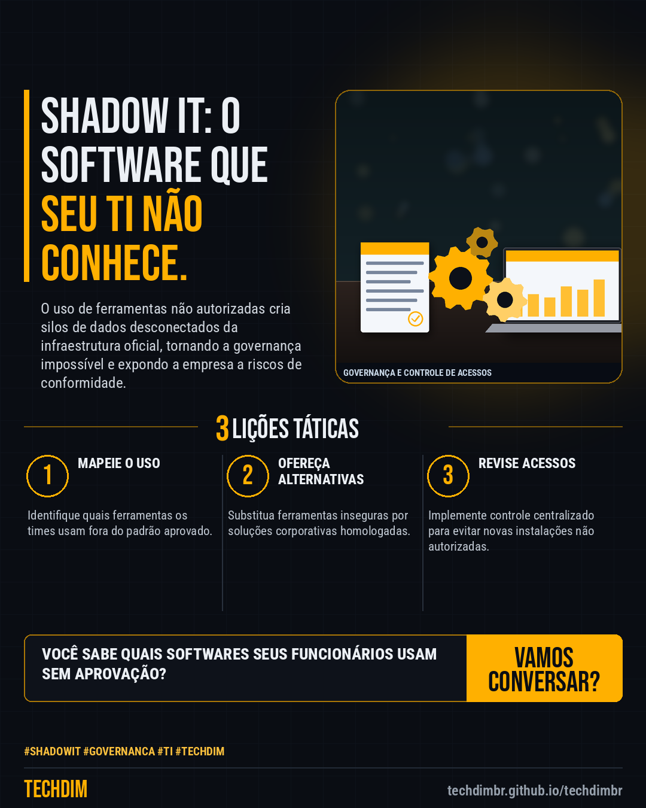

# Conhecimento — Shadow IT: o risco invisível que pode estar rodando na sua empresa hoje

- **Data:** 2026-11-12, 19:46 (horário de Brasília)
- **Curadoria:** Claude (Routine) — pauta do dia
- **Execução no Actions:** https://github.com/Techdimbr/Publi-midia-Techdim/actions/runs/43322891708
- **Por que esta pauta:** A proliferação de ferramentas não homologadas aumenta exponencialmente a superfície de ataque em PMEs.

## Resultado

| Rede | Status | Link | 1º comentário |
|---|---|---|---|
| linkedin | ✅ publicado | https://www.linkedin.com/feed/update/urn:li:share:7526777427365130240/ | — |
| facebook | ✅ publicado | https://www.facebook.com/122132402349390486/posts/122143509357390486 | ✅ |
| instagram | ✅ publicado | https://www.instagram.com/p/DfqKW-cjQuL/ | — |

## Linkedin

```text
Shadow IT: o risco invisível que pode estar rodando na sua empresa hoje

01. Shadow IT ocorre quando colaboradores utilizam softwares, nuvens ou dispositivos não aprovados pelo TI para realizar tarefas corporativas.
02. A falta de visibilidade sobre essas ferramentas impede a gestão de acessos, o controle de dados sensíveis e a aplicação de políticas de segurança.
03. Identificar e centralizar essas aplicações é a única forma de mitigar vazamentos e garantir a conformidade com a LGPD na sua operação.

A TECHDIM auxilia sua gestão a mapear e integrar ferramentas de forma segura e eficiente.

TECHDIM — Infraestrutura · Segurança · IA
https://techdimbr.github.io/techdimbr/

#ShadowIT #Governanca #TI #TECHDIM #Conhecimento
```



## Facebook

```text
Shadow IT: o risco invisível que pode estar rodando na sua empresa hoje

• Shadow IT ocorre quando colaboradores utilizam softwares, nuvens ou dispositivos não aprovados pelo TI para realizar tarefas corporativas.
• A falta de visibilidade sobre essas ferramentas impede a gestão de acessos, o controle de dados sensíveis e a aplicação de políticas de segurança.
• Identificar e centralizar essas aplicações é a única forma de mitigar vazamentos e garantir a conformidade com a LGPD na sua operação.

A TECHDIM auxilia sua gestão a mapear e integrar ferramentas de forma segura e eficiente.

Fale com a TECHDIM — link no primeiro comentário 👇

#ShadowIT #Governanca #TI #TECHDIM
```

Primeiro comentário:

```text
🌐 TECHDIM — Infraestrutura · Segurança · IA: https://techdimbr.github.io/techdimbr/
```


## Instagram

```text
Shadow IT: o risco invisível que pode estar rodando na sua empresa hoje

1️⃣ Shadow IT ocorre quando colaboradores utilizam softwares, nuvens ou dispositivos não aprovados pelo TI para realizar tarefas corporativas.
2️⃣ A falta de visibilidade sobre essas ferramentas impede a gestão de acessos, o controle de dados sensíveis e a aplicação de políticas de segurança.
3️⃣ Identificar e centralizar essas aplicações é a única forma de mitigar vazamentos e garantir a conformidade com a LGPD na sua operação.

A TECHDIM auxilia sua gestão a mapear e integrar ferramentas de forma segura e eficiente.

🔗 Link na bio: techdimbr.github.io/techdimbr

#shadowit #governanca #ti #techdim #conhecimento #aprendati #tecnologia #ciberseguranca
```


