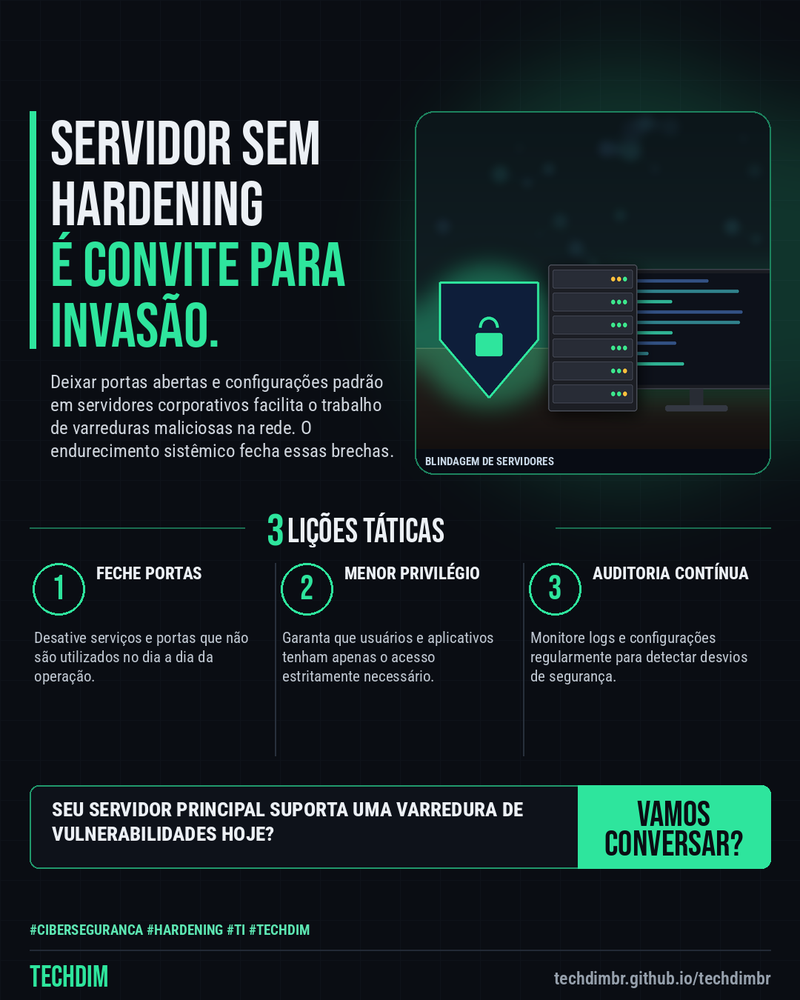

# TECHDIM · Serviços — HARDENING DE SERVIDORES: Blindagem técnica para proteger os ativos críticos da sua PME

- **Data:** 2026-11-12, 22:15 (horário de Brasília)
- **Curadoria:** Claude (Routine) — pauta do dia
- **Execução no Actions:** https://github.com/Techdimbr/Publi-midia-Techdim/actions/runs/43343436911
- **Por que esta pauta:** A blindagem de servidores e estações é indispensável para conter explorações automatizadas e acessos não autorizados em PMEs.

## Resultado

| Rede | Status | Link | 1º comentário |
|---|---|---|---|
| linkedin | ✅ publicado | https://www.linkedin.com/feed/update/urn:li:share:7526814887432536064/ | — |
| facebook | ✅ publicado | https://www.facebook.com/122132402349390486/posts/122143552131390486 | ✅ |
| instagram | ✅ publicado | https://www.instagram.com/p/DfqbZRXjRQ9/ | — |

## Linkedin

```text
HARDENING DE SERVIDORES: Blindagem técnica para proteger os ativos críticos da sua PME

01. Servidores e estações de trabalho mal configurados expõem portas, serviços desnecessários e credenciais padrão a invasões.
02. O processo de hardening da TECHDIM remove brechas nativas, restringe privilégios e aplica protocolos rígidos de acesso.
03. A blindagem estrutural eleva a resiliência do ambiente corporativo frente a varreduras automatizadas e tentativas de intrusão.

A engenharia da TECHDIM aplica diretrizes avançadas de hardening na sua infraestrutura. Visite o portal oficial.

TECHDIM — Infraestrutura · Segurança · IA
https://techdimbr.github.io/techdimbr/

#Ciberseguranca #Hardening #TI #TECHDIM #InfraestruturaDeTI
```



## Facebook

```text
HARDENING DE SERVIDORES: Blindagem técnica para proteger os ativos críticos da sua PME

• Servidores e estações de trabalho mal configurados expõem portas, serviços desnecessários e credenciais padrão a invasões.
• O processo de hardening da TECHDIM remove brechas nativas, restringe privilégios e aplica protocolos rígidos de acesso.
• A blindagem estrutural eleva a resiliência do ambiente corporativo frente a varreduras automatizadas e tentativas de intrusão.

A engenharia da TECHDIM aplica diretrizes avançadas de hardening na sua infraestrutura. Visite o portal oficial.

Fale com a TECHDIM — link no primeiro comentário 👇

#Ciberseguranca #Hardening #TI #TECHDIM
```

Primeiro comentário:

```text
🌐 TECHDIM — Infraestrutura · Segurança · IA: https://techdimbr.github.io/techdimbr/
```


## Instagram

```text
HARDENING DE SERVIDORES: Blindagem técnica para proteger os ativos críticos da sua PME

1️⃣ Servidores e estações de trabalho mal configurados expõem portas, serviços desnecessários e credenciais padrão a invasões.
2️⃣ O processo de hardening da TECHDIM remove brechas nativas, restringe privilégios e aplica protocolos rígidos de acesso.
3️⃣ A blindagem estrutural eleva a resiliência do ambiente corporativo frente a varreduras automatizadas e tentativas de intrusão.

A engenharia da TECHDIM aplica diretrizes avançadas de hardening na sua infraestrutura. Visite o portal oficial.

🔗 Link na bio: techdimbr.github.io/techdimbr

#ciberseguranca #hardening #ti #techdim #suportetecnico #automacao #campinas
```


