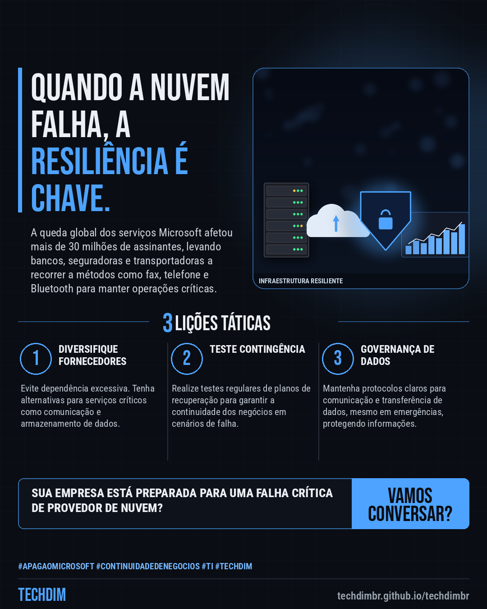
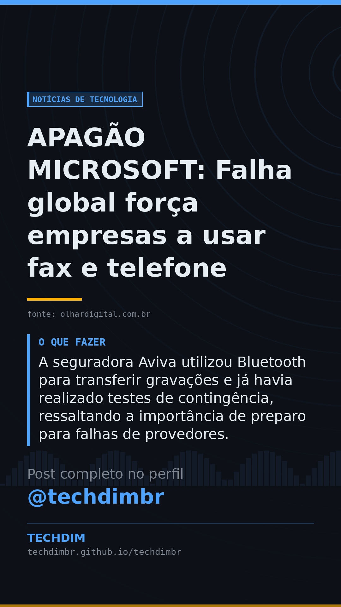

# Notícias de Tecnologia — APAGÃO MICROSOFT: Falha global força empresas a usar fax e telefone

- **Data:** 2026-11-13, 15:30 (horário de Brasília)
- **Curadoria:** Claude (Routine) — pauta do dia
- **Execução no Actions:** https://github.com/Techdimbr/Publi-midia-Techdim/actions/runs/43483084649
- **Por que esta pauta:** O incidente ressalta a importância de planos de contingência e diversificação de fornecedores para a continuidade dos negócios.

## Resultado

| Rede | Status | Link | 1º comentário |
|---|---|---|---|
| linkedin | ✅ publicado | https://www.linkedin.com/feed/update/urn:li:share:7527075239688597504/ | — |
| facebook | ✅ publicado | https://www.facebook.com/122132402349390486/posts/122143729419390486 | ✅ |
| instagram | ✅ publicado | https://www.instagram.com/p/DfsRy-Bj1Oz/ | ✅ |
| Stories | ✅ publicado | https://www.instagram.com/stories/techdimbr/4029674185731044946 | — |

## Fontes

- [olhardigital.com.br](https://olhardigital.com.br/2026/11/13/internet-e-redes-sociais/qual-a-ultima-vez-que-voce-usou-um-fax-no-apagao-da-microsoft-empresas-voltaram-ao-passado/)

## Linkedin

```text
APAGÃO MICROSOFT: Falha global força empresas a usar fax e telefone

01. A interrupção dos serviços Microsoft afetou mais de 30 milhões de assinantes, obrigando empresas a recorrer a fax, telefone e Bluetooth para manter operações críticas.
02. Bancos em Taiwan usaram fax para validar operações com títulos de curto prazo, enquanto Euronext e Maersk orientaram clientes a usar o telefone para comunicações urgentes.
03. A seguradora Aviva utilizou Bluetooth para transferir gravações e já havia realizado testes de contingência, ressaltando a importância de preparo para falhas de provedores.

A TECHDIM fortalece sua infraestrutura com resiliência, cibersegurança e planos de contingência para evitar paralisações.

Fontes: https://olhardigital.com.br/2026/11/13/internet-e-redes-sociais/qual-a-ultima-vez-que-voce-usou-um-fax-no-apagao-da-microsoft-empresas-voltaram-ao-passado/

TECHDIM — Infraestrutura · Segurança · IA
https://techdimbr.github.io/techdimbr/

#ApagaoMicrosoft #ContinuidadeDeNegocios #TI #TECHDIM #Tecnologia
```



## Facebook

```text
APAGÃO MICROSOFT: Falha global força empresas a usar fax e telefone

• A interrupção dos serviços Microsoft afetou mais de 30 milhões de assinantes, obrigando empresas a recorrer a fax, telefone e Bluetooth para manter operações críticas.
• Bancos em Taiwan usaram fax para validar operações com títulos de curto prazo, enquanto Euronext e Maersk orientaram clientes a usar o telefone para comunicações urgentes.
• A seguradora Aviva utilizou Bluetooth para transferir gravações e já havia realizado testes de contingência, ressaltando a importância de preparo para falhas de provedores.

A TECHDIM fortalece sua infraestrutura com resiliência, cibersegurança e planos de contingência para evitar paralisações.

Fale com a TECHDIM — fontes e site no primeiro comentário 👇

#ApagaoMicrosoft #ContinuidadeDeNegocios #TI #TECHDIM
```

Primeiro comentário:

```text
📎 Fontes:
• olhardigital.com.br: https://olhardigital.com.br/2026/11/13/internet-e-redes-sociais/qual-a-ultima-vez-que-voce-usou-um-fax-no-apagao-da-microsoft-empresas-voltaram-ao-passado/

🌐 TECHDIM — Infraestrutura · Segurança · IA: https://techdimbr.github.io/techdimbr/
```


## Instagram

```text
APAGÃO MICROSOFT: Falha global força empresas a usar fax e telefone

1️⃣ A interrupção dos serviços Microsoft afetou mais de 30 milhões de assinantes, obrigando empresas a recorrer a fax, telefone e Bluetooth para manter operações críticas.
2️⃣ Bancos em Taiwan usaram fax para validar operações com títulos de curto prazo, enquanto Euronext e Maersk orientaram clientes a usar o telefone para comunicações urgentes.
3️⃣ A seguradora Aviva utilizou Bluetooth para transferir gravações e já havia realizado testes de contingência, ressaltando a importância de preparo para falhas de provedores.

A TECHDIM fortalece sua infraestrutura com resiliência, cibersegurança e planos de contingência para evitar paralisações.

🔗 Link na bio: techdimbr.github.io/techdimbr
Fontes no primeiro comentário 👇

#apagaomicrosoft #continuidadedenegocios #ti #techdim #tecnologia #inteligenciaartificial #ia #inovacao
```

Primeiro comentário:

```text
📎 Fontes: olhardigital.com.br
```


## Stories


