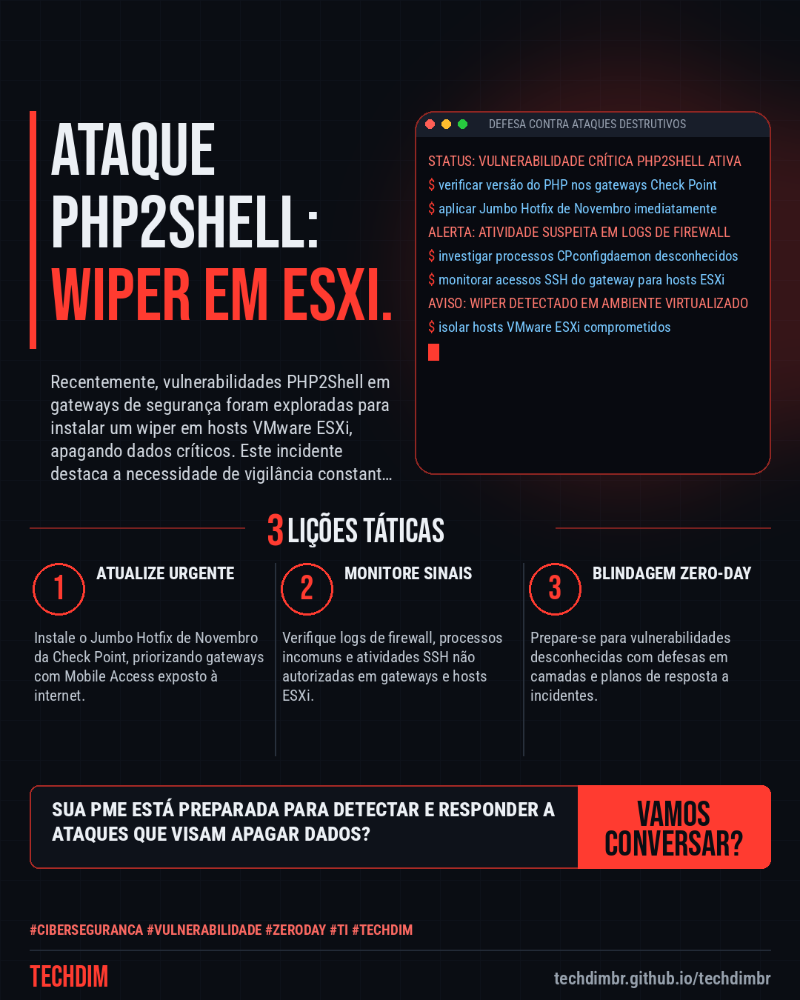

# Cibersegurança · IA · Hacker — Check Point Gateways: Ataques PHP2Shell exploram falhas e instalam wiper em VMware ESXi

- **Data:** 2026-11-13, 17:51 (horário de Brasília)
- **Curadoria:** Claude (Routine) — pauta do dia
- **Execução no Actions:** https://github.com/Techdimbr/Publi-midia-Techdim/actions/runs/43505248423
- **Por que esta pauta:** Este alerta destaca a urgência de manter sistemas atualizados e monitorar ativamente a infraestrutura de TI.

## Resultado

| Rede | Status | Link | 1º comentário |
|---|---|---|---|
| linkedin | ✅ publicado | https://www.linkedin.com/feed/update/urn:li:share:7527110810184171520/ | — |
| facebook | ✅ publicado | https://www.facebook.com/122132402349390486/posts/122143749015390486 | ✅ |
| instagram | ✅ publicado | https://www.instagram.com/p/Dfsh9h6jKJU/ | ✅ |
| Stories | ✅ publicado | https://www.instagram.com/stories/techdimbr/4029745253766200362 | — |

## Fontes

- [bleepingcomputer.com](https://www.bleepingcomputer.com/news/security/check-point-gateways-hacked-via-php2shell-to-deploy-vmware-esxi-wiper/)

## Linkedin

```text
Check Point Gateways: Ataques PHP2Shell exploram falhas e instalam wiper em VMware ESXi

01. Ataques recentes exploraram vulnerabilidades PHP2Shell (CVE-2026-109618, CVE-2026-109619) em gateways Check Point, instalando um wiper destrutivo em hosts VMware ESXi.
02. A exploração inicial via Mobile Access portal foi seguida por escalada de privilégios com uma zero-day (CVE-2026-123039) e uso de webshells para controle e movimentação lateral.
03. A Check Point recomenda aplicar o Jumbo Hotfix de Novembro em Management Servers e Security Gateways, priorizando portais Mobile Access expostos à internet, e monitorar sinais de comprometimento.

A TECHDIM oferece cibersegurança defensiva e governança de dados para proteger sua infraestrutura contra ameaças avançadas como esta.

Fontes: https://www.bleepingcomputer.com/news/security/check-point-gateways-hacked-via-php2shell-to-deploy-vmware-esxi-wiper/

TECHDIM — Infraestrutura · Segurança · IA
https://techdimbr.github.io/techdimbr/

#Ciberseguranca #Vulnerabilidade #ZeroDay #TI #TECHDIM
```



## Facebook

```text
Check Point Gateways: Ataques PHP2Shell exploram falhas e instalam wiper em VMware ESXi

• Ataques recentes exploraram vulnerabilidades PHP2Shell (CVE-2026-109618, CVE-2026-109619) em gateways Check Point, instalando um wiper destrutivo em hosts VMware ESXi.
• A exploração inicial via Mobile Access portal foi seguida por escalada de privilégios com uma zero-day (CVE-2026-123039) e uso de webshells para controle e movimentação lateral.
• A Check Point recomenda aplicar o Jumbo Hotfix de Novembro em Management Servers e Security Gateways, priorizando portais Mobile Access expostos à internet, e monitorar sinais de comprometimento.

A TECHDIM oferece cibersegurança defensiva e governança de dados para proteger sua infraestrutura contra ameaças avançadas como esta.

Fale com a TECHDIM — fontes e site no primeiro comentário 👇

#Ciberseguranca #Vulnerabilidade #ZeroDay #TECHDIM
```

Primeiro comentário:

```text
📎 Fontes:
• bleepingcomputer.com: https://www.bleepingcomputer.com/news/security/check-point-gateways-hacked-via-php2shell-to-deploy-vmware-esxi-wiper/

🌐 TECHDIM — Infraestrutura · Segurança · IA: https://techdimbr.github.io/techdimbr/
```


## Instagram

```text
Check Point Gateways: Ataques PHP2Shell exploram falhas e instalam wiper em VMware ESXi

1️⃣ Ataques recentes exploraram vulnerabilidades PHP2Shell (CVE-2026-109618, CVE-2026-109619) em gateways Check Point, instalando um wiper destrutivo em hosts VMware ESXi.
2️⃣ A exploração inicial via Mobile Access portal foi seguida por escalada de privilégios com uma zero-day (CVE-2026-123039) e uso de webshells para controle e movimentação lateral.
3️⃣ A Check Point recomenda aplicar o Jumbo Hotfix de Novembro em Management Servers e Security Gateways, priorizando portais Mobile Access expostos à internet, e monitorar sinais de comprometimento.

A TECHDIM oferece cibersegurança defensiva e governança de dados para proteger sua infraestrutura contra ameaças avançadas como esta.

🔗 Link na bio: techdimbr.github.io/techdimbr
Fontes no primeiro comentário 👇

#ciberseguranca #vulnerabilidade #zeroday #ti #techdim #seguranca #hacker #infraestrutura
```

Primeiro comentário:

```text
📎 Fontes: bleepingcomputer.com
```


## Stories


