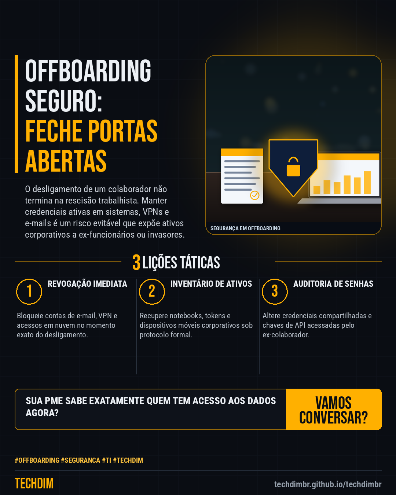

# Conhecimento — Offboarding de colaboradores: como garantir a segurança após o desligamento

- **Data:** 2026-11-13, 19:42 (horário de Brasília)
- **Curadoria:** Claude (Routine) — pauta do dia
- **Execução no Actions:** https://github.com/Techdimbr/Publi-midia-Techdim/actions/runs/43521356685
- **Por que esta pauta:** Muitas empresas falham em revogar acessos de ex-funcionários, criando brechas críticas de segurança.

## Resultado

| Rede | Status | Link | 1º comentário |
|---|---|---|---|
| linkedin | ✅ publicado | https://www.linkedin.com/feed/update/urn:li:share:7527138776997892096/ | — |
| facebook | ✅ publicado | https://www.facebook.com/122132402349390486/posts/122143764609390486 | ✅ |
| instagram | ✅ publicado | https://www.instagram.com/p/Dfsurb3l72p/ | — |

## Linkedin

```text
Offboarding de colaboradores: como garantir a segurança após o desligamento

01. O offboarding estruturado revoga acessos críticos imediatamente após o desligamento de funcionários.
02. Contas corporativas ativas de ex-colaboradores são portas abertas para vazamentos de dados e invasões.
03. A automação do processo reduz falhas humanas e protege o inventário tecnológico da sua PME.

A TECHDIM implementa processos automatizados de offboarding para blindar a sua infraestrutura corporativa.

TECHDIM — Infraestrutura · Segurança · IA
https://techdimbr.github.io/techdimbr/

#Offboarding #Seguranca #TI #TECHDIM #Conhecimento
```



## Facebook

```text
Offboarding de colaboradores: como garantir a segurança após o desligamento

• O offboarding estruturado revoga acessos críticos imediatamente após o desligamento de funcionários.
• Contas corporativas ativas de ex-colaboradores são portas abertas para vazamentos de dados e invasões.
• A automação do processo reduz falhas humanas e protege o inventário tecnológico da sua PME.

A TECHDIM implementa processos automatizados de offboarding para blindar a sua infraestrutura corporativa.

Fale com a TECHDIM — link no primeiro comentário 👇

#Offboarding #Seguranca #TI #TECHDIM
```

Primeiro comentário:

```text
🌐 TECHDIM — Infraestrutura · Segurança · IA: https://techdimbr.github.io/techdimbr/
```


## Instagram

```text
Offboarding de colaboradores: como garantir a segurança após o desligamento

1️⃣ O offboarding estruturado revoga acessos críticos imediatamente após o desligamento de funcionários.
2️⃣ Contas corporativas ativas de ex-colaboradores são portas abertas para vazamentos de dados e invasões.
3️⃣ A automação do processo reduz falhas humanas e protege o inventário tecnológico da sua PME.

A TECHDIM implementa processos automatizados de offboarding para blindar a sua infraestrutura corporativa.

🔗 Link na bio: techdimbr.github.io/techdimbr

#offboarding #seguranca #ti #techdim #conhecimento #aprendati #tecnologia #ciberseguranca
```


