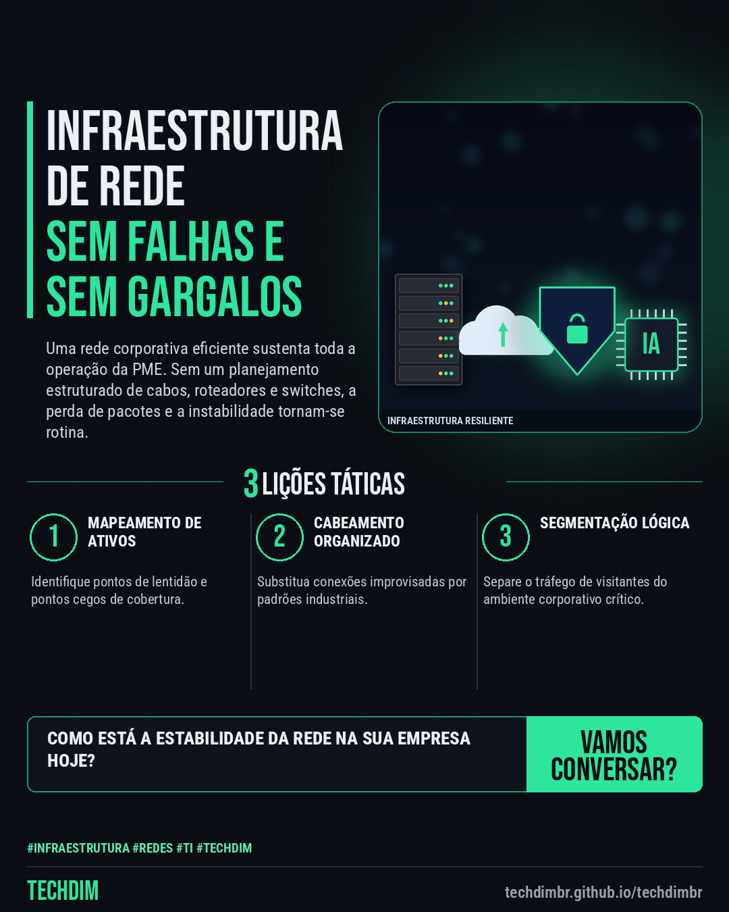

# TECHDIM · Serviços — INFRAESTRUTURA: Construa uma base de redes sólida para a sua PME

- **Data:** 2026-11-13, 21:56 (horário de Brasília)
- **Curadoria:** Claude (Routine) — pauta do dia
- **Execução no Actions:** https://github.com/Techdimbr/Publi-midia-Techdim/actions/runs/43537386308
- **Por que esta pauta:** Empresas frequentemente sofrem com quedas de conexão e lentidão por falta de planejamento adequado na infraestrutura de rede.

## Resultado

| Rede | Status | Link | 1º comentário |
|---|---|---|---|
| linkedin | ✅ publicado | https://www.linkedin.com/feed/update/urn:li:share:7527172564595425280/ | — |
| facebook | ✅ publicado | https://www.facebook.com/122132402349390486/posts/122143802721390486 | ✅ |
| instagram | ✅ publicado | https://www.instagram.com/p/Dfs-DQGE6jG/ | — |

## Linkedin

```text
INFRAESTRUTURA: Construa uma base de redes sólida para a sua PME

01. Redes instáveis e gargalos de hardware reduzem a produtividade diária e geram lentidão sistêmica nas operações da sua empresa.
02. A engenharia da TECHDIM projeta arquiteturas de rede robustas, organizando cabeamento estruturado e switches de alto desempenho.
03. Com uma infraestrutura alinhada às demandas corporativas, sua PME ganha escalabilidade e estabilidade para crescer com segurança.

Conte com a engenharia da TECHDIM para estruturar a rede da sua PME. Acesse techdimbr.github.io/techdimbr.

TECHDIM — Infraestrutura · Segurança · IA
https://techdimbr.github.io/techdimbr/

#Infraestrutura #Redes #TI #TECHDIM #InfraestruturaDeTI
```



## Facebook

```text
INFRAESTRUTURA: Construa uma base de redes sólida para a sua PME

• Redes instáveis e gargalos de hardware reduzem a produtividade diária e geram lentidão sistêmica nas operações da sua empresa.
• A engenharia da TECHDIM projeta arquiteturas de rede robustas, organizando cabeamento estruturado e switches de alto desempenho.
• Com uma infraestrutura alinhada às demandas corporativas, sua PME ganha escalabilidade e estabilidade para crescer com segurança.

Conte com a engenharia da TECHDIM para estruturar a rede da sua PME. Acesse techdimbr.github.io/techdimbr.

Fale com a TECHDIM — link no primeiro comentário 👇

#Infraestrutura #Redes #TI #TECHDIM
```

Primeiro comentário:

```text
🌐 TECHDIM — Infraestrutura · Segurança · IA: https://techdimbr.github.io/techdimbr/
```


## Instagram

```text
INFRAESTRUTURA: Construa uma base de redes sólida para a sua PME

1️⃣ Redes instáveis e gargalos de hardware reduzem a produtividade diária e geram lentidão sistêmica nas operações da sua empresa.
2️⃣ A engenharia da TECHDIM projeta arquiteturas de rede robustas, organizando cabeamento estruturado e switches de alto desempenho.
3️⃣ Com uma infraestrutura alinhada às demandas corporativas, sua PME ganha escalabilidade e estabilidade para crescer com segurança.

Conte com a engenharia da TECHDIM para estruturar a rede da sua PME. Acesse techdimbr.github.io/techdimbr.

🔗 Link na bio: techdimbr.github.io/techdimbr

#infraestrutura #redes #ti #techdim #suportetecnico #ciberseguranca #automacao #campinas
```


