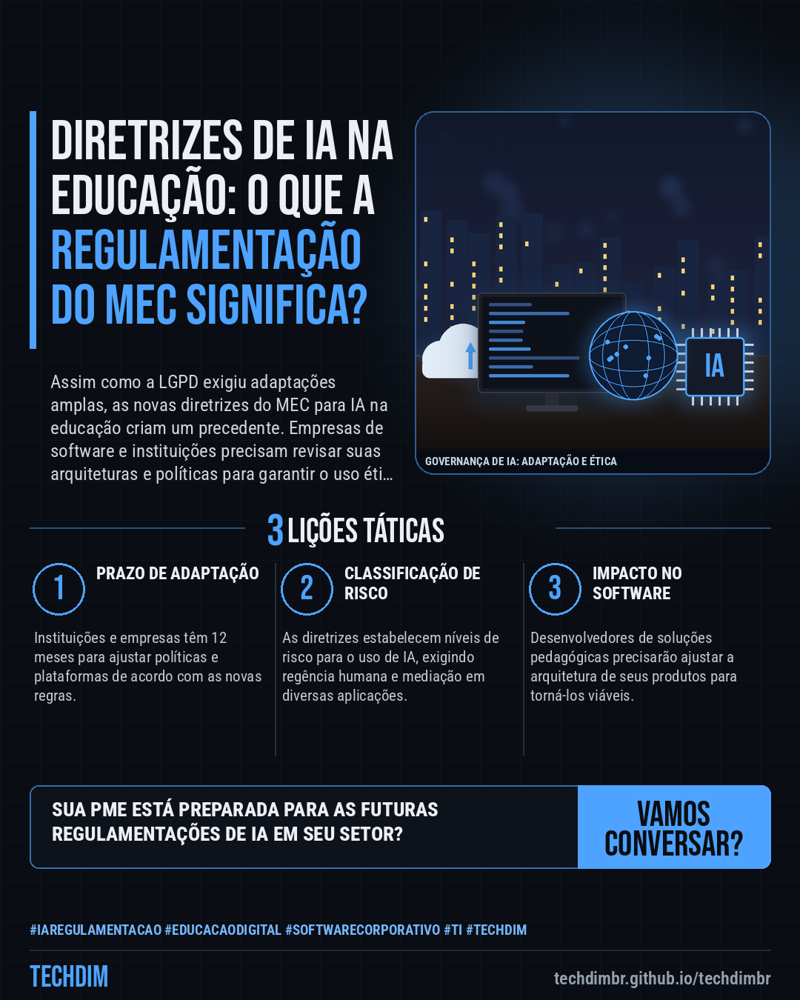
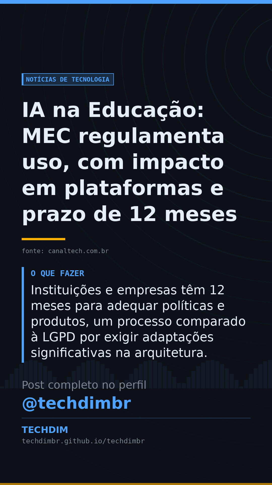

# Notícias de Tecnologia — IA na Educação: MEC regulamenta uso, com impacto em plataformas e prazo de 12 meses

- **Data:** 2026-11-14, 14:01 (horário de Brasília)
- **Curadoria:** Claude (Routine) — pauta do dia
- **Execução no Actions:** https://github.com/Techdimbr/Publi-midia-Techdim/actions/runs/43618737225
- **Por que esta pauta:** A regulamentação de IA na educação sinaliza a crescente necessidade de governança e adaptação tecnológica em todos os setores.

## Resultado

| Rede | Status | Link | 1º comentário |
|---|---|---|---|
| linkedin | ✅ publicado | https://www.linkedin.com/feed/update/urn:li:share:7527415363148386304/ | — |
| facebook | ✅ publicado | https://www.facebook.com/122132402349390486/posts/122144008347390486 | ✅ |
| instagram | ✅ publicado | https://www.instagram.com/p/DfusdUQiYrK/ | ✅ |
| Stories | ✅ publicado | https://www.instagram.com/stories/techdimbr/4030354399766840456 | — |

## Fontes

- [canaltech.com.br](https://canaltech.com.br/inteligencia-artificial/mec-adota-novas-diretrizes-de-uso-de-ia-na-educacao-o-que-muda-na-pratica/)

## Linkedin

```text
IA na Educação: MEC regulamenta uso, com impacto em plataformas e prazo de 12 meses

01. O MEC homologou diretrizes para o uso responsável de IA na educação, estabelecendo regras claras para escolas, universidades e empresas de plataformas pedagógicas.
02. As normas classificam riscos, mantêm a regência humana e proíbem o uso de IA por alunos no ensino infantil, permitindo em níveis superiores com mediação.
03. Instituições e empresas têm 12 meses para adequar políticas e produtos, um processo comparado à LGPD por exigir adaptações significativas na arquitetura.

A TECHDIM auxilia PMEs na adequação a novas regulamentações de IA, com software corporativo sob medida e governança de dados.

Fontes: https://canaltech.com.br/inteligencia-artificial/mec-adota-novas-diretrizes-de-uso-de-ia-na-educacao-o-que-muda-na-pratica/

TECHDIM — Infraestrutura · Segurança · IA
https://techdimbr.github.io/techdimbr/

#IARegulamentacao #EducacaoDigital #SoftwareCorporativo #TI #TECHDIM
```



## Facebook

```text
IA na Educação: MEC regulamenta uso, com impacto em plataformas e prazo de 12 meses

• O MEC homologou diretrizes para o uso responsável de IA na educação, estabelecendo regras claras para escolas, universidades e empresas de plataformas pedagógicas.
• As normas classificam riscos, mantêm a regência humana e proíbem o uso de IA por alunos no ensino infantil, permitindo em níveis superiores com mediação.
• Instituições e empresas têm 12 meses para adequar políticas e produtos, um processo comparado à LGPD por exigir adaptações significativas na arquitetura.

A TECHDIM auxilia PMEs na adequação a novas regulamentações de IA, com software corporativo sob medida e governança de dados.

Fale com a TECHDIM — fontes e site no primeiro comentário 👇

#IARegulamentacao #EducacaoDigital #SoftwareCorporativo #TECHDIM
```

Primeiro comentário:

```text
📎 Fontes:
• canaltech.com.br: https://canaltech.com.br/inteligencia-artificial/mec-adota-novas-diretrizes-de-uso-de-ia-na-educacao-o-que-muda-na-pratica/

🌐 TECHDIM — Infraestrutura · Segurança · IA: https://techdimbr.github.io/techdimbr/
```


## Instagram

```text
IA na Educação: MEC regulamenta uso, com impacto em plataformas e prazo de 12 meses

1️⃣ O MEC homologou diretrizes para o uso responsável de IA na educação, estabelecendo regras claras para escolas, universidades e empresas de plataformas pedagógicas.
2️⃣ As normas classificam riscos, mantêm a regência humana e proíbem o uso de IA por alunos no ensino infantil, permitindo em níveis superiores com mediação.
3️⃣ Instituições e empresas têm 12 meses para adequar políticas e produtos, um processo comparado à LGPD por exigir adaptações significativas na arquitetura.

A TECHDIM auxilia PMEs na adequação a novas regulamentações de IA, com software corporativo sob medida e governança de dados.

🔗 Link na bio: techdimbr.github.io/techdimbr
Fontes no primeiro comentário 👇

#iaregulamentacao #educacaodigital #softwarecorporativo #ti #techdim #tecnologia #inteligenciaartificial #ia
```

Primeiro comentário:

```text
📎 Fontes: canaltech.com.br
```


## Stories


