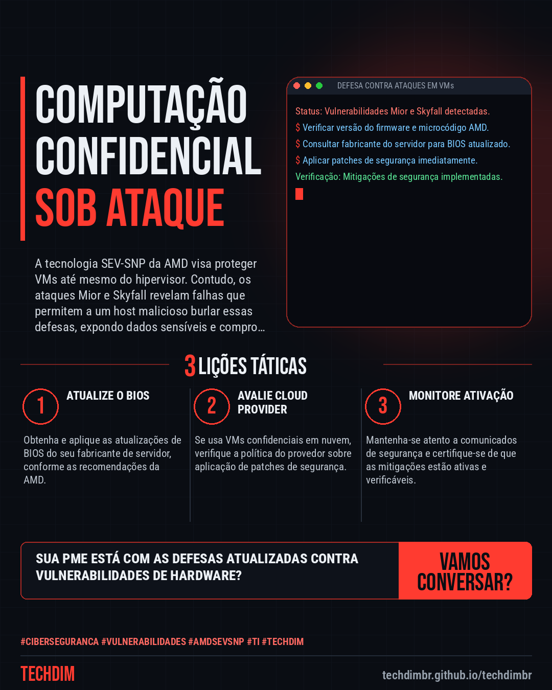

# Cibersegurança · IA · Hacker — Vulnerabilidades AMD: Ataques Mior e Skyfall expõem VMs Confidenciais

- **Data:** 2026-11-14, 16:02 (horário de Brasília)
- **Curadoria:** Claude (Routine) — pauta do dia
- **Execução no Actions:** https://github.com/Techdimbr/Publi-midia-Techdim/actions/runs/43629813476
- **Por que esta pauta:** Novas vulnerabilidades críticas em processadores AMD exigem atenção imediata para proteger ambientes de computação confidencial em PMEs brasileiras.

## Resultado

| Rede | Status | Link | 1º comentário |
|---|---|---|---|
| linkedin | ✅ publicado | https://www.linkedin.com/feed/update/urn:li:share:7527445748834254848/ | — |
| facebook | ✅ publicado | https://www.facebook.com/122132402349390486/posts/122144025027390486 | ✅ |
| instagram | ✅ publicado | https://www.instagram.com/p/Dfu6RNKF943/ | ✅ |
| Stories | ✅ publicado | https://www.instagram.com/stories/techdimbr/4030415101312356591 | — |

## Fontes

- [thehackernews.com](https://thehackernews.com/2026/11/new-mior-and-skyfall-attacks-let-rogue.html)

## Linkedin

```text
Vulnerabilidades AMD: Ataques Mior e Skyfall expõem VMs Confidenciais

01. Os ataques Mior e Skyfall permitem que hosts maliciosos leiam e, no caso de Mior, modifiquem dados em Máquinas Virtuais (VMs) protegidas por AMD SEV-SNP.
02. Mior exige controle do hipervisor e BIOS, além de um dispositivo PCIe. Skyfall necessita de um host ou hipervisor malicioso, sem adulteração de hardware.
03. A AMD liberou firmware e microcódigo em agosto e setembro, com mais atualizações previstas até 2027. Clientes devem obter patches dos fabricantes de servidores.

A proteção de dados em ambientes virtualizados é complexa. Conte com a TECHDIM para fortalecer sua cibersegurança e governança de dados.

Fontes: https://thehackernews.com/2026/11/new-mior-and-skyfall-attacks-let-rogue.html

TECHDIM — Infraestrutura · Segurança · IA
https://techdimbr.github.io/techdimbr/

#Ciberseguranca #Vulnerabilidades #Amdsevsnp #TI #TECHDIM
```



## Facebook

```text
Vulnerabilidades AMD: Ataques Mior e Skyfall expõem VMs Confidenciais

• Os ataques Mior e Skyfall permitem que hosts maliciosos leiam e, no caso de Mior, modifiquem dados em Máquinas Virtuais (VMs) protegidas por AMD SEV-SNP.
• Mior exige controle do hipervisor e BIOS, além de um dispositivo PCIe. Skyfall necessita de um host ou hipervisor malicioso, sem adulteração de hardware.
• A AMD liberou firmware e microcódigo em agosto e setembro, com mais atualizações previstas até 2027. Clientes devem obter patches dos fabricantes de servidores.

A proteção de dados em ambientes virtualizados é complexa. Conte com a TECHDIM para fortalecer sua cibersegurança e governança de dados.

Fale com a TECHDIM — fontes e site no primeiro comentário 👇

#Ciberseguranca #Vulnerabilidades #Amdsevsnp #TECHDIM
```

Primeiro comentário:

```text
📎 Fontes:
• thehackernews.com: https://thehackernews.com/2026/11/new-mior-and-skyfall-attacks-let-rogue.html

🌐 TECHDIM — Infraestrutura · Segurança · IA: https://techdimbr.github.io/techdimbr/
```


## Instagram

```text
Vulnerabilidades AMD: Ataques Mior e Skyfall expõem VMs Confidenciais

1️⃣ Os ataques Mior e Skyfall permitem que hosts maliciosos leiam e, no caso de Mior, modifiquem dados em Máquinas Virtuais (VMs) protegidas por AMD SEV-SNP.
2️⃣ Mior exige controle do hipervisor e BIOS, além de um dispositivo PCIe. Skyfall necessita de um host ou hipervisor malicioso, sem adulteração de hardware.
3️⃣ A AMD liberou firmware e microcódigo em agosto e setembro, com mais atualizações previstas até 2027. Clientes devem obter patches dos fabricantes de servidores.

A proteção de dados em ambientes virtualizados é complexa. Conte com a TECHDIM para fortalecer sua cibersegurança e governança de dados.

🔗 Link na bio: techdimbr.github.io/techdimbr
Fontes no primeiro comentário 👇

#ciberseguranca #vulnerabilidades #amdsevsnp #ti #techdim #seguranca #hacker #infraestrutura
```

Primeiro comentário:

```text
📎 Fontes: thehackernews.com
```


## Stories


