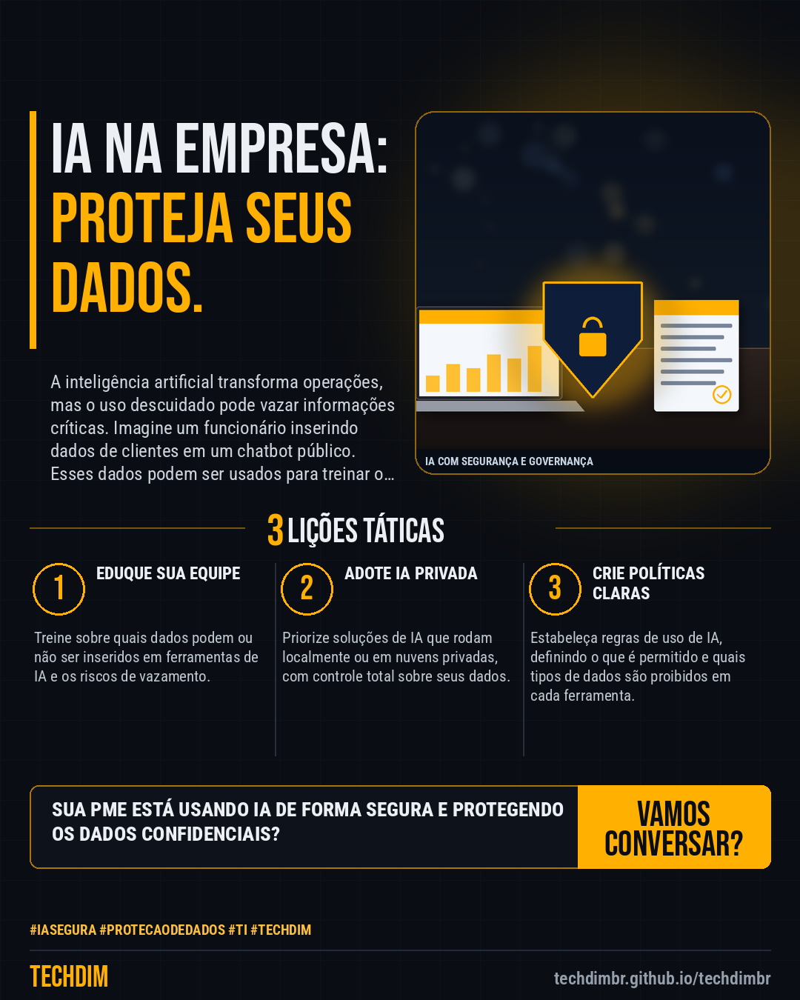

# Conhecimento — IA Segura: Como usar inteligência artificial sem expor dados confidenciais da sua PME

- **Data:** 2026-11-14, 18:35 (horário de Brasília)
- **Curadoria:** Claude (Routine) — pauta do dia
- **Execução no Actions:** https://github.com/Techdimbr/Publi-midia-Techdim/actions/runs/43643484313
- **Por que esta pauta:** A adoção crescente de IA nas PMEs torna a gestão de dados um tema crítico hoje.

## Resultado

| Rede | Status | Link | 1º comentário |
|---|---|---|---|
| linkedin | ✅ publicado | https://www.linkedin.com/feed/update/urn:li:share:7527484125960667136/ | — |
| facebook | ✅ publicado | https://www.facebook.com/122132402349390486/posts/122144045487390486 | ✅ |
| instagram | ✅ publicado | https://www.instagram.com/p/DfvLvIqk4I_/ | — |

## Linkedin

```text
IA Segura: Como usar inteligência artificial sem expor dados confidenciais da sua PME

01. A integração de IA em processos corporativos pode otimizar tarefas, mas exige cautela para evitar a exposição indevida de dados sensíveis de clientes ou da própria empresa.
02. Muitas ferramentas de IA processam as informações inseridas para aprimorar seus modelos, o que significa que dados confidenciais podem se tornar parte do treinamento público.
03. É crucial estabelecer políticas internas claras sobre o uso de IA, treinando equipes e optando por soluções que garantam a privacidade e o controle sobre os dados processados.

A TECHDIM oferece consultoria e soluções de IA sob medida para sua PME, garantindo a segurança e conformidade dos seus dados.

TECHDIM — Infraestrutura · Segurança · IA
https://techdimbr.github.io/techdimbr/

#IASegura #ProtecaoDeDados #TI #TECHDIM #Conhecimento
```



## Facebook

```text
IA Segura: Como usar inteligência artificial sem expor dados confidenciais da sua PME

• A integração de IA em processos corporativos pode otimizar tarefas, mas exige cautela para evitar a exposição indevida de dados sensíveis de clientes ou da própria empresa.
• Muitas ferramentas de IA processam as informações inseridas para aprimorar seus modelos, o que significa que dados confidenciais podem se tornar parte do treinamento público.
• É crucial estabelecer políticas internas claras sobre o uso de IA, treinando equipes e optando por soluções que garantam a privacidade e o controle sobre os dados processados.

A TECHDIM oferece consultoria e soluções de IA sob medida para sua PME, garantindo a segurança e conformidade dos seus dados.

Fale com a TECHDIM — link no primeiro comentário 👇

#IASegura #ProtecaoDeDados #TI #TECHDIM
```

Primeiro comentário:

```text
🌐 TECHDIM — Infraestrutura · Segurança · IA: https://techdimbr.github.io/techdimbr/
```


## Instagram

```text
IA Segura: Como usar inteligência artificial sem expor dados confidenciais da sua PME

1️⃣ A integração de IA em processos corporativos pode otimizar tarefas, mas exige cautela para evitar a exposição indevida de dados sensíveis de clientes ou da própria empresa.
2️⃣ Muitas ferramentas de IA processam as informações inseridas para aprimorar seus modelos, o que significa que dados confidenciais podem se tornar parte do treinamento público.
3️⃣ É crucial estabelecer políticas internas claras sobre o uso de IA, treinando equipes e optando por soluções que garantam a privacidade e o controle sobre os dados processados.

A TECHDIM oferece consultoria e soluções de IA sob medida para sua PME, garantindo a segurança e conformidade dos seus dados.

🔗 Link na bio: techdimbr.github.io/techdimbr

#iasegura #protecaodedados #ti #techdim #conhecimento #aprendati #tecnologia #ciberseguranca
```


