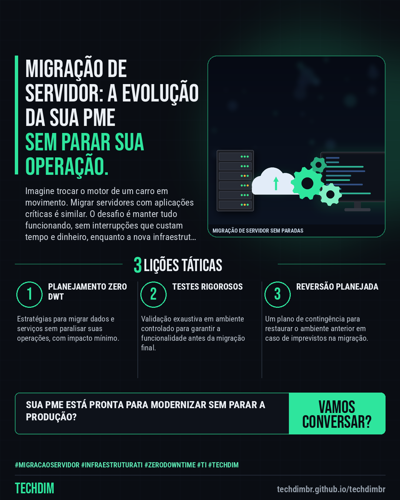

# TECHDIM · Serviços — Migração de Servidor: Mude sua infraestrutura sem paralisar a operação da sua PME

- **Data:** 2026-11-14, 21:00 (horário de Brasília)
- **Curadoria:** Claude (Routine) — pauta do dia
- **Execução no Actions:** https://github.com/Techdimbr/Publi-midia-Techdim/actions/runs/43655911684
- **Por que esta pauta:** A modernização da infraestrutura é essencial para a competitividade e segurança das PMEs no cenário atual.

## Resultado

| Rede | Status | Link | 1º comentário |
|---|---|---|---|
| linkedin | ✅ publicado | https://www.linkedin.com/feed/update/urn:li:share:7527520667353653248/ | — |
| facebook | ✅ publicado | https://www.facebook.com/122132402349390486/posts/122144064105390486 | ✅ |
| instagram | ✅ publicado | https://www.instagram.com/p/DfvcWOYjBT-/ | — |

## Linkedin

```text
Migração de Servidor: Mude sua infraestrutura sem paralisar a operação da sua PME

01. Migrar servidores é um desafio crítico para PMEs, que frequentemente adiam a modernização por medo de interrupções e perda de produtividade.
02. A TECHDIM planeja migrações complexas com estratégias de zero downtime, utilizando métodos que minimizam riscos e garantem a continuidade dos serviços essenciais.
03. Nosso processo abrange desde a preparação detalhada do ambiente e testes exaustivos até a reversão planejada, assegurando uma transição segura e eficiente.

A TECHDIM garante que a evolução da sua infraestrutura seja um passo à frente, sem comprometer a continuidade do seu negócio.

TECHDIM — Infraestrutura · Segurança · IA
https://techdimbr.github.io/techdimbr/

#MigracaoServidor #InfraestruturaTI #ZeroDowntime #TI #TECHDIM
```



## Facebook

```text
Migração de Servidor: Mude sua infraestrutura sem paralisar a operação da sua PME

• Migrar servidores é um desafio crítico para PMEs, que frequentemente adiam a modernização por medo de interrupções e perda de produtividade.
• A TECHDIM planeja migrações complexas com estratégias de zero downtime, utilizando métodos que minimizam riscos e garantem a continuidade dos serviços essenciais.
• Nosso processo abrange desde a preparação detalhada do ambiente e testes exaustivos até a reversão planejada, assegurando uma transição segura e eficiente.

A TECHDIM garante que a evolução da sua infraestrutura seja um passo à frente, sem comprometer a continuidade do seu negócio.

Fale com a TECHDIM — link no primeiro comentário 👇

#MigracaoServidor #InfraestruturaTI #ZeroDowntime #TECHDIM
```

Primeiro comentário:

```text
🌐 TECHDIM — Infraestrutura · Segurança · IA: https://techdimbr.github.io/techdimbr/
```


## Instagram

```text
Migração de Servidor: Mude sua infraestrutura sem paralisar a operação da sua PME

1️⃣ Migrar servidores é um desafio crítico para PMEs, que frequentemente adiam a modernização por medo de interrupções e perda de produtividade.
2️⃣ A TECHDIM planeja migrações complexas com estratégias de zero downtime, utilizando métodos que minimizam riscos e garantem a continuidade dos serviços essenciais.
3️⃣ Nosso processo abrange desde a preparação detalhada do ambiente e testes exaustivos até a reversão planejada, assegurando uma transição segura e eficiente.

A TECHDIM garante que a evolução da sua infraestrutura seja um passo à frente, sem comprometer a continuidade do seu negócio.

🔗 Link na bio: techdimbr.github.io/techdimbr

#migracaoservidor #infraestruturati #zerodowntime #ti #techdim #suportetecnico #ciberseguranca #automacao
```


