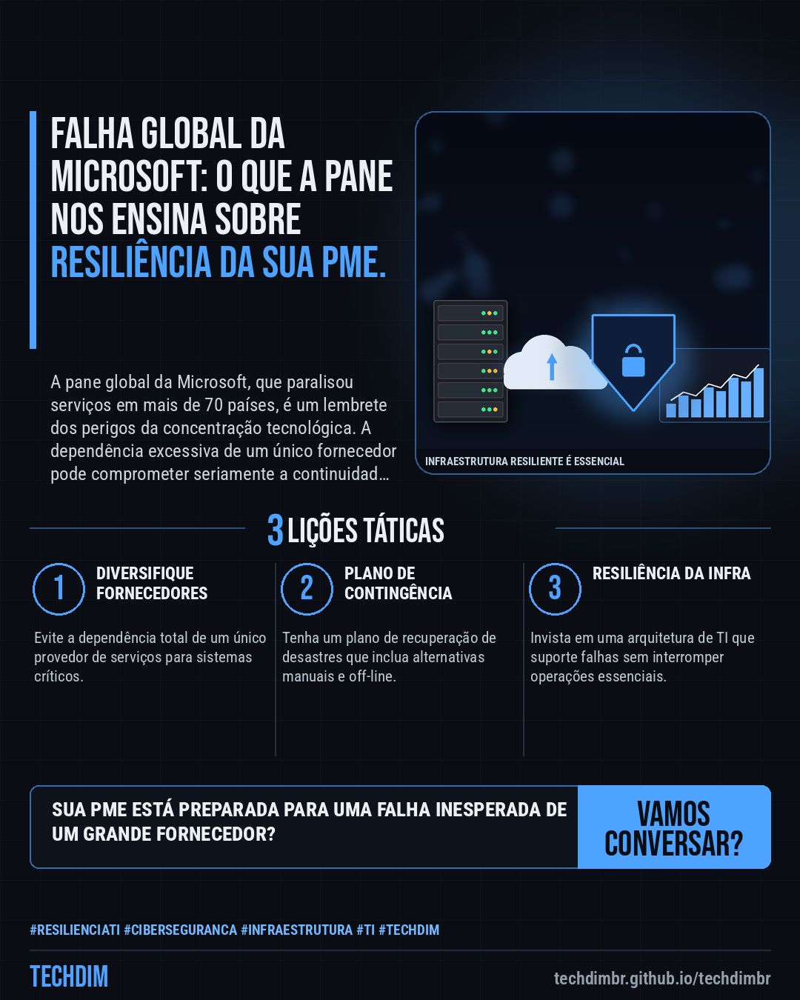
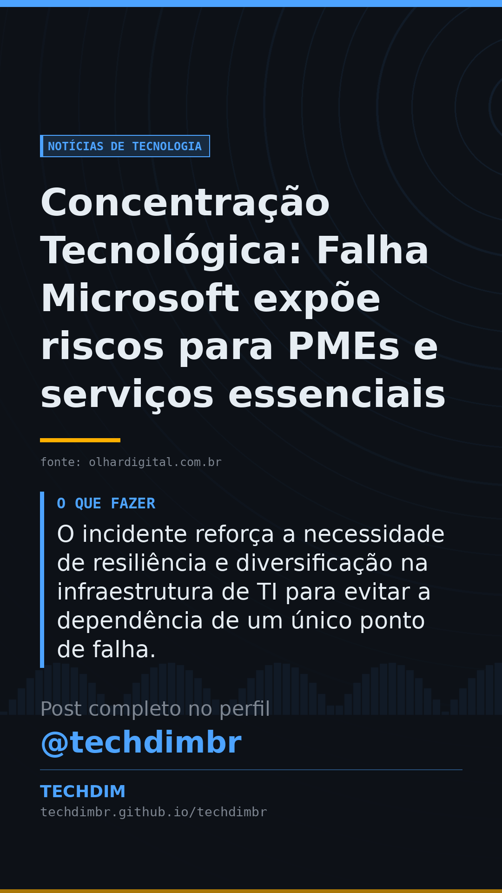

# Notícias de Tecnologia — Concentração Tecnológica: Falha Microsoft expõe riscos para PMEs e serviços essenciais

- **Data:** 2026-11-15, 14:41 (horário de Brasília)
- **Curadoria:** Claude (Routine) — pauta do dia
- **Execução no Actions:** https://github.com/Techdimbr/Publi-midia-Techdim/actions/runs/43742442957
- **Por que esta pauta:** Este evento ressalta a importância de avaliar a resiliência de suas operações digitais.

## Resultado

| Rede | Status | Link | 1º comentário |
|---|---|---|---|
| linkedin | ✅ publicado | https://www.linkedin.com/feed/update/urn:li:share:7527787808942374913/ | — |
| facebook | ✅ publicado | https://www.facebook.com/122132402349390486/posts/122144262639390486 | ✅ |
| instagram | ✅ publicado | https://www.instagram.com/p/DfxV1IiExpM/ | ✅ |
| Stories | ✅ publicado | https://www.instagram.com/stories/techdimbr/4031099270350488462 | — |

## Fontes

- [olhardigital.com.br](https://olhardigital.com.br/2026/11/15/internet-e-redes-sociais/falha-da-microsoft-mostra-riscos-de-concentrar-servicos-digitais/)

## Linkedin

```text
Concentração Tecnológica: Falha Microsoft expõe riscos para PMEs e serviços essenciais

01. A pane global da Microsoft, que afetou serviços como Outlook e Teams em mais de 70 países, demonstrou a vulnerabilidade de infraestruturas centralizadas.
02. Hospitais e tribunais no Reino Unido recorreram a papel e fax, expondo como a falha em um único fornecedor pode paralisar operações essenciais.
03. O incidente reforça a necessidade de resiliência e diversificação na infraestrutura de TI para evitar a dependência de um único ponto de falha.

A TECHDIM projeta infraestruturas robustas e cibersegurança defensiva, garantindo a continuidade operacional da sua PME.

Fontes: https://olhardigital.com.br/2026/11/15/internet-e-redes-sociais/falha-da-microsoft-mostra-riscos-de-concentrar-servicos-digitais/

TECHDIM — Infraestrutura · Segurança · IA
https://techdimbr.github.io/techdimbr/

#ResilienciaTI #Ciberseguranca #Infraestrutura #TI #TECHDIM
```



## Facebook

```text
Concentração Tecnológica: Falha Microsoft expõe riscos para PMEs e serviços essenciais

• A pane global da Microsoft, que afetou serviços como Outlook e Teams em mais de 70 países, demonstrou a vulnerabilidade de infraestruturas centralizadas.
• Hospitais e tribunais no Reino Unido recorreram a papel e fax, expondo como a falha em um único fornecedor pode paralisar operações essenciais.
• O incidente reforça a necessidade de resiliência e diversificação na infraestrutura de TI para evitar a dependência de um único ponto de falha.

A TECHDIM projeta infraestruturas robustas e cibersegurança defensiva, garantindo a continuidade operacional da sua PME.

Fale com a TECHDIM — fontes e site no primeiro comentário 👇

#ResilienciaTI #Ciberseguranca #Infraestrutura #TECHDIM
```

Primeiro comentário:

```text
📎 Fontes:
• olhardigital.com.br: https://olhardigital.com.br/2026/11/15/internet-e-redes-sociais/falha-da-microsoft-mostra-riscos-de-concentrar-servicos-digitais/

🌐 TECHDIM — Infraestrutura · Segurança · IA: https://techdimbr.github.io/techdimbr/
```


## Instagram

```text
Concentração Tecnológica: Falha Microsoft expõe riscos para PMEs e serviços essenciais

1️⃣ A pane global da Microsoft, que afetou serviços como Outlook e Teams em mais de 70 países, demonstrou a vulnerabilidade de infraestruturas centralizadas.
2️⃣ Hospitais e tribunais no Reino Unido recorreram a papel e fax, expondo como a falha em um único fornecedor pode paralisar operações essenciais.
3️⃣ O incidente reforça a necessidade de resiliência e diversificação na infraestrutura de TI para evitar a dependência de um único ponto de falha.

A TECHDIM projeta infraestruturas robustas e cibersegurança defensiva, garantindo a continuidade operacional da sua PME.

🔗 Link na bio: techdimbr.github.io/techdimbr
Fontes no primeiro comentário 👇

#resilienciati #ciberseguranca #infraestrutura #ti #techdim #tecnologia #inteligenciaartificial #ia
```

Primeiro comentário:

```text
📎 Fontes: olhardigital.com.br
```


## Stories


