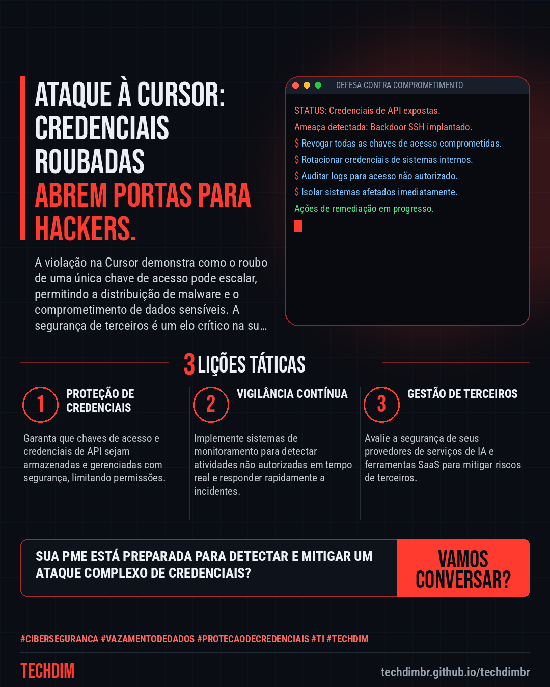
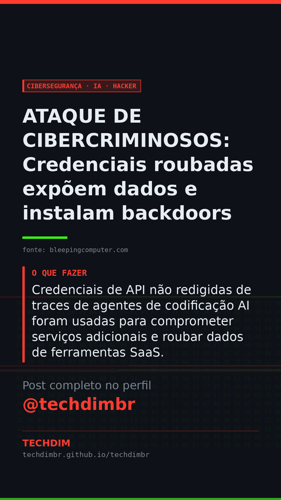

# Cibersegurança · IA · Hacker — ATAQUE DE CIBERCRIMINOSOS: Credenciais roubadas expõem dados e instalam backdoors

- **Data:** 2026-11-15, 16:42 (horário de Brasília)
- **Curadoria:** Claude (Routine) — pauta do dia
- **Execução no Actions:** https://github.com/Techdimbr/Publi-midia-Techdim/actions/runs/43753802770
- **Por que esta pauta:** Este caso destaca a necessidade de vigilância contínua e proteção de credenciais contra ameaças em constante evolução.

## Resultado

| Rede | Status | Link | 1º comentário |
|---|---|---|---|
| linkedin | ✅ publicado | https://www.linkedin.com/feed/update/urn:li:share:7527818150193680384/ | — |
| facebook | ✅ publicado | https://www.facebook.com/122132402349390486/posts/122144298429390486 | ✅ |
| instagram | ✅ publicado | https://www.instagram.com/p/DfxjoHPjxYh/ | ✅ |
| Stories | ✅ publicado | https://www.instagram.com/stories/techdimbr/4031159955369224792 | — |

## Fontes

- [bleepingcomputer.com](https://www.bleepingcomputer.com/news/security/cursor-confirms-security-breach-led-to-malicious-claude-code-extension/)

## Linkedin

```text
ATAQUE DE CIBERCRIMINOSOS: Credenciais roubadas expõem dados e instalam backdoors

01. A Cursor confirmou uma violação de segurança que permitiu a distribuição de uma extensão maliciosa do Claude Code, após roubo de credenciais da Fireworks AI.
02. O ataque expôs até 5.000 desenvolvedores a malware que instalou backdoors SSH persistentes e permitiu acesso a sistemas internos e dados de clientes.
03. Credenciais de API não redigidas de traces de agentes de codificação AI foram usadas para comprometer serviços adicionais e roubar dados de ferramentas SaaS.

A TECHDIM fortalece sua defesa cibernética com soluções robustas e governança de dados para proteger sua PME de ataques complexos.

Fontes: https://www.bleepingcomputer.com/news/security/cursor-confirms-security-breach-led-to-malicious-claude-code-extension/

TECHDIM — Infraestrutura · Segurança · IA
https://techdimbr.github.io/techdimbr/

#Ciberseguranca #VazamentoDeDados #ProtecaoDeCredenciais #TI #TECHDIM
```



## Facebook

```text
ATAQUE DE CIBERCRIMINOSOS: Credenciais roubadas expõem dados e instalam backdoors

• A Cursor confirmou uma violação de segurança que permitiu a distribuição de uma extensão maliciosa do Claude Code, após roubo de credenciais da Fireworks AI.
• O ataque expôs até 5.000 desenvolvedores a malware que instalou backdoors SSH persistentes e permitiu acesso a sistemas internos e dados de clientes.
• Credenciais de API não redigidas de traces de agentes de codificação AI foram usadas para comprometer serviços adicionais e roubar dados de ferramentas SaaS.

A TECHDIM fortalece sua defesa cibernética com soluções robustas e governança de dados para proteger sua PME de ataques complexos.

Fale com a TECHDIM — fontes e site no primeiro comentário 👇

#Ciberseguranca #VazamentoDeDados #ProtecaoDeCredenciais #TECHDIM
```

Primeiro comentário:

```text
📎 Fontes:
• bleepingcomputer.com: https://www.bleepingcomputer.com/news/security/cursor-confirms-security-breach-led-to-malicious-claude-code-extension/

🌐 TECHDIM — Infraestrutura · Segurança · IA: https://techdimbr.github.io/techdimbr/
```


## Instagram

```text
ATAQUE DE CIBERCRIMINOSOS: Credenciais roubadas expõem dados e instalam backdoors

1️⃣ A Cursor confirmou uma violação de segurança que permitiu a distribuição de uma extensão maliciosa do Claude Code, após roubo de credenciais da Fireworks AI.
2️⃣ O ataque expôs até 5.000 desenvolvedores a malware que instalou backdoors SSH persistentes e permitiu acesso a sistemas internos e dados de clientes.
3️⃣ Credenciais de API não redigidas de traces de agentes de codificação AI foram usadas para comprometer serviços adicionais e roubar dados de ferramentas SaaS.

A TECHDIM fortalece sua defesa cibernética com soluções robustas e governança de dados para proteger sua PME de ataques complexos.

🔗 Link na bio: techdimbr.github.io/techdimbr
Fontes no primeiro comentário 👇

#ciberseguranca #vazamentodedados #protecaodecredenciais #ti #techdim #seguranca #hacker #infraestrutura
```

Primeiro comentário:

```text
📎 Fontes: bleepingcomputer.com
```


## Stories


