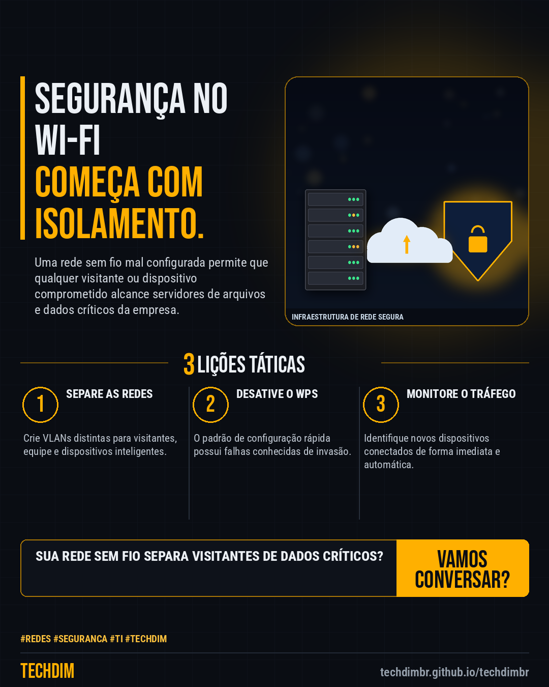

# Conhecimento — Wi-Fi Corporativo: 4 erros estruturais que expõem a rede da sua PME

- **Data:** 2026-11-15, 18:53 (horário de Brasília)
- **Curadoria:** Claude (Routine) — pauta do dia
- **Execução no Actions:** https://github.com/Techdimbr/Publi-midia-Techdim/actions/runs/43766142028
- **Por que esta pauta:** Erros básicos em redes sem fio continuam abrindo portas para invasões em pequenas e médias empresas.

## Resultado

| Rede | Status | Link | 1º comentário |
|---|---|---|---|
| linkedin | ✅ publicado | https://www.linkedin.com/feed/update/urn:li:share:7527851334843355136/ | — |
| facebook | ✅ publicado | https://www.facebook.com/122132402349390486/posts/122144314017390486 | ✅ |
| instagram | ✅ publicado | https://www.instagram.com/p/DfxytpFjQGh/ | — |

## Linkedin

```text
Wi-Fi Corporativo: 4 erros estruturais que expõem a rede da sua PME

01. Usar a mesma senha de Wi-Fi para funcionários, visitantes e dispositivos IoT fragiliza toda a operação e facilita o acesso não autorizado.
02. A separação correta de redes através de VLANs isola o tráfego sensível e protege contra interceptações indevidas de dados corporativos.
03. Auditorias periódicas e políticas claras de acesso sem fio são indispensáveis para manter o ambiente de TI seguro e estável.

A TECHDIM projeta e implementa arquiteturas de rede seguras para proteger sua PME.

TECHDIM — Infraestrutura · Segurança · IA
https://techdimbr.github.io/techdimbr/

#Redes #Seguranca #TI #TECHDIM #Conhecimento
```



## Facebook

```text
Wi-Fi Corporativo: 4 erros estruturais que expõem a rede da sua PME

• Usar a mesma senha de Wi-Fi para funcionários, visitantes e dispositivos IoT fragiliza toda a operação e facilita o acesso não autorizado.
• A separação correta de redes através de VLANs isola o tráfego sensível e protege contra interceptações indevidas de dados corporativos.
• Auditorias periódicas e políticas claras de acesso sem fio são indispensáveis para manter o ambiente de TI seguro e estável.

A TECHDIM projeta e implementa arquiteturas de rede seguras para proteger sua PME.

Fale com a TECHDIM — link no primeiro comentário 👇

#Redes #Seguranca #TI #TECHDIM
```

Primeiro comentário:

```text
🌐 TECHDIM — Infraestrutura · Segurança · IA: https://techdimbr.github.io/techdimbr/
```


## Instagram

```text
Wi-Fi Corporativo: 4 erros estruturais que expõem a rede da sua PME

1️⃣ Usar a mesma senha de Wi-Fi para funcionários, visitantes e dispositivos IoT fragiliza toda a operação e facilita o acesso não autorizado.
2️⃣ A separação correta de redes através de VLANs isola o tráfego sensível e protege contra interceptações indevidas de dados corporativos.
3️⃣ Auditorias periódicas e políticas claras de acesso sem fio são indispensáveis para manter o ambiente de TI seguro e estável.

A TECHDIM projeta e implementa arquiteturas de rede seguras para proteger sua PME.

🔗 Link na bio: techdimbr.github.io/techdimbr

#redes #seguranca #ti #techdim #conhecimento #aprendati #tecnologia #ciberseguranca
```


