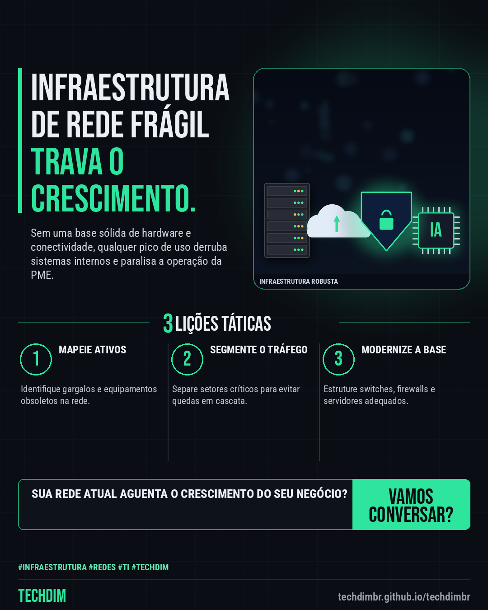

# TECHDIM · Serviços — INFRAESTRUTURA: O perigo invisível do hardware obsoleto na sua PME

- **Data:** 2026-11-15, 21:04 (horário de Brasília)
- **Curadoria:** Claude (Routine) — pauta do dia
- **Execução no Actions:** https://github.com/Techdimbr/Publi-midia-Techdim/actions/runs/43778130150
- **Por que esta pauta:** Empresas perdem produtividade diariamente por falhas em uma infraestrutura de rede que já não suporta a demanda operacional atual.

## Resultado

| Rede | Status | Link | 1º comentário |
|---|---|---|---|
| linkedin | ✅ publicado | https://www.linkedin.com/feed/update/urn:li:share:7527884158157639680/ | — |
| facebook | ✅ publicado | https://www.facebook.com/122132402349390486/posts/122144326167390486 | ✅ |
| instagram | ✅ publicado | https://www.instagram.com/p/DfyBpBbj7NX/ | — |

## Linkedin

```text
INFRAESTRUTURA: O perigo invisível do hardware obsoleto na sua PME

01. Redes lentas, quedas intermitentes de conexão e gargalos em servidores geram prejuízos diários e frustram equipes inteiras.
02. Muitas PMEs operam com ativos de rede desatualizados, sem visibilidade de tráfego e sem segmentação adequada entre departamentos.
03. A engenharia da TECHDIM avalia a topologia atual, moderniza o parque tecnológico e implementa infraestrutura robusta e escalável.

Conte com a TECHDIM para desenhar uma infraestrutura resiliente para o seu negócio. Acesse techdimbr.github.io/techdimbr.

TECHDIM — Infraestrutura · Segurança · IA
https://techdimbr.github.io/techdimbr/

#Infraestrutura #Redes #TI #TECHDIM #InfraestruturaDeTI
```



## Facebook

```text
INFRAESTRUTURA: O perigo invisível do hardware obsoleto na sua PME

• Redes lentas, quedas intermitentes de conexão e gargalos em servidores geram prejuízos diários e frustram equipes inteiras.
• Muitas PMEs operam com ativos de rede desatualizados, sem visibilidade de tráfego e sem segmentação adequada entre departamentos.
• A engenharia da TECHDIM avalia a topologia atual, moderniza o parque tecnológico e implementa infraestrutura robusta e escalável.

Conte com a TECHDIM para desenhar uma infraestrutura resiliente para o seu negócio. Acesse techdimbr.github.io/techdimbr.

Fale com a TECHDIM — link no primeiro comentário 👇

#Infraestrutura #Redes #TI #TECHDIM
```

Primeiro comentário:

```text
🌐 TECHDIM — Infraestrutura · Segurança · IA: https://techdimbr.github.io/techdimbr/
```


## Instagram

```text
INFRAESTRUTURA: O perigo invisível do hardware obsoleto na sua PME

1️⃣ Redes lentas, quedas intermitentes de conexão e gargalos em servidores geram prejuízos diários e frustram equipes inteiras.
2️⃣ Muitas PMEs operam com ativos de rede desatualizados, sem visibilidade de tráfego e sem segmentação adequada entre departamentos.
3️⃣ A engenharia da TECHDIM avalia a topologia atual, moderniza o parque tecnológico e implementa infraestrutura robusta e escalável.

Conte com a TECHDIM para desenhar uma infraestrutura resiliente para o seu negócio. Acesse techdimbr.github.io/techdimbr.

🔗 Link na bio: techdimbr.github.io/techdimbr

#infraestrutura #redes #ti #techdim #suportetecnico #ciberseguranca #automacao #campinas
```


