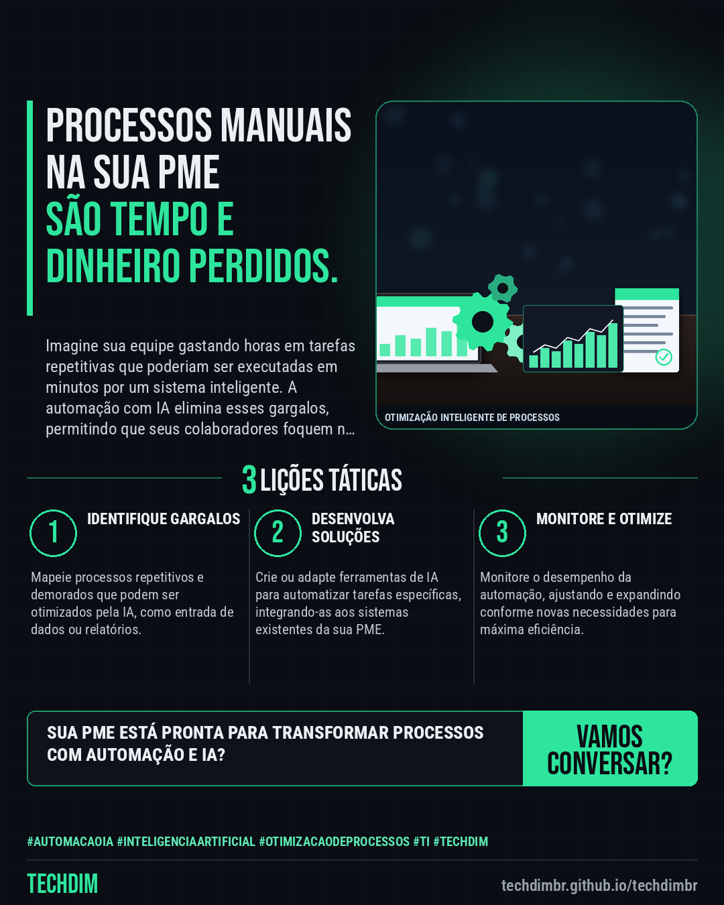

# TECHDIM · Serviços — AUTOMAÇÃO COM IA: Otimize processos e reduza custos na sua PME com inteligência artificial

- **Data:** 2026-11-16, 00:00 (horário de Brasília)
- **Curadoria:** Claude (Routine) — pauta do dia
- **Execução no Actions:** https://github.com/Techdimbr/Publi-midia-Techdim/actions/runs/44006942573
- **Por que esta pauta:** Este assunto é relevante hoje para PMEs que buscam eficiência e inovação em suas operações.

## Resultado

| Rede | Status | Link | 1º comentário |
|---|---|---|---|
| linkedin | ✅ publicado | https://www.linkedin.com/feed/update/urn:li:share:7528290836258869249/ | — |
| facebook | ✅ publicado | https://www.facebook.com/122132402349390486/posts/122144607609390486 | ✅ |
| instagram | ✅ publicado | https://www.instagram.com/p/Df06ksXF-gi/ | — |

## Linkedin

```text
AUTOMAÇÃO COM IA: Otimize processos e reduza custos na sua PME com inteligência artificial

01. Muitas PMEs enfrentam gargalos operacionais e tarefas repetitivas que consomem tempo e recursos, impactando a produtividade e o crescimento.
02. A automação com IA pode transformar esses processos, liberando equipes para atividades estratégicas e otimizando a eficiência operacional.
03. A TECHDIM projeta e implementa soluções de IA sob medida para automatizar tarefas administrativas, financeiras e de TI, adaptando-se às necessidades da PME.

Nossa engenharia em automação com IA moderniza sua operação, garantindo competitividade e escalabilidade para sua PME no mercado.

TECHDIM — Infraestrutura · Segurança · IA
https://techdimbr.github.io/techdimbr/

#AutomacaoIA #InteligenciaArtificial #OtimizacaoDeProcessos #TI #TECHDIM
```



## Facebook

```text
AUTOMAÇÃO COM IA: Otimize processos e reduza custos na sua PME com inteligência artificial

• Muitas PMEs enfrentam gargalos operacionais e tarefas repetitivas que consomem tempo e recursos, impactando a produtividade e o crescimento.
• A automação com IA pode transformar esses processos, liberando equipes para atividades estratégicas e otimizando a eficiência operacional.
• A TECHDIM projeta e implementa soluções de IA sob medida para automatizar tarefas administrativas, financeiras e de TI, adaptando-se às necessidades da PME.

Nossa engenharia em automação com IA moderniza sua operação, garantindo competitividade e escalabilidade para sua PME no mercado.

Fale com a TECHDIM — link no primeiro comentário 👇

#AutomacaoIA #InteligenciaArtificial #OtimizacaoDeProcessos #TECHDIM
```

Primeiro comentário:

```text
🌐 TECHDIM — Infraestrutura · Segurança · IA: https://techdimbr.github.io/techdimbr/
```


## Instagram

```text
AUTOMAÇÃO COM IA: Otimize processos e reduza custos na sua PME com inteligência artificial

1️⃣ Muitas PMEs enfrentam gargalos operacionais e tarefas repetitivas que consomem tempo e recursos, impactando a produtividade e o crescimento.
2️⃣ A automação com IA pode transformar esses processos, liberando equipes para atividades estratégicas e otimizando a eficiência operacional.
3️⃣ A TECHDIM projeta e implementa soluções de IA sob medida para automatizar tarefas administrativas, financeiras e de TI, adaptando-se às necessidades da PME.

Nossa engenharia em automação com IA moderniza sua operação, garantindo competitividade e escalabilidade para sua PME no mercado.

🔗 Link na bio: techdimbr.github.io/techdimbr

#automacaoia #inteligenciaartificial #otimizacaodeprocessos #ti #techdim #suportetecnico #ciberseguranca #automacao
```


