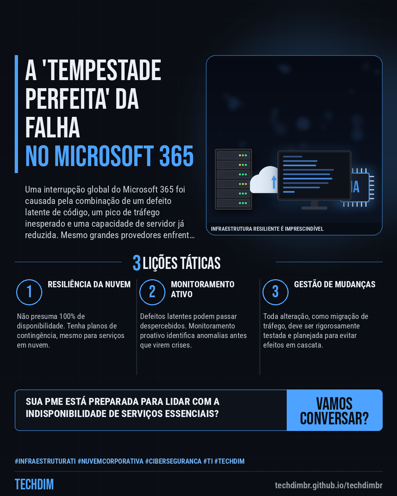
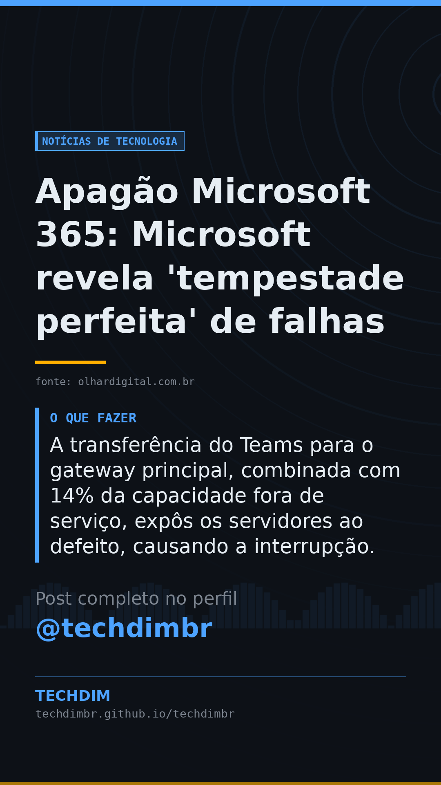

# Notícias de Tecnologia — Apagão Microsoft 365: Microsoft revela 'tempestade perfeita' de falhas

- **Data:** 2026-11-16, 17:59 (horário de Brasília)
- **Curadoria:** Claude (Routine) — pauta do dia
- **Execução no Actions:** https://github.com/Techdimbr/Publi-midia-Techdim/actions/runs/43955135801
- **Por que esta pauta:** Entender as causas de falhas globais é crucial para fortalecer a infraestrutura de TI de PMEs no Brasil.

## Resultado

| Rede | Status | Link | 1º comentário |
|---|---|---|---|
| linkedin | ✅ publicado | https://www.linkedin.com/feed/update/urn:li:share:7528199787410640897/ | — |
| facebook | ✅ publicado | https://www.facebook.com/122132402349390486/posts/122144530551390486 | ✅ |
| instagram | ✅ publicado | https://www.instagram.com/p/Df0RLkskt5L/ | ✅ |
| Stories | ✅ publicado | https://www.instagram.com/stories/techdimbr/4031923310166149066 | — |

## Fontes

- [olhardigital.com.br](https://olhardigital.com.br/2026/11/16/internet-e-redes-sociais/apagao-do-microsoft-365-empresa-revela-o-que-causou-a-falha/)

## Linkedin

```text
Apagão Microsoft 365: Microsoft revela 'tempestade perfeita' de falhas

01. Microsoft identificou três problemas simultâneos: um defeito no código dos servidores, aumento de tráfego do Teams e redução de capacidade da infraestrutura.
02. Um defeito latente de código, introduzido em julho de 2026, só foi acionado sob condições específicas de tráfego e capacidade reduzida, passando meses despercebido.
03. A transferência do Teams para o gateway principal, combinada com 14% da capacidade fora de serviço, expôs os servidores ao defeito, causando a interrupção.

A TECHDIM atua na gestão e otimização de infraestrutura, garantindo que sua PME esteja preparada para qualquer cenário de indisponibilidade.

Fontes: https://olhardigital.com.br/2026/11/16/internet-e-redes-sociais/apagao-do-microsoft-365-empresa-revela-o-que-causou-a-falha/

TECHDIM — Infraestrutura · Segurança · IA
https://techdimbr.github.io/techdimbr/

#InfraestruturaTI #NuvemCorporativa #Ciberseguranca #TI #TECHDIM
```



## Facebook

```text
Apagão Microsoft 365: Microsoft revela 'tempestade perfeita' de falhas

• Microsoft identificou três problemas simultâneos: um defeito no código dos servidores, aumento de tráfego do Teams e redução de capacidade da infraestrutura.
• Um defeito latente de código, introduzido em julho de 2026, só foi acionado sob condições específicas de tráfego e capacidade reduzida, passando meses despercebido.
• A transferência do Teams para o gateway principal, combinada com 14% da capacidade fora de serviço, expôs os servidores ao defeito, causando a interrupção.

A TECHDIM atua na gestão e otimização de infraestrutura, garantindo que sua PME esteja preparada para qualquer cenário de indisponibilidade.

Fale com a TECHDIM — fontes e site no primeiro comentário 👇

#InfraestruturaTI #NuvemCorporativa #Ciberseguranca #TECHDIM
```

Primeiro comentário:

```text
📎 Fontes:
• olhardigital.com.br: https://olhardigital.com.br/2026/11/16/internet-e-redes-sociais/apagao-do-microsoft-365-empresa-revela-o-que-causou-a-falha/

🌐 TECHDIM — Infraestrutura · Segurança · IA: https://techdimbr.github.io/techdimbr/
```


## Instagram

```text
Apagão Microsoft 365: Microsoft revela 'tempestade perfeita' de falhas

1️⃣ Microsoft identificou três problemas simultâneos: um defeito no código dos servidores, aumento de tráfego do Teams e redução de capacidade da infraestrutura.
2️⃣ Um defeito latente de código, introduzido em julho de 2026, só foi acionado sob condições específicas de tráfego e capacidade reduzida, passando meses despercebido.
3️⃣ A transferência do Teams para o gateway principal, combinada com 14% da capacidade fora de serviço, expôs os servidores ao defeito, causando a interrupção.

A TECHDIM atua na gestão e otimização de infraestrutura, garantindo que sua PME esteja preparada para qualquer cenário de indisponibilidade.

🔗 Link na bio: techdimbr.github.io/techdimbr
Fontes no primeiro comentário 👇

#infraestruturati #nuvemcorporativa #ciberseguranca #ti #techdim #tecnologia #inteligenciaartificial #ia
```

Primeiro comentário:

```text
📎 Fontes: olhardigital.com.br
```


## Stories


