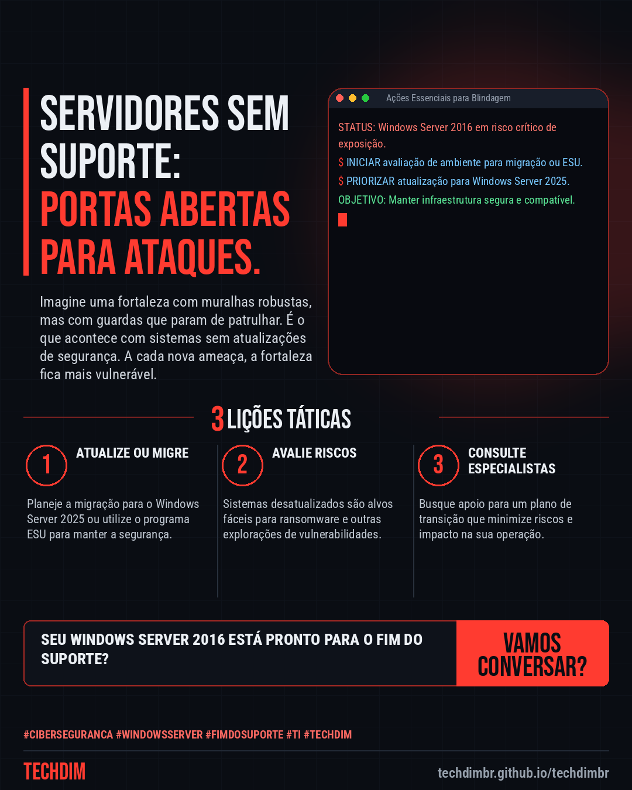
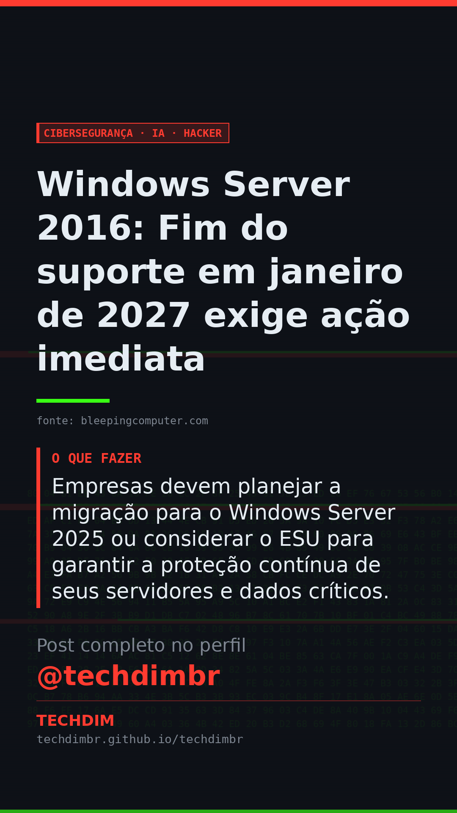

# Cibersegurança · IA · Hacker — Windows Server 2016: Fim do suporte em janeiro de 2027 exige ação imediata

- **Data:** 2026-11-16, 20:20 (horário de Brasília)
- **Curadoria:** Claude (Routine) — pauta do dia
- **Execução no Actions:** https://github.com/Techdimbr/Publi-midia-Techdim/actions/runs/43978195964
- **Por que esta pauta:** O fim do suporte de um sistema operacional amplamente utilizado é um alerta crítico de cibersegurança para todas as PMEs.

## Resultado

| Rede | Status | Link | 1º comentário |
|---|---|---|---|
| linkedin | ✅ publicado | https://www.linkedin.com/feed/update/urn:li:share:7528235282626924544/ | — |
| facebook | ✅ publicado | https://www.facebook.com/122132402349390486/posts/122144545635390486 | ✅ |
| instagram | ✅ publicado | https://www.instagram.com/p/Df0hUjSoOis/ | ✅ |
| Stories | ✅ publicado | https://www.instagram.com/stories/techdimbr/4031994227559784510 | — |

## Fontes

- [bleepingcomputer.com](https://www.bleepingcomputer.com/news/microsoft/microsoft-windows-server-2016-reaches-end-of-support-in-60-days/)

## Linkedin

```text
Windows Server 2016: Fim do suporte em janeiro de 2027 exige ação imediata

01. A Microsoft alertou novamente que o Windows Server 2016 deixará de receber atualizações de segurança em 13 de janeiro de 2027, marcando o fim do suporte estendido.
02. Após esta data, os sistemas que não forem atualizados ou inscritos no programa ESU (Extended Security Updates) ficarão expostos a novas vulnerabilidades e ataques cibernéticos.
03. Empresas devem planejar a migração para o Windows Server 2025 ou considerar o ESU para garantir a proteção contínua de seus servidores e dados críticos.

A TECHDIM oferece consultoria especializada para planejar e executar a migração segura do seu ambiente, garantindo a continuidade operacional.

Fontes: https://www.bleepingcomputer.com/news/microsoft/microsoft-windows-server-2016-reaches-end-of-support-in-60-days/

TECHDIM — Infraestrutura · Segurança · IA
https://techdimbr.github.io/techdimbr/

#Ciberseguranca #WindowsServer #FimDoSuporte #TI #TECHDIM
```



## Facebook

```text
Windows Server 2016: Fim do suporte em janeiro de 2027 exige ação imediata

• A Microsoft alertou novamente que o Windows Server 2016 deixará de receber atualizações de segurança em 13 de janeiro de 2027, marcando o fim do suporte estendido.
• Após esta data, os sistemas que não forem atualizados ou inscritos no programa ESU (Extended Security Updates) ficarão expostos a novas vulnerabilidades e ataques cibernéticos.
• Empresas devem planejar a migração para o Windows Server 2025 ou considerar o ESU para garantir a proteção contínua de seus servidores e dados críticos.

A TECHDIM oferece consultoria especializada para planejar e executar a migração segura do seu ambiente, garantindo a continuidade operacional.

Fale com a TECHDIM — fontes e site no primeiro comentário 👇

#Ciberseguranca #WindowsServer #FimDoSuporte #TECHDIM
```

Primeiro comentário:

```text
📎 Fontes:
• bleepingcomputer.com: https://www.bleepingcomputer.com/news/microsoft/microsoft-windows-server-2016-reaches-end-of-support-in-60-days/

🌐 TECHDIM — Infraestrutura · Segurança · IA: https://techdimbr.github.io/techdimbr/
```


## Instagram

```text
Windows Server 2016: Fim do suporte em janeiro de 2027 exige ação imediata

1️⃣ A Microsoft alertou novamente que o Windows Server 2016 deixará de receber atualizações de segurança em 13 de janeiro de 2027, marcando o fim do suporte estendido.
2️⃣ Após esta data, os sistemas que não forem atualizados ou inscritos no programa ESU (Extended Security Updates) ficarão expostos a novas vulnerabilidades e ataques cibernéticos.
3️⃣ Empresas devem planejar a migração para o Windows Server 2025 ou considerar o ESU para garantir a proteção contínua de seus servidores e dados críticos.

A TECHDIM oferece consultoria especializada para planejar e executar a migração segura do seu ambiente, garantindo a continuidade operacional.

🔗 Link na bio: techdimbr.github.io/techdimbr
Fontes no primeiro comentário 👇

#ciberseguranca #windowsserver #fimdosuporte #ti #techdim #seguranca #hacker #infraestrutura
```

Primeiro comentário:

```text
📎 Fontes: bleepingcomputer.com
```


## Stories


