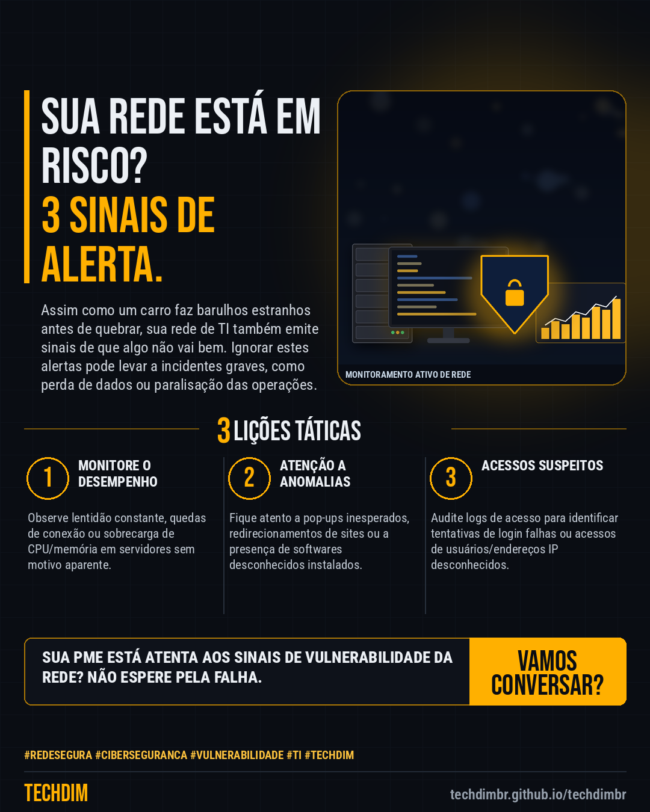

# Conhecimento — Rede Vulnerável: 3 sinais que sua PME não pode ignorar hoje

- **Data:** 2026-11-16, 21:52 (horário de Brasília)
- **Curadoria:** Claude (Routine) — pauta do dia
- **Execução no Actions:** https://github.com/Techdimbr/Publi-midia-Techdim/actions/runs/43990963155
- **Por que esta pauta:** É crucial educar as PMEs sobre os indicadores de risco de rede para prevenção de ciberataques.

## Resultado

| Rede | Status | Link | 1º comentário |
|---|---|---|---|
| linkedin | ✅ publicado | https://www.linkedin.com/feed/update/urn:li:share:7528258499189972992/ | — |
| facebook | ✅ publicado | https://www.facebook.com/122132402349390486/posts/122144556225390486 | ✅ |
| instagram | ✅ publicado | https://www.instagram.com/p/Df0r3svl858/ | — |

## Linkedin

```text
Rede Vulnerável: 3 sinais que sua PME não pode ignorar hoje

01. Sua rede corporativa pode estar vulnerável sem que você perceba. Pequenos sinais diários podem indicar brechas de segurança.
02. Lentidão inexplicável, travamentos frequentes ou falhas de acesso a recursos da rede são alertas de possível sobrecarga ou ataque.
03. Comportamentos anômalos como pop-ups estranhos, redirecionamentos de navegador ou arquivos desconhecidos indicam infecção por malware.

A TECHDIM atua na identificação e correção de vulnerabilidades, garantindo a resiliência e segurança da infraestrutura da sua PME.

TECHDIM — Infraestrutura · Segurança · IA
https://techdimbr.github.io/techdimbr/

#RedeSegura #Ciberseguranca #Vulnerabilidade #TI #TECHDIM
```



## Facebook

```text
Rede Vulnerável: 3 sinais que sua PME não pode ignorar hoje

• Sua rede corporativa pode estar vulnerável sem que você perceba. Pequenos sinais diários podem indicar brechas de segurança.
• Lentidão inexplicável, travamentos frequentes ou falhas de acesso a recursos da rede são alertas de possível sobrecarga ou ataque.
• Comportamentos anômalos como pop-ups estranhos, redirecionamentos de navegador ou arquivos desconhecidos indicam infecção por malware.

A TECHDIM atua na identificação e correção de vulnerabilidades, garantindo a resiliência e segurança da infraestrutura da sua PME.

Fale com a TECHDIM — link no primeiro comentário 👇

#RedeSegura #Ciberseguranca #Vulnerabilidade #TECHDIM
```

Primeiro comentário:

```text
🌐 TECHDIM — Infraestrutura · Segurança · IA: https://techdimbr.github.io/techdimbr/
```


## Instagram

```text
Rede Vulnerável: 3 sinais que sua PME não pode ignorar hoje

1️⃣ Sua rede corporativa pode estar vulnerável sem que você perceba. Pequenos sinais diários podem indicar brechas de segurança.
2️⃣ Lentidão inexplicável, travamentos frequentes ou falhas de acesso a recursos da rede são alertas de possível sobrecarga ou ataque.
3️⃣ Comportamentos anômalos como pop-ups estranhos, redirecionamentos de navegador ou arquivos desconhecidos indicam infecção por malware.

A TECHDIM atua na identificação e correção de vulnerabilidades, garantindo a resiliência e segurança da infraestrutura da sua PME.

🔗 Link na bio: techdimbr.github.io/techdimbr

#redesegura #ciberseguranca #vulnerabilidade #ti #techdim #conhecimento #aprendati #tecnologia
```


