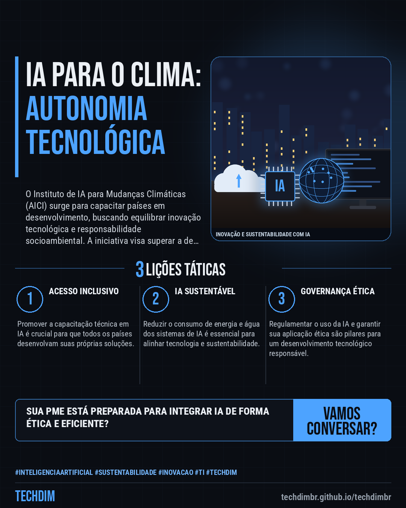
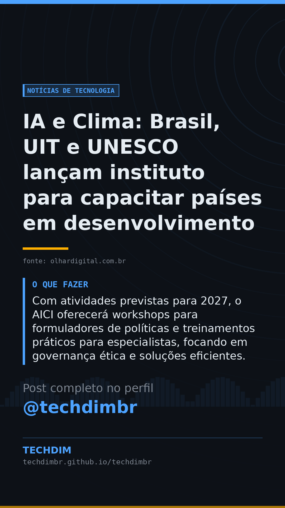

# Notícias de Tecnologia — IA e Clima: Brasil, UIT e UNESCO lançam instituto para capacitar países em desenvolvimento

- **Data:** 2026-11-17, 16:48 (horário de Brasília)
- **Curadoria:** Claude (Routine) — pauta do dia
- **Execução no Actions:** https://github.com/Techdimbr/Publi-midia-Techdim/actions/runs/44162351711
- **Por que esta pauta:** O lançamento de um instituto focado em IA e clima torna a pauta de IA ética e sustentável relevante para PMEs brasileiras.

## Resultado

| Rede | Status | Link | 1º comentário |
|---|---|---|---|
| linkedin | ✅ publicado | https://www.linkedin.com/feed/update/urn:li:share:7528544469386833921/ | — |
| facebook | ✅ publicado | https://www.facebook.com/122132402349390486/posts/122144751459390486 | ✅ |
| instagram | ✅ publicado | https://www.instagram.com/p/Df2t6V8DE6m/ | ✅ |
| Stories | ✅ publicado | https://www.instagram.com/stories/techdimbr/4032612575409386515 | — |

## Fontes

- [olhardigital.com.br](https://olhardigital.com.br/2026/11/17/inteligencia-artificial/brasil-uit-e-unesco-criam-centro-para-capacitar-paises-em-ia-e-clima/)

## Linkedin

```text
IA e Clima: Brasil, UIT e UNESCO lançam instituto para capacitar países em desenvolvimento

01. O Brasil, em parceria com Anatel, UIT e UNESCO, lançou o Instituto de IA para Mudanças Climáticas (AICI) na COP31, visando ampliar a aplicação de IA em desafios climáticos.
02. A iniciativa busca superar a desigualdade no acesso à capacitação técnica em IA e mitigar os impactos ambientais do consumo de energia e água por sistemas de inteligência artificial.
03. Com atividades previstas para 2027, o AICI oferecerá workshops para formuladores de políticas e treinamentos práticos para especialistas, focando em governança ética e soluções eficientes.

A TECHDIM apoia PMEs na governança de dados e implementação de IA ética e eficiente, alinhada a práticas regulatórias e sustentáveis.

Fontes: https://olhardigital.com.br/2026/11/17/inteligencia-artificial/brasil-uit-e-unesco-criam-centro-para-capacitar-paises-em-ia-e-clima/

TECHDIM — Infraestrutura · Segurança · IA
https://techdimbr.github.io/techdimbr/

#InteligenciaArtificial #Sustentabilidade #Inovacao #TI #TECHDIM
```



## Facebook

```text
IA e Clima: Brasil, UIT e UNESCO lançam instituto para capacitar países em desenvolvimento

• O Brasil, em parceria com Anatel, UIT e UNESCO, lançou o Instituto de IA para Mudanças Climáticas (AICI) na COP31, visando ampliar a aplicação de IA em desafios climáticos.
• A iniciativa busca superar a desigualdade no acesso à capacitação técnica em IA e mitigar os impactos ambientais do consumo de energia e água por sistemas de inteligência artificial.
• Com atividades previstas para 2027, o AICI oferecerá workshops para formuladores de políticas e treinamentos práticos para especialistas, focando em governança ética e soluções eficientes.

A TECHDIM apoia PMEs na governança de dados e implementação de IA ética e eficiente, alinhada a práticas regulatórias e sustentáveis.

Fale com a TECHDIM — fontes e site no primeiro comentário 👇

#InteligenciaArtificial #Sustentabilidade #Inovacao #TECHDIM
```

Primeiro comentário:

```text
📎 Fontes:
• olhardigital.com.br: https://olhardigital.com.br/2026/11/17/inteligencia-artificial/brasil-uit-e-unesco-criam-centro-para-capacitar-paises-em-ia-e-clima/

🌐 TECHDIM — Infraestrutura · Segurança · IA: https://techdimbr.github.io/techdimbr/
```


## Instagram

```text
IA e Clima: Brasil, UIT e UNESCO lançam instituto para capacitar países em desenvolvimento

1️⃣ O Brasil, em parceria com Anatel, UIT e UNESCO, lançou o Instituto de IA para Mudanças Climáticas (AICI) na COP31, visando ampliar a aplicação de IA em desafios climáticos.
2️⃣ A iniciativa busca superar a desigualdade no acesso à capacitação técnica em IA e mitigar os impactos ambientais do consumo de energia e água por sistemas de inteligência artificial.
3️⃣ Com atividades previstas para 2027, o AICI oferecerá workshops para formuladores de políticas e treinamentos práticos para especialistas, focando em governança ética e soluções eficientes.

A TECHDIM apoia PMEs na governança de dados e implementação de IA ética e eficiente, alinhada a práticas regulatórias e sustentáveis.

🔗 Link na bio: techdimbr.github.io/techdimbr
Fontes no primeiro comentário 👇

#inteligenciaartificial #sustentabilidade #inovacao #ti #techdim #tecnologia #ia #campinas
```

Primeiro comentário:

```text
📎 Fontes: olhardigital.com.br
```


## Stories


