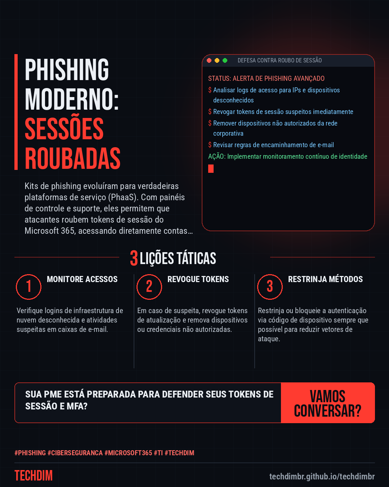
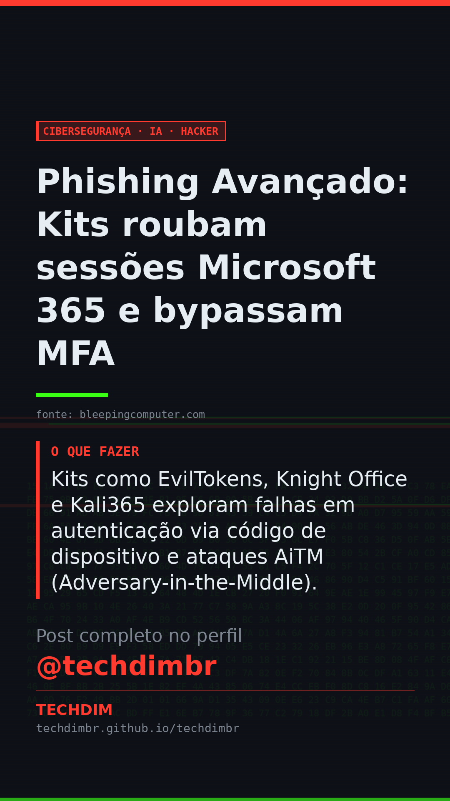

# Cibersegurança · IA · Hacker — Phishing Avançado: Kits roubam sessões Microsoft 365 e bypassam MFA

- **Data:** 2026-11-17, 19:12 (horário de Brasília)
- **Curadoria:** Claude (Routine) — pauta do dia
- **Execução no Actions:** https://github.com/Techdimbr/Publi-midia-Techdim/actions/runs/44187466244
- **Por que esta pauta:** A sofisticação dos ataques de phishing exige uma defesa robusta e atualizada para o ambiente corporativo.

## Resultado

| Rede | Status | Link | 1º comentário |
|---|---|---|---|
| linkedin | ✅ publicado | https://www.linkedin.com/feed/update/urn:li:share:7528580588400873486/ | — |
| facebook | ✅ publicado | https://www.facebook.com/122132402349390486/posts/122144767911390486 | ✅ |
| instagram | ✅ publicado | https://www.instagram.com/p/Df2-WMYmCC2/ | ✅ |
| Stories | ✅ publicado | https://www.instagram.com/stories/techdimbr/4032684870472322089 | — |

## Fontes

- [bleepingcomputer.com](https://www.bleepingcomputer.com/news/security/inside-modern-phishing-kits-built-to-steal-microsoft-365-sessions/)

## Linkedin

```text
Phishing Avançado: Kits roubam sessões Microsoft 365 e bypassam MFA

01. Kits de phishing modernos agem como SaaS, oferecendo painéis de administração e suporte para roubar tokens de sessão do Microsoft 365, não apenas credenciais.
02. Atacantes usam tokens roubados para entrar em sessões ativas, ignorando login e MFA, obtendo acesso direto a e-mails e recursos na nuvem.
03. Kits como EvilTokens, Knight Office e Kali365 exploram falhas em autenticação via código de dispositivo e ataques AiTM (Adversary-in-the-Middle).

A TECHDIM oferece cibersegurança defensiva para proteger sua PME contra ameaças avançadas que visam seus dados e acessos críticos.

Fontes: https://www.bleepingcomputer.com/news/security/inside-modern-phishing-kits-built-to-steal-microsoft-365-sessions/

TECHDIM — Infraestrutura · Segurança · IA
https://techdimbr.github.io/techdimbr/

#Phishing #Ciberseguranca #Microsoft365 #TI #TECHDIM
```



## Facebook

```text
Phishing Avançado: Kits roubam sessões Microsoft 365 e bypassam MFA

• Kits de phishing modernos agem como SaaS, oferecendo painéis de administração e suporte para roubar tokens de sessão do Microsoft 365, não apenas credenciais.
• Atacantes usam tokens roubados para entrar em sessões ativas, ignorando login e MFA, obtendo acesso direto a e-mails e recursos na nuvem.
• Kits como EvilTokens, Knight Office e Kali365 exploram falhas em autenticação via código de dispositivo e ataques AiTM (Adversary-in-the-Middle).

A TECHDIM oferece cibersegurança defensiva para proteger sua PME contra ameaças avançadas que visam seus dados e acessos críticos.

Fale com a TECHDIM — fontes e site no primeiro comentário 👇

#Phishing #Ciberseguranca #Microsoft365 #TECHDIM
```

Primeiro comentário:

```text
📎 Fontes:
• bleepingcomputer.com: https://www.bleepingcomputer.com/news/security/inside-modern-phishing-kits-built-to-steal-microsoft-365-sessions/

🌐 TECHDIM — Infraestrutura · Segurança · IA: https://techdimbr.github.io/techdimbr/
```


## Instagram

```text
Phishing Avançado: Kits roubam sessões Microsoft 365 e bypassam MFA

1️⃣ Kits de phishing modernos agem como SaaS, oferecendo painéis de administração e suporte para roubar tokens de sessão do Microsoft 365, não apenas credenciais.
2️⃣ Atacantes usam tokens roubados para entrar em sessões ativas, ignorando login e MFA, obtendo acesso direto a e-mails e recursos na nuvem.
3️⃣ Kits como EvilTokens, Knight Office e Kali365 exploram falhas em autenticação via código de dispositivo e ataques AiTM (Adversary-in-the-Middle).

A TECHDIM oferece cibersegurança defensiva para proteger sua PME contra ameaças avançadas que visam seus dados e acessos críticos.

🔗 Link na bio: techdimbr.github.io/techdimbr
Fontes no primeiro comentário 👇

#phishing #ciberseguranca #microsoft365 #ti #techdim #seguranca #hacker #infraestrutura
```

Primeiro comentário:

```text
📎 Fontes: bleepingcomputer.com
```


## Stories


