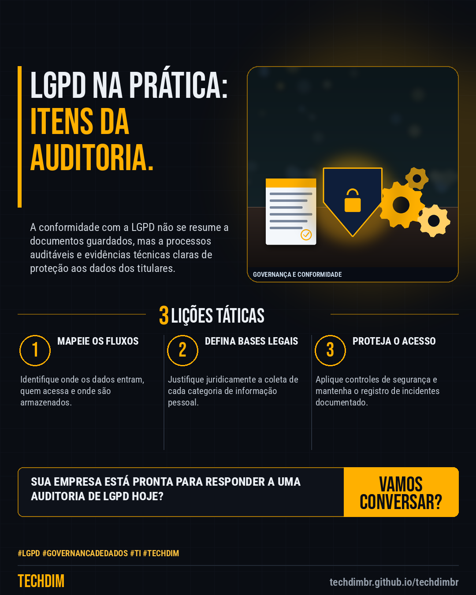

# Conhecimento — Auditoria de TI: 4 itens que o auditor da LGPD exige primeiro

- **Data:** 2026-11-17, 20:53 (horário de Brasília)
- **Curadoria:** Claude (Routine) — pauta do dia
- **Execução no Actions:** https://github.com/Techdimbr/Publi-midia-Techdim/actions/runs/44203099815
- **Por que esta pauta:** Exigências de auditoria de LGPD pegam PMEs de surpresa sem preparação prévia.

## Resultado

| Rede | Status | Link | 1º comentário |
|---|---|---|---|
| linkedin | ✅ publicado | https://www.linkedin.com/feed/update/urn:li:share:7528606090700427265/ | — |
| facebook | ✅ publicado | https://www.facebook.com/122132402349390486/posts/122144779149390486 | ✅ |
| instagram | ✅ publicado | https://www.instagram.com/p/Df3J7_sCblq/ | — |

## Linkedin

```text
Auditoria de TI: 4 itens que o auditor da LGPD exige primeiro

01. O auditor da LGPD inicia a verificação exigindo o mapeamento do fluxo de dados pessoais que circulam na empresa.
02. Comprovar o registro das bases legais de tratamento e o termo de consentimento é o segundo ponto cobrado na checagem.
03. Apresentar planos de resposta a incidentes e evidências de segurança técnica, como criptografia, completa o escopo inicial.

Estruture a conformidade técnica da sua PME com a governança de dados da TECHDIM.

TECHDIM — Infraestrutura · Segurança · IA
https://techdimbr.github.io/techdimbr/

#Lgpd #GovernancaDeDados #TI #TECHDIM #Conhecimento
```



## Facebook

```text
Auditoria de TI: 4 itens que o auditor da LGPD exige primeiro

• O auditor da LGPD inicia a verificação exigindo o mapeamento do fluxo de dados pessoais que circulam na empresa.
• Comprovar o registro das bases legais de tratamento e o termo de consentimento é o segundo ponto cobrado na checagem.
• Apresentar planos de resposta a incidentes e evidências de segurança técnica, como criptografia, completa o escopo inicial.

Estruture a conformidade técnica da sua PME com a governança de dados da TECHDIM.

Fale com a TECHDIM — link no primeiro comentário 👇

#Lgpd #GovernancaDeDados #TI #TECHDIM
```

Primeiro comentário:

```text
🌐 TECHDIM — Infraestrutura · Segurança · IA: https://techdimbr.github.io/techdimbr/
```


## Instagram

```text
Auditoria de TI: 4 itens que o auditor da LGPD exige primeiro

1️⃣ O auditor da LGPD inicia a verificação exigindo o mapeamento do fluxo de dados pessoais que circulam na empresa.
2️⃣ Comprovar o registro das bases legais de tratamento e o termo de consentimento é o segundo ponto cobrado na checagem.
3️⃣ Apresentar planos de resposta a incidentes e evidências de segurança técnica, como criptografia, completa o escopo inicial.

Estruture a conformidade técnica da sua PME com a governança de dados da TECHDIM.

🔗 Link na bio: techdimbr.github.io/techdimbr

#lgpd #governancadedados #ti #techdim #conhecimento #aprendati #tecnologia #ciberseguranca
```


