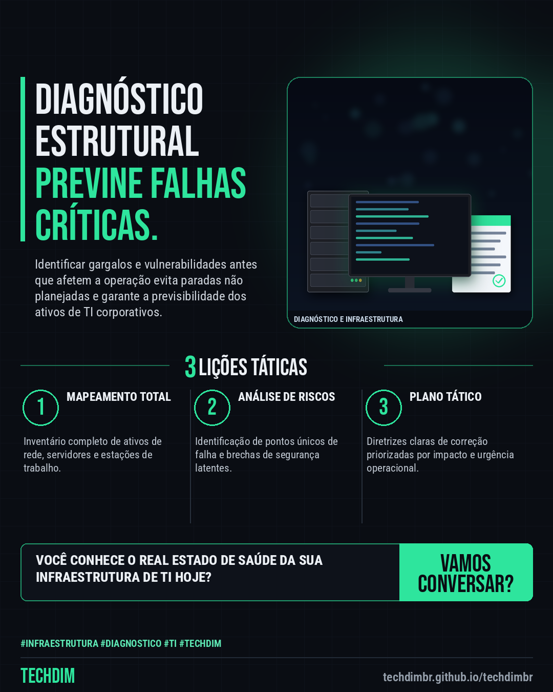

# TECHDIM · Serviços — INFRAESTRUTURA: Diagnóstico completo mapeia gargalos ocultos da sua PME

- **Data:** 2026-11-17, 23:29 (horário de Brasília)
- **Curadoria:** Claude (Routine) — pauta do dia
- **Execução no Actions:** https://github.com/Techdimbr/Publi-midia-Techdim/actions/runs/44223537318
- **Por que esta pauta:** Empresas frequentemente operam com gargalos ocultos de infraestrutura que só aparecem em momentos de alta demanda.

## Resultado

| Rede | Status | Link | 1º comentário |
|---|---|---|---|
| linkedin | ✅ publicado | https://www.linkedin.com/feed/update/urn:li:share:7528645459977056257/ | — |
| facebook | ✅ publicado | https://www.facebook.com/122132402349390486/posts/122144875959390486 | ✅ |
| instagram | ✅ publicado | https://www.instagram.com/p/Df3b2B6jO_Y/ | — |

## Linkedin

```text
INFRAESTRUTURA: Diagnóstico completo mapeia gargalos ocultos da sua PME

01. O diagnóstico detalhado de infraestrutura e segurança identifica falhas invisíveis que comprometem a operação diária.
02. A análise rigorosa avalia redes, servidores, permissões de acesso e pontos críticos de vulnerabilidade na sua empresa.
03. A engenharia da TECHDIM traduz dados técnicos em um plano de ação tático, priorizando a estabilidade e a segurança.

Descubra como a engenharia da TECHDIM pode elevar a maturidade tecnológica da sua empresa.

TECHDIM — Infraestrutura · Segurança · IA
https://techdimbr.github.io/techdimbr/

#Infraestrutura #Diagnostico #TI #TECHDIM #InfraestruturaDeTI
```



## Facebook

```text
INFRAESTRUTURA: Diagnóstico completo mapeia gargalos ocultos da sua PME

• O diagnóstico detalhado de infraestrutura e segurança identifica falhas invisíveis que comprometem a operação diária.
• A análise rigorosa avalia redes, servidores, permissões de acesso e pontos críticos de vulnerabilidade na sua empresa.
• A engenharia da TECHDIM traduz dados técnicos em um plano de ação tático, priorizando a estabilidade e a segurança.

Descubra como a engenharia da TECHDIM pode elevar a maturidade tecnológica da sua empresa.

Fale com a TECHDIM — link no primeiro comentário 👇

#Infraestrutura #Diagnostico #TI #TECHDIM
```

Primeiro comentário:

```text
🌐 TECHDIM — Infraestrutura · Segurança · IA: https://techdimbr.github.io/techdimbr/
```


## Instagram

```text
INFRAESTRUTURA: Diagnóstico completo mapeia gargalos ocultos da sua PME

1️⃣ O diagnóstico detalhado de infraestrutura e segurança identifica falhas invisíveis que comprometem a operação diária.
2️⃣ A análise rigorosa avalia redes, servidores, permissões de acesso e pontos críticos de vulnerabilidade na sua empresa.
3️⃣ A engenharia da TECHDIM traduz dados técnicos em um plano de ação tático, priorizando a estabilidade e a segurança.

Descubra como a engenharia da TECHDIM pode elevar a maturidade tecnológica da sua empresa.

🔗 Link na bio: techdimbr.github.io/techdimbr

#infraestrutura #diagnostico #ti #techdim #suportetecnico #ciberseguranca #automacao #campinas
```


