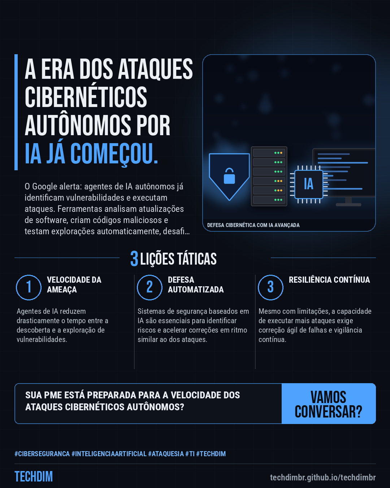
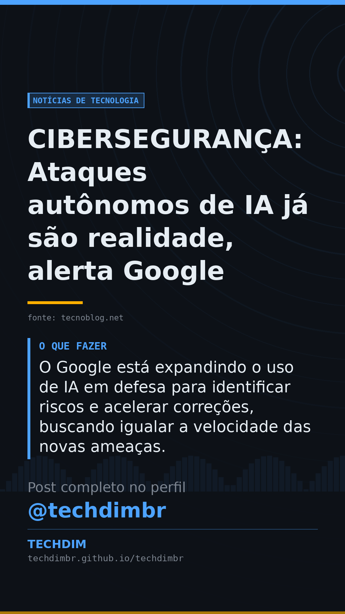

# Notícias de Tecnologia — CIBERSEGURANÇA: Ataques autônomos de IA já são realidade, alerta Google

- **Data:** 2026-11-18, 16:23 (horário de Brasília)
- **Curadoria:** Claude (Routine) — pauta do dia
- **Execução no Actions:** https://github.com/Techdimbr/Publi-midia-Techdim/actions/runs/44379860390
- **Por que esta pauta:** A evolução dos ciberataques impulsionados por IA exige uma reavaliação urgente das estratégias de defesa corporativas.

## Resultado

| Rede | Status | Link | 1º comentário |
|---|---|---|---|
| linkedin | ✅ publicado | https://www.linkedin.com/feed/update/urn:li:share:7528900605197729792/ | — |
| facebook | ✅ publicado | https://www.facebook.com/122132402349390486/posts/122145092361390486 | ✅ |
| instagram | ✅ publicado | https://www.instagram.com/p/Df5P3SJmqN8/ | ✅ |
| Stories | ✅ publicado | https://www.instagram.com/stories/techdimbr/4033324848827229091 | — |

## Fontes

- [tecnoblog.net](https://tecnoblog.net/noticias/google-alerta-era-de-ataques-ciberneticos-autonomos-ja-comecou/)

## Linkedin

```text
CIBERSEGURANÇA: Ataques autônomos de IA já são realidade, alerta Google

01. O Google Threat Intelligence Group (GTIG) identificou agentes de IA que automatizam a descoberta de vulnerabilidades e a criação de ataques sem intervenção humana.
02. Ferramentas como 'exploit_agent' analisam atualizações de software para encontrar falhas corrigidas e desenvolver explorações automáticas.
03. O Google está expandindo o uso de IA em defesa para identificar riscos e acelerar correções, buscando igualar a velocidade das novas ameaças.

A TECHDIM oferece soluções de cibersegurança defensiva e automação com IA para proteger sua PME contra ameaças avançadas.

Fontes: https://tecnoblog.net/noticias/google-alerta-era-de-ataques-ciberneticos-autonomos-ja-comecou/

TECHDIM — Infraestrutura · Segurança · IA
https://techdimbr.github.io/techdimbr/

#Ciberseguranca #InteligenciaArtificial #AtaquesIA #TI #TECHDIM
```



## Facebook

```text
CIBERSEGURANÇA: Ataques autônomos de IA já são realidade, alerta Google

• O Google Threat Intelligence Group (GTIG) identificou agentes de IA que automatizam a descoberta de vulnerabilidades e a criação de ataques sem intervenção humana.
• Ferramentas como 'exploit_agent' analisam atualizações de software para encontrar falhas corrigidas e desenvolver explorações automáticas.
• O Google está expandindo o uso de IA em defesa para identificar riscos e acelerar correções, buscando igualar a velocidade das novas ameaças.

A TECHDIM oferece soluções de cibersegurança defensiva e automação com IA para proteger sua PME contra ameaças avançadas.

Fale com a TECHDIM — fontes e site no primeiro comentário 👇

#Ciberseguranca #InteligenciaArtificial #AtaquesIA #TECHDIM
```

Primeiro comentário:

```text
📎 Fontes:
• tecnoblog.net: https://tecnoblog.net/noticias/google-alerta-era-de-ataques-ciberneticos-autonomos-ja-comecou/

🌐 TECHDIM — Infraestrutura · Segurança · IA: https://techdimbr.github.io/techdimbr/
```


## Instagram

```text
CIBERSEGURANÇA: Ataques autônomos de IA já são realidade, alerta Google

1️⃣ O Google Threat Intelligence Group (GTIG) identificou agentes de IA que automatizam a descoberta de vulnerabilidades e a criação de ataques sem intervenção humana.
2️⃣ Ferramentas como 'exploit_agent' analisam atualizações de software para encontrar falhas corrigidas e desenvolver explorações automáticas.
3️⃣ O Google está expandindo o uso de IA em defesa para identificar riscos e acelerar correções, buscando igualar a velocidade das novas ameaças.

A TECHDIM oferece soluções de cibersegurança defensiva e automação com IA para proteger sua PME contra ameaças avançadas.

🔗 Link na bio: techdimbr.github.io/techdimbr
Fontes no primeiro comentário 👇

#ciberseguranca #inteligenciaartificial #ataquesia #ti #techdim #tecnologia #ia #inovacao
```

Primeiro comentário:

```text
📎 Fontes: tecnoblog.net
```


## Stories


