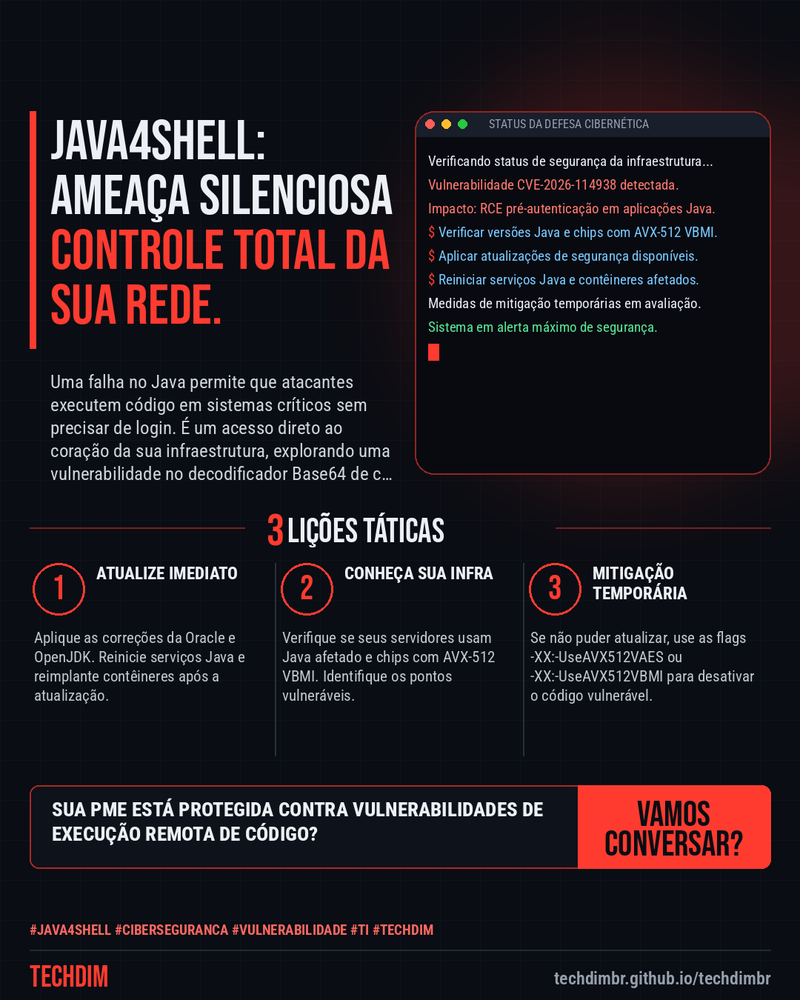
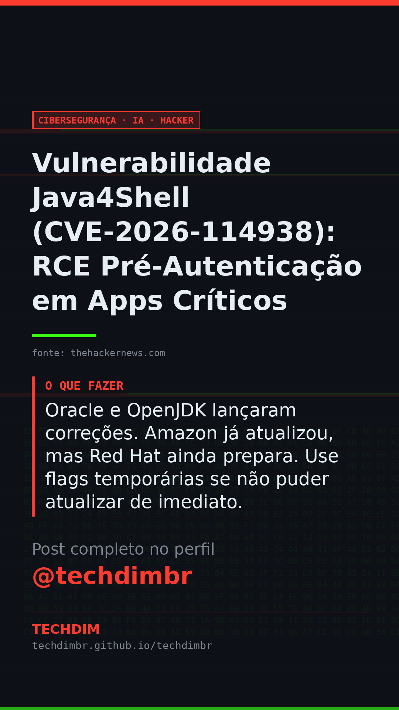

# Cibersegurança · IA · Hacker — Vulnerabilidade Java4Shell (CVE-2026-114938): RCE Pré-Autenticação em Apps Críticos

- **Data:** 2026-11-18, 18:49 (horário de Brasília)
- **Curadoria:** Claude (Routine) — pauta do dia
- **Execução no Actions:** https://github.com/Techdimbr/Publi-midia-Techdim/actions/runs/44405320564
- **Por que esta pauta:** Esta vulnerabilidade de alto risco exige atenção imediata devido ao seu potencial de exploração sem autenticação.

## Resultado

| Rede | Status | Link | 1º comentário |
|---|---|---|---|
| linkedin | ✅ publicado | https://www.linkedin.com/feed/update/urn:li:share:7528937410508931072/ | — |
| facebook | ✅ publicado | https://www.facebook.com/122132402349390486/posts/122145112197390486 | ✅ |
| instagram | ✅ publicado | https://www.instagram.com/p/Df5gmajDTfm/ | ✅ |
| Stories | ✅ publicado | https://www.instagram.com/stories/techdimbr/4033398452235260257 | — |

## Fontes

- [thehackernews.com](https://thehackernews.com/2026/11/java4shell-cve-2026-114938-enables-pre.html)

## Linkedin

```text
Vulnerabilidade Java4Shell (CVE-2026-114938): RCE Pré-Autenticação em Apps Críticos

01. A falha Java4Shell permite a execução remota de código (RCE) sem autenticação em aplicações como Jira, Jenkins e Keycloak, segundo a Calif.
02. Presente em Java 17.0.6 e versões posteriores, afeta chips Intel/AMD com AVX-512 VBMI, explorando o decodificador Base64.
03. Oracle e OpenJDK lançaram correções. Amazon já atualizou, mas Red Hat ainda prepara. Use flags temporárias se não puder atualizar de imediato.

Nossa expertise em cibersegurança defensiva protege sua infraestrutura contra falhas críticas como a Java4Shell, garantindo a continuidade da PME.

Fontes: https://thehackernews.com/2026/11/java4shell-cve-2026-114938-enables-pre.html

TECHDIM — Infraestrutura · Segurança · IA
https://techdimbr.github.io/techdimbr/

#Java4Shell #Ciberseguranca #Vulnerabilidade #TI #TECHDIM
```



## Facebook

```text
Vulnerabilidade Java4Shell (CVE-2026-114938): RCE Pré-Autenticação em Apps Críticos

• A falha Java4Shell permite a execução remota de código (RCE) sem autenticação em aplicações como Jira, Jenkins e Keycloak, segundo a Calif.
• Presente em Java 17.0.6 e versões posteriores, afeta chips Intel/AMD com AVX-512 VBMI, explorando o decodificador Base64.
• Oracle e OpenJDK lançaram correções. Amazon já atualizou, mas Red Hat ainda prepara. Use flags temporárias se não puder atualizar de imediato.

Nossa expertise em cibersegurança defensiva protege sua infraestrutura contra falhas críticas como a Java4Shell, garantindo a continuidade da PME.

Fale com a TECHDIM — fontes e site no primeiro comentário 👇

#Java4Shell #Ciberseguranca #Vulnerabilidade #TECHDIM
```

Primeiro comentário:

```text
📎 Fontes:
• thehackernews.com: https://thehackernews.com/2026/11/java4shell-cve-2026-114938-enables-pre.html

🌐 TECHDIM — Infraestrutura · Segurança · IA: https://techdimbr.github.io/techdimbr/
```


## Instagram

```text
Vulnerabilidade Java4Shell (CVE-2026-114938): RCE Pré-Autenticação em Apps Críticos

1️⃣ A falha Java4Shell permite a execução remota de código (RCE) sem autenticação em aplicações como Jira, Jenkins e Keycloak, segundo a Calif.
2️⃣ Presente em Java 17.0.6 e versões posteriores, afeta chips Intel/AMD com AVX-512 VBMI, explorando o decodificador Base64.
3️⃣ Oracle e OpenJDK lançaram correções. Amazon já atualizou, mas Red Hat ainda prepara. Use flags temporárias se não puder atualizar de imediato.

Nossa expertise em cibersegurança defensiva protege sua infraestrutura contra falhas críticas como a Java4Shell, garantindo a continuidade da PME.

🔗 Link na bio: techdimbr.github.io/techdimbr
Fontes no primeiro comentário 👇

#java4shell #ciberseguranca #vulnerabilidade #ti #techdim #seguranca #hacker #infraestrutura
```

Primeiro comentário:

```text
📎 Fontes: thehackernews.com
```


## Stories


