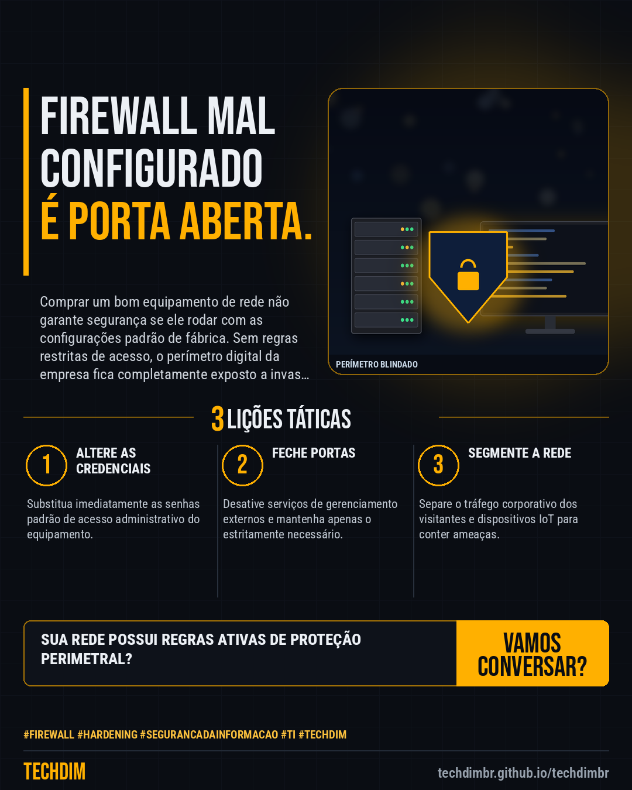

# Conhecimento — Firewall de PME: Seu equipamento está configurado ou apenas ligado na tomada?

- **Data:** 2026-11-18, 20:25 (horário de Brasília)
- **Curadoria:** Claude (Routine) — pauta do dia
- **Execução no Actions:** https://github.com/Techdimbr/Publi-midia-Techdim/actions/runs/44420551618
- **Por que esta pauta:** Equipamentos de rede mal configurados são a principal porta de entrada para acessos não autorizados nas PMEs.

## Resultado

| Rede | Status | Link | 1º comentário |
|---|---|---|---|
| linkedin | ✅ publicado | https://www.linkedin.com/feed/update/urn:li:share:7528961584665239552/ | — |
| facebook | ✅ publicado | https://www.facebook.com/122132402349390486/posts/122145122769390486 | ✅ |
| instagram | ✅ publicado | https://www.instagram.com/p/Df5rmVij6Lq/ | — |

## Linkedin

```text
Firewall de PME: Seu equipamento está configurado ou apenas ligado na tomada?

01. Firewalls apenas conectados à tomada de fábrica mantêm senhas padrão e portas abertas para a internet.
02. A configuração adequada exige a criação de regras de acesso restrito, isolando servidores e estações.
03. A TECHDIM implementa políticas de hardening e monitoramento de tráfego para blindar o perímetro da sua rede.

Proteja o perímetro da sua operação com serviços especializados em infraestrutura da TECHDIM.

TECHDIM — Infraestrutura · Segurança · IA
https://techdimbr.github.io/techdimbr/

#Firewall #Hardening #SegurancaDaInformacao #TI #TECHDIM
```



## Facebook

```text
Firewall de PME: Seu equipamento está configurado ou apenas ligado na tomada?

• Firewalls apenas conectados à tomada de fábrica mantêm senhas padrão e portas abertas para a internet.
• A configuração adequada exige a criação de regras de acesso restrito, isolando servidores e estações.
• A TECHDIM implementa políticas de hardening e monitoramento de tráfego para blindar o perímetro da sua rede.

Proteja o perímetro da sua operação com serviços especializados em infraestrutura da TECHDIM.

Fale com a TECHDIM — link no primeiro comentário 👇

#Firewall #Hardening #SegurancaDaInformacao #TECHDIM
```

Primeiro comentário:

```text
🌐 TECHDIM — Infraestrutura · Segurança · IA: https://techdimbr.github.io/techdimbr/
```


## Instagram

```text
Firewall de PME: Seu equipamento está configurado ou apenas ligado na tomada?

1️⃣ Firewalls apenas conectados à tomada de fábrica mantêm senhas padrão e portas abertas para a internet.
2️⃣ A configuração adequada exige a criação de regras de acesso restrito, isolando servidores e estações.
3️⃣ A TECHDIM implementa políticas de hardening e monitoramento de tráfego para blindar o perímetro da sua rede.

Proteja o perímetro da sua operação com serviços especializados em infraestrutura da TECHDIM.

🔗 Link na bio: techdimbr.github.io/techdimbr

#firewall #hardening #segurancadainformacao #ti #techdim #conhecimento #aprendati #tecnologia
```


