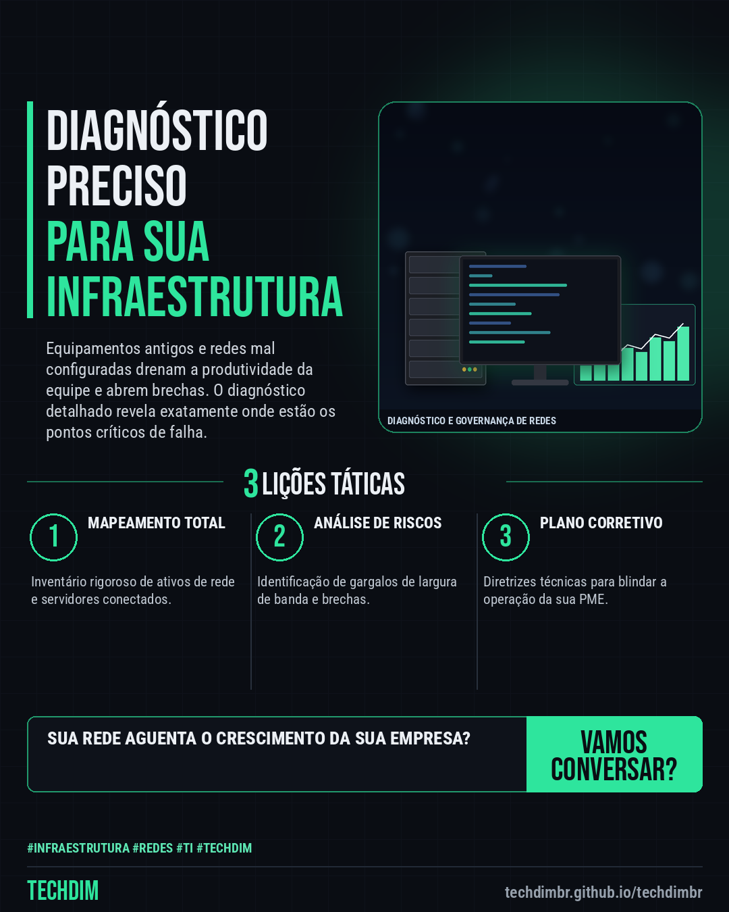

# TECHDIM · Serviços — INFRAESTRUTURA: Diagnóstico de TI mapeia falhas ocultas em servidores e redes

- **Data:** 2026-11-18, 22:56 (horário de Brasília)
- **Curadoria:** Claude (Routine) — pauta do dia
- **Execução no Actions:** https://github.com/Techdimbr/Publi-midia-Techdim/actions/runs/44440476264
- **Por que esta pauta:** PMEs frequentemente acumulam ajustes temporários em redes que geram lentidão e riscos de segurança.

## Resultado

| Rede | Status | Link | 1º comentário |
|---|---|---|---|
| linkedin | ✅ publicado | https://www.linkedin.com/feed/update/urn:li:share:7528999445049303040/ | — |
| facebook | ✅ publicado | https://www.facebook.com/122132402349390486/posts/122145141309390486 | ✅ |
| instagram | ✅ publicado | https://www.instagram.com/p/Df580qNk0aW/ | — |

## Linkedin

```text
INFRAESTRUTURA: Diagnóstico de TI mapeia falhas ocultas em servidores e redes

01. Identifique gargalos de desempenho e falhas de segurança antes que causem paradas não planejadas na sua operação.
02. O diagnóstico estruturado analisa switches, firewalls, servidores e políticas de acesso vigentes na sua empresa.
03. A TECHDIM entrega um relatório técnico acionável para priorizar correções sem interromper o expediente.

Conheça nossa metodologia de diagnóstico em techdimbr.github.io/techdimbr.

TECHDIM — Infraestrutura · Segurança · IA
https://techdimbr.github.io/techdimbr/

#Infraestrutura #Redes #TI #TECHDIM #InfraestruturaDeTI
```



## Facebook

```text
INFRAESTRUTURA: Diagnóstico de TI mapeia falhas ocultas em servidores e redes

• Identifique gargalos de desempenho e falhas de segurança antes que causem paradas não planejadas na sua operação.
• O diagnóstico estruturado analisa switches, firewalls, servidores e políticas de acesso vigentes na sua empresa.
• A TECHDIM entrega um relatório técnico acionável para priorizar correções sem interromper o expediente.

Conheça nossa metodologia de diagnóstico em techdimbr.github.io/techdimbr.

Fale com a TECHDIM — link no primeiro comentário 👇

#Infraestrutura #Redes #TI #TECHDIM
```

Primeiro comentário:

```text
🌐 TECHDIM — Infraestrutura · Segurança · IA: https://techdimbr.github.io/techdimbr/
```


## Instagram

```text
INFRAESTRUTURA: Diagnóstico de TI mapeia falhas ocultas em servidores e redes

1️⃣ Identifique gargalos de desempenho e falhas de segurança antes que causem paradas não planejadas na sua operação.
2️⃣ O diagnóstico estruturado analisa switches, firewalls, servidores e políticas de acesso vigentes na sua empresa.
3️⃣ A TECHDIM entrega um relatório técnico acionável para priorizar correções sem interromper o expediente.

Conheça nossa metodologia de diagnóstico em techdimbr.github.io/techdimbr.

🔗 Link na bio: techdimbr.github.io/techdimbr

#infraestrutura #redes #ti #techdim #suportetecnico #ciberseguranca #automacao #campinas
```


